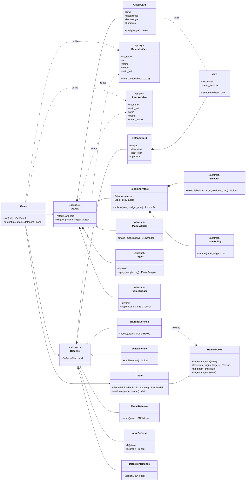
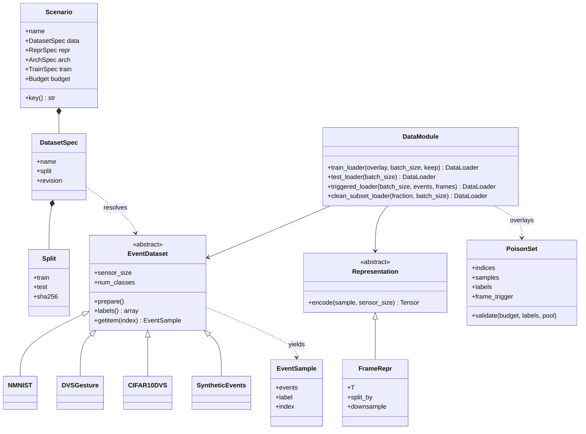
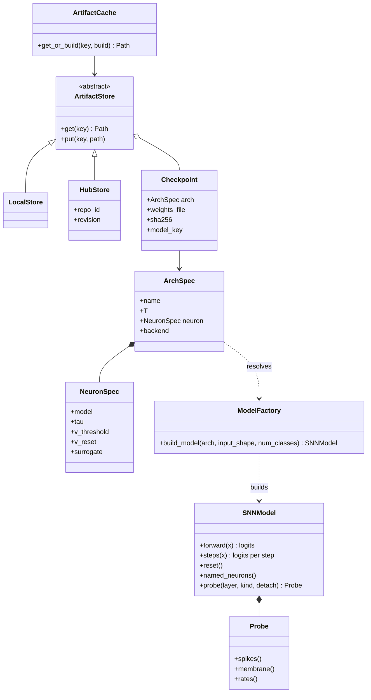
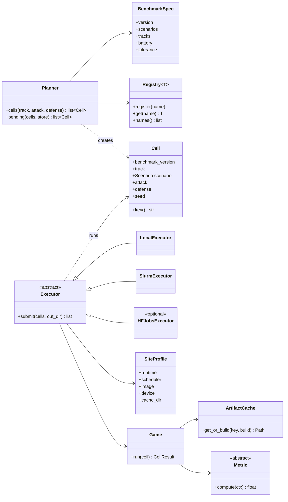
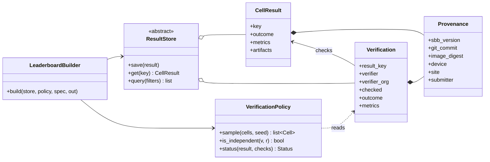
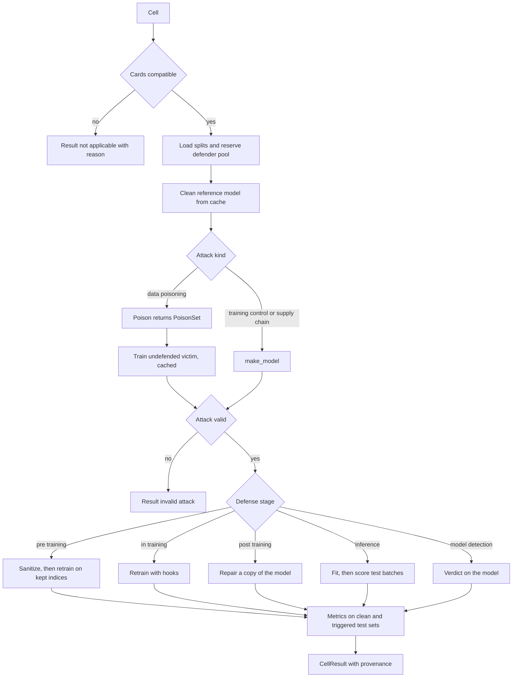
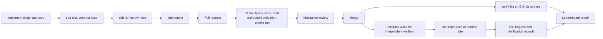

# SNN Backdoor Benchmark: design and implementation plan

Working name: `sbb` (placeholder, see section 16). Scope: versions v0 to v5. Last updated: 2026-11-25.

## 0. How to use this document

This document is the single source of truth for the project. It is written for the maintainers and for Claude Code.

- Build version by version (section 13). Do not start a version before the definition of done of the previous one passes.
- The interfaces in section 6 are contracts. If one has to change, update this document first, in the same pull request.
- Items marked **[DECIDE]** are open decisions. Use the stated default until a maintainer changes it.
- Items marked **[FILL]** need information from the maintainers (URLs, table numbers, names). Leave a TODO and continue.
- Every section but the roadmap (13) says what holds now. How it came to be is in section 13, in `docs/releases/` and in the git history.

## 1. Goal and scope

A living benchmark for backdoor attacks and defenses on spiking neural networks (SNNs), mainly with neuromorphic event data. Anyone can submit an attack or a defense. The harness evaluates it against every compatible method already registered, under explicit threat models, and publishes the results on a leaderboard.

Principles:

1. **Typed threat models.** Which attack and defense pairs are comparable, and which cells are N/A, is derived from machine-checked cards. Nothing is curated by hand.
2. **One code path.** The same `sbb run-cell` entry point runs on a laptop, on GitHub runners, on a Slurm cluster or on HF Jobs.
3. **Bring your own compute.** The project needs no paid compute. Trust comes from independent reproduction, not from a central service.
4. **Provenance everywhere.** Every number is produced by the harness and carries provenance. Hand-typed results are never accepted.
5. **Modular and non-repetitive.** One base class per role, plugins registered by name, one training loop, one data pipeline.
6. **Reproducible.** Pinned environment, deterministic runs, a replication record for every ported method.

Out of scope until v5: federated learning, ANN-to-SNN conversion, static-image datasets, physical recordings, deployment on neuromorphic hardware.

## 2. Glossary

| Term | Meaning |
|---|---|
| Scenario | Fixed dataset, split, representation, architecture, training recipe and budget. |
| Cell | One evaluation of (scenario, attack, defense, seed). Unit of work, caching and verification. |
| Attack, defense | Plugins. Each one is a class plus a card. |
| Card | YAML file with a plugin's threat model, metadata and frozen hyperparameters. |
| Capabilities | What an attacker controls. |
| View | The resources a defense needs to see. |
| Avail(c) | The resources still in the defender's hands when the attacker holds capabilities c. |
| DefenderView, AttackerView | Proxy objects that give a plugin only the resources its card declares. |
| Trigger | Transformation of raw events that activates the backdoor. A `FrameTrigger` transforms the encoded frames instead. |
| PoisonSet | Overlay of modified training samples: indices, new samples, new labels. |
| Defender pool | Clean training samples reserved before the attack. The attacker cannot modify them. |
| Zoo | Cached clean and backdoored models, published on Hugging Face. |
| Benchmark spec | Versioned YAML with datasets, splits, scenarios, battery, seeds, tracks and tolerances. |
| Track | `lite` (CPU, verified on GitHub runners) or `full` (GPU, verified by independent reproduction). |
| Site | A compute environment, described by a SiteProfile kept outside the repository. |
| Status | `self-reported`, `reproduced`, `disputed`, `not-applicable` or `failed`. Computed, never set by hand. |

## 3. Threat-model formalism

### 3.1 The game

Each cell is a security game. The harness plays the challenger:

1. **Compatibility.** Check the cards (3.4). If the defense needs a resource that Avail does not provide, the cell is N/A with a reason and nothing else runs.
2. **Data.** Load the clean train and test splits and fix the seed. Reserve the defender pool: a class-stratified fraction of the train split (default 5%) that the attacker cannot modify. It stays in the training set.
3. **Clean reference.** Get the clean model for this scenario and seed (cached, shared by all cells).
4. **Attack.** The attacker acts within its capabilities through an AttackerView. A poisoning attack returns a PoisonSet and a trigger. A model attack returns a model and a trigger.
5. **Victim.** For poisoning attacks, the harness trains the victim on the train split with the PoisonSet overlay, using the scenario recipe. The undefended backdoored model is cached and shared.
6. **Attack validity.** `CA(backdoored) >= CA(clean) - delta`. Otherwise the result is `invalid_attack`. Validity is judged per seed (user decision of 2026-10-23). The leaderboard averages a cell over its valid seeds, lists the left-out seeds with their reasons, and shows the cell as invalid only when no seed is valid. On DVS128 Gesture, whose test set has 288 samples, the 3-point budget is 8 samples, close to the spread between seeds. An attack whose card sets `keeps_clean_accuracy: false` trades clean accuracy for its backdoor by design, and its cells skip this check (user decision of 2026-10-26). They run the defense like any valid cell and report `ca_clean` and `ca_backdoored` next to the defended metrics. `sneaky_dynamic` is the only one: its joint training with the generator costs clean accuracy in the paper too (CIFAR10-DVS 44 against about 68 clean).
7. **Defense.** The harness builds a DefenderView with exactly the declared resources. The defense acts according to its stage (3.3). Pre-training and in-training defenses trigger a new victim training run with the sanitized data or the hooks.
8. **Metrics.** Compute the metrics (section 8) on the clean test set and on the triggered test set. Every metric but `asr_all` counts only triggered samples whose true label is not the target.

### 3.2 Attacker capabilities

Scenario kinds:

- `data_poisoning`: modifies up to `poison_rate x |train|` samples outside the defender pool. Labels may change (dirty-label) or not (clean-label). The victim trains.
- `training_control`: controls training (loss, schedule, neuron hyperparameters) for the scenario architecture and returns weights.
- `supply_chain`: receives a clean trained model from the zoo, modifies its weights, returns weights. Neuron parameters can change only where they are weights, such as the trainable time constant of PLIF neurons. The victim is stored as a state dict and rebuilt from the scenario's `ArchSpec`.
- `federated` (v5): controls k of n clients.

Other capability fields:

- `labels`: `clean` or `dirty`. The harness checks it automatically against the PoisonSet.
- `trigger_domain`: `raw_events` (default) or `frames`. Frame-level injection is a stronger capability because it assumes access after preprocessing. A `frames` attack has a `FrameTrigger`, which acts on the encoded frames [T, P, H, W] of the poisoned training samples and of the triggered test inputs. The Game refuses a trigger of the other domain, and a poison set that edits frames under a `raw_events` card (`ThreatModelViolation`). A train split poisoned in frames exists only as frames: `TrainSetView` refuses raw-event access there, because re-encoding the clean events and comparing them with the frames would reveal every poisoned sample. A defense that reads raw events of such a split fails the cell.

Knowledge fields:

- `architecture`: `known` or `unknown`.
- `data`: `full` or `partial`.
- `defense`: `oblivious` or `aware:<defense_id>[,<defense_id>...]` (adaptive attack, built to beat the named defenses).

The AttackerView is built from these fields. For example, with `architecture: unknown` the view has no `arch` attribute, and accessing it raises `ThreatModelViolation`.

### 3.3 Defender resources and stages

Resources:

- `train_set`: the training set as the victim received it, poisoned samples included. The defense never learns which indices are poisoned.
- `training_loop`: the right to hook into the victim's training run.
- `model`: white-box weights of the trained victim (a copy).
- `clean_subset`: a fraction of the defender pool.

| Stage | Base class | Method | Required resources |
|---|---|---|---|
| `pre_training` | `DataDefense` | `sanitize(view)` returns the indices to keep | `train_set` |
| `in_training` | `TrainingDefense` | `hooks(view)` returns `TrainerHooks` | `train_set`, `training_loop` |
| `post_training` | `ModelDefense` | `repair(view)` returns an `SNNModel` | `model`, optional `clean_subset` |
| `inference` | `InputDefense` | `fit(view)`, then `score(x)` per batch | `model`, optional `clean_subset` |
| `model_detection` | `DetectionDefense` | `verdict(view)` returns a score | `model`, optional `clean_subset` |

A `DataDefense` may train its own reference model with the shared Trainer (for example spectral signatures). That counts as using `train_set`, not `training_loop`, because it does not hook into the victim's run.

The shared `Trainer`, a seeded RNG and the public scenario description (architecture, number of classes, sensor size, T) are always available. They are tools and public knowledge, not resources.

### 3.4 Avail and compatibility

| Scenario kind | `train_set` | `training_loop` | `model` | `clean_subset` |
|---|---|---|---|---|
| `data_poisoning` | yes | yes | yes | yes |
| `training_control` | no | no | yes | yes |
| `supply_chain` | no | no | yes | yes |
| `federated` (v5) | no | server only | yes | yes |

The available clean fraction is the scenario budget `defender_clean_fraction`.

A cell (attack A, defense D) is defined if and only if `D.view.resources` is a subset of `Avail(A).resources` and `D.view.clean_fraction <= budget.defender_clean_fraction`. Otherwise the cell is N/A and the reason lists the missing resources.

Partial order: capability sets and views are ordered by inclusion. An attack that reaches the same ASR against the same defenses with fewer capabilities dominates. A defense that holds against the same attacks with a smaller view dominates. The leaderboard shows one table per comparable threat-model class plus Pareto fronts, never one global ranking.

### 3.5 Rules

- **Kerckhoffs.** Defenses are public, including their hyperparameters. Adaptive attacks declare `aware:<defense_id>[,<defense_id>...]`, run against every compatible defense like any other attack (the full matrix, user decision of 2026-10-28), and appear as "broken by" on the page of each defense they beat.
- **Frozen hyperparameters.** Hyperparameters are fixed per (dataset, architecture) in the card. Authors may tune them only against the public dev battery. The defender cannot know the trigger, so per-cell tuning is not allowed.
- **Attack validity.** `CA(backdoored) >= CA(clean) - delta` with the same scenario and seed. Default delta = 3 percentage points **[DECIDE]**. Invalid attacks are reported, flagged and excluded from rankings.
- **Attack effectiveness.** An attack whose mean ASR without a defense is below `BROKEN_ASR` (0.5) left no backdoor to remove. The LeaderboardBuilder flags its cells `ineffective_attack` and leaves them out of the Pareto means, `broken_by` and the backdoored models of the model AUROC.
- **Defense validity.** A defense counts as successful only if `CA(after) >= CA(before) - delta`, with the means over the valid seeds of the cell and of the same attack without a defense. The LeaderboardBuilder flags a cell that fails it `costly_defense`, and a defense with such a cell in an attack group can neither be on that group's Pareto front nor dominate another. A cell whose every seed has the CA, ASR and RA of the undefended model of its seed is flagged `unchanged` (detection defenses excepted, they keep the model by design). The flags are judged when the site is built, so no result changes.

## 4. Architecture

### 4.1 Packages and layers

| Layer | Package | Responsibility |
|---|---|---|
| 0 | `sbb.utils` | Canonical hashing, determinism, errors, the generic `Registry`, `ArtifactStore`, `LocalStore`, `HubStore`, `ArtifactCache`. |
| 1 | `sbb.data` | `EventSample`, dataset adapters, splits, representations, `PoisonSet`, `DataModule`. |
| 1 | `sbb.models` | `NeuronSpec`, `ArchSpec`, `SNNModel`, `Probe`, architecture builders, checkpoints. |
| 2 | `sbb.core` | Cards, views, Avail, compatibility, the plugin registries, `Trainer`, proxies, base classes for plugins and metrics, `Scenario`, `Cell`, `CellResult`, `Provenance`, `Game`. |
| 3 | `sbb.attacks`, `sbb.defenses`, `sbb.metrics` | Plugins. Shared parts (triggers, selectors, label policies, SNN adaptation utilities). |
| 4 | `sbb.runner` | `BenchmarkSpec`, `Planner`, executors, `SiteProfile`. |
| 4 | `sbb.results` | `ResultStore`, bundles and manifests, `Verification`, `VerificationPolicy`. |
| 5 | `sbb.site` | `LeaderboardBuilder` and templates. |
| 6 | `sbb.cli` | Typer CLI. |

A package may import only from lower layers (packages in the same layer do not import each other). import-linter enforces this in CI. Plugin base classes live in `sbb.core`, implementations in layer 3, so the Game finds plugins through the registry and never imports them.

### 4.2 Core: the security game



### 4.3 Data layer



### 4.4 Models and storage



### 4.5 Planning and execution



### 4.6 Results and verification



### 4.7 Lifecycle of one cell



### 4.8 Design rules

1. **One base class per role, one generic `Registry`.** A new method is one file, one class and one card, with no edits to the core.
2. **Composition over inheritance for attacks.** A poisoning attack combines a `Trigger`, a `Selector` and a `LabelPolicy`. Most new attacks are only a new trigger.
3. **One training loop.** Everything trains through `Trainer`. In-training defenses and training-control attacks provide `TrainerHooks`.
4. **Proxies enforce threat models.** `DefenderView` and `AttackerView` expose only what the card declares. Any other access raises `ThreatModelViolation`.
5. **Raw events first.** Triggers and PoisonSets act on raw `EventSample`s. Representations run afterwards. Only an attack whose card declares `trigger_domain: frames` uses a `FrameTrigger`, which the DataModule applies to the encoded frames.
6. **One data pipeline.** Only `DataModule` builds loaders. Attacks return overlays, never dataset copies.
7. **Uniform model surface.** Every architecture is wrapped in `SNNModel`. Defenses reach internal activity only through probes and `named_neurons()`, so an SNN adaptation (for example "activation = spike rate over T") is defined once and reused by every port.
8. **Configs are data.** Scenarios, budgets and hyperparameters live in YAML validated by pydantic. There are no per-experiment scripts.
9. **Content-addressed caching.** Each stage (clean model, PoisonSet, backdoored model, defense output) is cached by a hash of everything that determines it. The zoo is that cache, published.
10. **Contract tests for free.** One parametrized test suite runs over everything in the registry. A new plugin gets its tests automatically.

## 5. Repository layout and hosting

### 5.1 GitHub repository

```
sbb/                                  # repository root, name [DECIDE]
├── CLAUDE.md                         # rules for Claude Code
├── README.md
├── LICENSE                           # [DECIDE]
├── pyproject.toml                    # single package, managed with uv
├── uv.lock
├── Dockerfile                        # one OCI image, runs under Docker and Apptainer
├── .importlinter                     # layer contract from section 4.1
├── src/sbb/
│   ├── utils/        hashing.py determinism.py errors.py logging.py storage.py
│   ├── data/         sample.py datasets/ splits.py splits/*.json representations.py poison.py module.py
│   ├── models/       spec.py snn.py probes.py factory.py architectures/ checkpoint.py
│   ├── core/         cards.py views.py registry.py trainer.py proxies.py plugins.py scenario.py cell.py result.py game.py
│   ├── attacks/      triggers/ selectors.py labels.py <one file per attack>.py cards/*.yaml
│   ├── defenses/     utils/ <one file per defense>.py cards/*.yaml
│   ├── metrics/      accuracy.py asr.py detection.py activity.py cost.py
│   ├── runner/       spec.py planner.py site.py executors/
│   ├── results/      store.py bundle.py verification.py policy.py
│   ├── site/         builder.py templates/
│   └── cli.py
├── benchmarks/       smoke.yaml toy.yaml v0.9.yaml v1.0.yaml
├── replications/     <method>.yaml
├── results/          <bench_version>/<cell_key>.json  manifests/<bundle_id>.json
├── verifications/    <bench_version>/<cell_key>/<verifier>-<date>.json
├── sites/examples/   local-cpu.yaml local-gpu.yaml slurm.yaml
├── tests/            conftest.py unit/ contracts/ golden/ integration/
├── docs/             PLAN.md contributing.md threat-model.md sites.md porting.md
└── .github/          workflows/ CODEOWNERS pull_request_template.md
```

`results/` and `verifications/` in this repository are the source of truth. They are small JSON files, reviewed through pull requests.

### 5.2 Hugging Face repositories

| Repository | Type | Content | Version |
|---|---|---|---|
| `<hf-org>/checkpoints` | model | `<bench_version>/<model_key>/model.safetensors` and `checkpoint.json` | v1 |
| `<hf-org>/sbb-data` | dataset | dataset mirrors where the license allows redistribution, optional frame caches | v1 |
| `<hf-org>/sbb-results` | dataset | read-only mirror of `results/` and `verifications/` | v2 |
| `<hf-org>/sbb-leaderboard` | Space | optional mirror of the leaderboard | v2 |

`<hf-org>` is the organization `sbb-zoo` (display name SNN-Backdoor-Benchmark, the organization named in the provenance of the published results). The zoo is `sbb-zoo/checkpoints`, the default of `sbb zoo`, and its model card is `docs/hub/checkpoints.md`. The other repositories keep the names of the table, so the results mirror is `sbb-zoo/sbb-results`. A maintainer uploads the models from the site whose cache holds them, with a fine-grained token that writes only to the zoo.

Rules: weights only as safetensors. Every Hub reference in a spec or manifest pins a commit revision. Free public storage on the Hub is best effort, which is enough because SNN checkpoints are small. Contributors may host their own models in their own Hub repos and reference them by revision and sha256 in their manifest.

The leaderboard itself is a static site built from `results/` and served by GitHub Pages **[DECIDE]**.

## 6. Interfaces

These signatures are contracts. Python 3.11, full type hints, pydantic v2 for every spec, card and record. Docstrings and bodies are omitted here. Every model forbids unknown keys, so a misspelled key fails when its file loads, and a value sbb cannot run is not valid either.

### 6.1 Cards and views (`sbb.core.cards`, `sbb.core.views`)

```python
class ScenarioKind(StrEnum):
    DATA_POISONING = "data_poisoning"
    TRAINING_CONTROL = "training_control"
    SUPPLY_CHAIN = "supply_chain"
    FEDERATED = "federated"            # v5, cards refuse it until then

class Stage(StrEnum):
    PRE_TRAINING = "pre_training"
    IN_TRAINING = "in_training"
    POST_TRAINING = "post_training"
    INFERENCE = "inference"
    MODEL_DETECTION = "model_detection"

class Resource(StrEnum):
    TRAIN_SET = "train_set"
    TRAINING_LOOP = "training_loop"
    MODEL = "model"
    CLEAN_SUBSET = "clean_subset"

class View(BaseModel, frozen=True):
    resources: frozenset[Resource]
    clean_fraction: float = 0.0
    def issubset(self, other: "View") -> bool: ...
    def missing(self, other: "View") -> list[str]: ...      # readable N/A reasons

class Capabilities(BaseModel, frozen=True):
    labels: Literal["clean", "dirty"] | None = None          # data_poisoning only
    trigger_domain: Literal["raw_events", "frames"] = "raw_events"

class Knowledge(BaseModel, frozen=True):
    architecture: Literal["known", "unknown"] = "unknown"
    data: Literal["full"] = "full"                          # partial knowledge is not supported
    defense: str = "oblivious"                                # or "aware:<defense_id>[,<defense_id>...]"

class CardBase(BaseModel):
    name: str                              # registry name, snake_case, unique
    display_name: str                      # the name every page and table shows, unique per role
    version: str                           # semver of the implementation
    title: str
    paper: str | None = None
    code_reference: str | None = None
    license_note: str | None = None
    adaptation_note: str | None = None     # SNN adaptation of a defense, or what an sbb variant changes
    hparams: dict[str, dict[str, Any]] = {}  # keys: "default" or "<dataset>/<arch>"
    def hparams_for(self, dataset: str, arch: str) -> dict[str, Any]: ...   # default merged with override
    @classmethod
    def load(cls, path: Path) -> Self: ...

class AttackCard(CardBase):
    kind: ScenarioKind
    capabilities: Capabilities
    knowledge: Knowledge
    keeps_clean_accuracy: bool = True                         # False skips the validity check (3.1, rule 6)
    def avail(self, budget: "Budget") -> View: ...           # Avail table of section 3.4

class DefenseCard(CardBase):
    stage: Stage
    view: View
    input_repr: Literal["frames"] = "frames"                  # raw-event input defenses in v5

def compatible(attack: AttackCard, defense: DefenseCard, budget: "Budget") -> tuple[bool, list[str]]: ...
```

### 6.2 Data (`sbb.data`)

```python
EVENT_DTYPE = np.dtype([("x", np.int16), ("y", np.int16), ("t", np.int64), ("p", np.int8)])

@dataclass(frozen=True)
class EventSample:
    events: np.ndarray        # structured array with EVENT_DTYPE, sorted by t, t in microseconds
    label: int
    index: int                # index in the full dataset

class EventDataset(ABC):
    name: ClassVar[str]
    display_name: ClassVar[str]                   # the name pages and tables show, for example "N-MNIST"
    sensor_size: ClassVar[tuple[int, int, int]]   # (W, H, P)
    num_classes: ClassVar[int]
    def __init__(self, root: Path) -> None: ...
    @abstractmethod
    def prepare(self) -> None: ...                # download, or stop with manual-download instructions, verify checksums
    @abstractmethod
    def __len__(self) -> int: ...
    @abstractmethod
    def __getitem__(self, index: int) -> EventSample: ...
    @abstractmethod
    def labels(self) -> np.ndarray: ...           # all labels without loading events

class Split(BaseModel, frozen=True):
    name: str                 # e.g. "cifar10dvs_9to1_v1"
    dataset: str
    train: tuple[int, ...]
    test: tuple[int, ...]
    sha256: str               # hash of the canonical JSON of (dataset, train, test)

class DatasetSpec(BaseModel, frozen=True):
    name: str                 # registry name of the adapter
    split: str                # split file name
    revision: str | None = None   # Hub revision of a mirror, if used

class ReprSpec(BaseModel, frozen=True):
    kind: Literal["frames"] = "frames"
    T: int
    split_by: Literal["number", "time"] = "number"
    downsample: int = 1       # integer spatial downsampling of event coordinates

class Representation(ABC):
    @abstractmethod
    def encode(self, sample: EventSample, sensor_size: tuple[int, int, int]) -> torch.Tensor: ...  # [T, P, H, W] float32

class Budget(BaseModel, frozen=True):
    poison_rate: float = 0.1
    target: int = 0
    defender_clean_fraction: float = 0.05
    delta_pp: float = 3.0

@dataclass(frozen=True)
class PoisonSet:
    indices: np.ndarray       # dataset indices, unique, disjoint from the defender pool
    samples: tuple[EventSample, ...]
    labels: np.ndarray        # labels used for training
    frame_trigger: Callable[[torch.Tensor, np.random.Generator], torch.Tensor] | None = None
    def validate(self, budget: Budget, n_train: int, original_labels: np.ndarray,
                 label_policy: Literal["clean", "dirty"], pool: np.ndarray) -> None: ...  # raises BudgetViolation

class DataModule:
    """The only class that builds DataLoaders. Batches are (x [B, T, P, H, W], y [B], index [B])."""
    def __init__(self, dataset: EventDataset, split: Split, representation: Representation,
                 cache: ArtifactCache, defender_pool: np.ndarray, seed: int) -> None: ...
    def train_loader(self, overlay: PoisonSet | None, batch_size: int,
                     keep: np.ndarray | None = None, shuffle: bool = True) -> DataLoader: ...
    def test_loader(self, batch_size: int) -> DataLoader: ...
    def triggered_loader(self, batch_size: int,
                         events: Callable[[EventSample, np.random.Generator], EventSample] | None = None,
                         frames: Callable[[torch.Tensor, np.random.Generator], torch.Tensor] | None = None,
                         ) -> DataLoader: ...   # every test sample, true labels
    def clean_subset_loader(self, fraction: float, batch_size: int) -> DataLoader: ...  # from the defender pool

def reserve_defender_pool(labels: np.ndarray, train: Sequence[int], fraction: float, seed: int) -> np.ndarray: ...
def rng_for(seed: int, index: int) -> np.random.Generator: ...   # per-sample RNG, used by randomized triggers
```

Frames of clean samples are cached by (dataset, split, representation). Overlay samples are encoded on the fly.

The `PoisonSet` of a `frames` attack carries its frame trigger and holds no raw events. Every loader over the poisoned split applies the trigger to the cached clean frames of the poisoned samples with `rng_for(seed, index)`. `triggered_loader` takes the trigger of the test inputs as `events` (raw events, before the representation) or `frames` (after it).

`rng_for` lives in `sbb.utils.determinism` and `DatasetSpec` in `sbb.data.splits`. The frame cache is one uint16 `.npy` file read with `mmap_mode="r"` and `allow_pickle=False`, so N-MNIST frames do not have to fit in memory. `DataModule` also exposes `input_shape` (P, H, W), `encode(sample)` and `labels` (all dataset labels). `Budget.max_poison(n_train)` is the single place that rounds the poison budget. `PoisonSet.by_index()` maps each poisoned index to its (sample, label). A `Representation` takes its `ReprSpec` in the constructor (`FrameRepr(spec)`), and the frame cache key uses that spec. `FrameRepr` follows the frame boundaries of SpikingJelly's `integrate_events_by_fixed_frames_number` and rejects events outside the sensor.

### 6.3 Models (`sbb.models`)

```python
class NeuronSpec(BaseModel, frozen=True):
    model: Literal["lif", "plif", "if"] = "lif"
    tau: float = 2.0
    v_threshold: float = 1.0
    v_reset: float | None = 0.0          # None means soft reset
    surrogate: Literal["atan", "sigmoid"] = "atan"
    detach_reset: bool = True

class ArchSpec(BaseModel, frozen=True):
    name: str                            # registry name, e.g. "tiny_lif_cnn"
    T: int
    neuron: NeuronSpec = NeuronSpec()
    backend: Literal["torch", "cupy"] = "torch"
    kwargs: dict[str, Any] = {}

class SNNModel(nn.Module):           # one concrete wrapper around a net mapping [T, B, P, H, W] to [T, B, K]
    """Uniform surface over every architecture.
    forward takes x [B, T, P, H, W], resets neuron states first, runs in multi-step mode,
    and returns logits [B, K] as the mean over T of a non-spiking linear readout."""   # or of voted spikes, see 13.6
    def forward(self, x: torch.Tensor) -> torch.Tensor: ...
    def steps(self, x: torch.Tensor) -> torch.Tensor: ...   # the output [T, B, K] before the mean
    def reset(self) -> None: ...
    def surrogate_eval(self) -> "SNNModel": ...   # eval mode, neurons in train mode, frozen: input gradients
    def named_neurons(self) -> Iterator[tuple[str, nn.Module]]: ...
    def probe(self, layer: str, kind: Literal["spikes", "membrane"],
              detach: bool = True) -> "Probe": ...   # detach False keeps the autograd graph
    @property
    def spec(self) -> ArchSpec: ...

class Probe:
    """Context manager that records one layer during forward passes."""
    def __enter__(self) -> "Probe": ...
    def __exit__(self, *exc: object) -> None: ...
    def spikes(self) -> torch.Tensor: ...      # [B, T, ...]
    def membrane(self) -> torch.Tensor: ...    # [B, T, ...]
    def rates(self) -> torch.Tensor: ...       # [B, ...], mean spike rate over T

ArchBuilder = Callable[[ArchSpec, tuple[int, int, int], int], SNNModel]   # (spec, input_shape (P, H, W), num_classes)

class Checkpoint(BaseModel):
    arch: ArchSpec
    input_shape: tuple[int, int, int]
    num_classes: int
    weights_file: str                 # safetensors file name
    sha256: str
    model_key: str

def save_checkpoint(model: SNNModel, directory: Path, model_key: str) -> Checkpoint: ...
def load_checkpoint(directory: Path) -> SNNModel: ...   # rebuilds from ArchSpec, loads safetensors, never unpickles
```

Builders receive the input shape, not the number of input channels, because the flatten size of `tiny_lif_cnn` depends on H and W. `SNNModel` is a concrete wrapper: every architecture is a network from `[T, B, P, H, W]` to `[T, B, K]`, so subclasses would add nothing. `build_model(arch, input_shape, num_classes)` plays the role of `ModelFactory`.

### 6.4 Storage (`sbb.utils.storage`)

```python
class ArtifactStore(ABC):
    @abstractmethod
    def get(self, key: str) -> Path | None: ...        # local path of the artifact directory, or None
    @abstractmethod
    def put(self, key: str, path: Path) -> None: ...

class LocalStore(ArtifactStore): ...                  # <cache_dir>/<key>/, an empty folder counts as missing
class HubStore(ArtifactStore): ...                    # repo_id, repo_type, revision. Read-only unless a token is configured

class ArtifactCache:
    def __init__(self, local: LocalStore, remote: ArtifactStore | None = None) -> None: ...
    def get_or_build(self, key: str, build: Callable[[Path], None]) -> Path: ...   # local, then remote, then build
```

`HubStore(repo_id, revision, prefix, repo_type)` keeps artifacts as `<prefix>/<key>/` folders, with the benchmark version as the zoo's prefix. It reads the repository's file list once, `keys()` lists the artifacts under the prefix, and `put_many` uploads several artifacts in one commit. `sbb zoo push VERSION` uploads the cached artifacts that the results of VERSION reference (models as safetensors, verdicts as JSON) to the zoo, `sbb-zoo/checkpoints` unless `--repo` names another (5.2), and `sbb zoo pull VERSION [--revision ...]` copies them into the local cache, where every run looks first.

### 6.5 Attacks (`sbb.core.plugins`, implementations in `sbb.attacks`)

```python
class AttackerView:
    """Proxy built from the attack card and the scenario. Undeclared access raises ThreatModelViolation."""
    scenario: ScenarioInfo                 # always: dataset name, sensor size, classes, T, input shape
    seed: int                              # always, for rng_for
    rng: np.random.Generator               # always
    train_set: TrainSetView                # always, the clean split. Subset if knowledge.data == "partial"
    arch: ArchSpec                         # only if knowledge.architecture == "known" or kind needs it
    trainer: Trainer                       # training_control, supply_chain
    clean_model: SNNModel                  # supply_chain (a copy of the zoo model), data_poisoning with arch known (a surrogate)
    def poisoned_loader(self, poison: PoisonSet, batch_size: int, shuffle: bool = True) -> DataLoader: ...

class Attack(ABC):
    card: ClassVar[AttackCard]
    trigger: Trigger | FrameTrigger        # the trigger of the test inputs, set in __init__
    source_classes: tuple[int, ...] = ()   # a source-specific backdoor's classes, the only ones ASR counts
    def __init__(self, hparams: dict[str, Any], target: int) -> None: ...

class Trigger(ABC):                        # trigger_domain raw_events
    def fit(self, view: AttackerView) -> None: ...          # optional, learned triggers only
    def learned(self) -> nn.Module | None: ...              # a model attack's learned part
    @abstractmethod
    def apply(self, sample: EventSample, rng: np.random.Generator) -> EventSample: ...

class FrameTrigger(ABC):                   # trigger_domain frames
    def fit(self, view: AttackerView) -> None: ...          # optional, learned or data-dependent
    def learned(self) -> nn.Module | None: ...              # a model attack's learned part
    @abstractmethod
    def apply(self, frames: torch.Tensor, rng: np.random.Generator) -> torch.Tensor: ...  # [T, P, H, W]

class Selector(ABC):
    @abstractmethod
    def select(self, labels: np.ndarray, n: int, target: int,
               excluded: np.ndarray, rng: np.random.Generator) -> np.ndarray: ...

class LabelPolicy(ABC):
    name: ClassVar[Literal["clean", "dirty"]]
    @abstractmethod
    def relabel(self, label: int, target: int) -> int: ...

class PoisoningAttack(Attack):
    selector: Selector
    labels: LabelPolicy
    def poison(self, view: AttackerView, budget: Budget, pool: np.ndarray) -> PoisonSet: ...  # generic

class ModelAttack(Attack):
    @abstractmethod
    def make_model(self, view: AttackerView) -> SNNModel: ...
```

Every attacker sees the clean train split, because a supply-chain attacker also needs data, for example to fine-tune the zoo model on poisoned samples, and `poisoned_loader` gives a loader over the attacker's own poison set for training. Model attacks always get the scenario architecture, because they must return it: the Game raises `ThreatModelViolation` when `make_model` returns a model whose `ArchSpec`, input shape or number of classes differ from the scenario's, whose state dict does not load strictly into a fresh model of that architecture, or whose `repr` differs from that fresh model with the returned weights (a neuron parameter changed in place, which a checkpoint would lose). The Game skips `make_model` when the victim is already cached, so a model attack's trigger may depend only on what `__init__` sets, and the attack contract test checks this. A model attack with a learned trigger, such as the Sneaky Spikes dynamic attack, exposes the trained part through `Trigger.learned()` or `FrameTrigger.learned()` (an `nn.Module`, None by default). The Game stores its state as `trigger.safetensors` next to the victim and restores it when the victim comes from the cache, and the contract test checks that this state restores the trigger. `ScenarioInfo.input_shape` is the (P, H, W) of one frame after the representation, so an attacker can build the scenario network. The clean model of a supply-chain cell comes from the local cache, which `sbb zoo pull` fills from the zoo.

A typical attack is configuration only:

```python
@ATTACKS.register("static_patch")
class StaticPatch(PoisoningAttack):
    card = AttackCard.load(CARDS / "static_patch.yaml")

    def __init__(self, hparams: dict[str, Any], target: int) -> None:
        super().__init__(hparams, target)
        self.trigger = PatchTrigger(**hparams["trigger"])
        self.selector = RandomSelector()
        self.labels = DirtyLabel()
```

`no_attack` is a `PoisoningAttack` that selects nothing and whose trigger is the identity. Its cells give the clean reference and the natural ASR.

`Attack.trigger` is a `Trigger` or a `FrameTrigger`, as the card's `trigger_domain` says, and the Game builds the triggered test set from it. `PoisoningAttack.poison` selects the samples before it calls `trigger.fit`, so fitting a trigger does not change which samples are poisoned. It applies a raw-event trigger itself and attaches a frame trigger to the `PoisonSet`. A model attack's trigger must not change in `make_model`, which the contract test checks. The shared parts are:

- Raw-event triggers in `sbb.attacks.triggers`: `IdentityTrigger`, `PatchTrigger`.
- Frame triggers in `sbb.attacks.frame_triggers`, ports of the official code: `FramePatchTrigger`, `MovingPatchTrigger` and `SmartPatchTrigger` (Sneaky Spikes), `FlashTrigger` (Flashy Backdoor). `SmartPatchTrigger.fit` picks its cell, polarity mode and random walk once from the train split, and the test inputs get the same trigger. The official code draws them again from the test set. The walk comes from a child of the view's generator, so like the official walk it depends on the seed and not on the poison rate.
- Temporal triggers in `sbb.attacks.temporal_triggers`, from the T-Backdoor paper's equations: `RateTrigger`, `LatencyTrigger`, `JitterTrigger`.
- Frame triggers of the sbb variants of ANN attacks, also in `sbb.attacks.frame_triggers`: `BlendTrigger` and `PatchesTrigger` (Qi et al.), `SigTrigger` (SIG) and `NarcissusTrigger` (Narcissus). SIG and Narcissus add a perturbation scaled by each sample's peak count, clipped at zero events (`add_peak_scaled`). `NarcissusTrigger.fit` optimizes its noise on the clean model, which a data-poisoning attack that knows the architecture gets as a surrogate.
- Selectors: `RandomSelector(include_target=False)`, which skips the target class unless replications of the papers ask otherwise, and `TargetClassSelector` for clean-label attacks. Label policies: `CleanLabel`, `DirtyLabel`.

A local parity check compared every trigger with the official functions on random count frames. The smart trigger ran its own `fit` and `apply` with the official random stream, so its cell, mode and walk matched too. The only differences are refusals: sbb rejects a moving square that would leave the frame. The official code clips a square that leaves on the right, and paints nothing, or wraps around, for one that starts left of the frame.

### 6.6 Defenses (`sbb.core.plugins`, implementations in `sbb.defenses`)

```python
class TrainSetView:
    """Training set as the victim received it. Poisoned samples included, indices not revealed."""
    indices: np.ndarray            # full-dataset index of each position
    def __len__(self) -> int: ...
    def __getitem__(self, i: int) -> EventSample: ...
    def labels(self) -> np.ndarray: ...
    def loader(self, batch_size: int, indices: np.ndarray | None = None, shuffle: bool = False) -> DataLoader: ...
    def trained_model(self) -> SNNModel | None: ...   # a copy of the victim the recipe trains on this split

class DefenderView:
    """Proxy built from the defense card. Undeclared access raises ThreatModelViolation."""
    scenario: ScenarioInfo         # always
    arch: ArchSpec                 # always, public (3.3), so a defense can build its own reference model
    trainer: Trainer               # always, fresh, configured with the scenario recipe
    rng: np.random.Generator       # always
    model: SNNModel                # Resource.MODEL, a copy
    train_set: TrainSetView        # Resource.TRAIN_SET
    def clean_loader(self, batch_size: int) -> DataLoader: ...   # Resource.CLEAN_SUBSET

class Defense(ABC):
    card: ClassVar[DefenseCard]
    def __init__(self, hparams: dict[str, Any]) -> None: ...

class DataDefense(Defense):
    @abstractmethod
    def sanitize(self, view: DefenderView) -> np.ndarray: ...       # positions in train_set to keep

class TrainingDefense(Defense):
    @abstractmethod
    def hooks(self, view: DefenderView) -> TrainerHooks: ...

class ModelDefense(Defense):
    @abstractmethod
    def repair(self, view: DefenderView) -> SNNModel: ...          # the model whose weights the Game stores
    def extra(self, model: SNNModel) -> nn.Module | None: ...      # state outside the weights, stored next to them
    def attach(self, model: SNNModel, extra: nn.Module) -> None: ...  # applies extra to the model loaded back

class InputDefense(Defense):
    threshold: float
    @abstractmethod
    def fit(self, view: DefenderView) -> None: ...                  # must set self.threshold
    @abstractmethod
    def score(self, x: torch.Tensor) -> torch.Tensor: ...           # [B], higher means more suspicious

class DetectionDefense(Defense):
    @abstractmethod
    def verdict(self, view: DefenderView) -> float: ...             # higher means more likely backdoored
```

How the Game plays each stage. The card's stage decides, and the class must subclass the matching base. A card must declare the resources its stage needs (the "Required resources" column of 3.3), which the card validation enforces, so a pre-training or in-training defense is N/A against model attacks. A pre-training defense returns unique positions of the train set (checked), and the victim is retrained on the poisoned split restricted to them. An in-training defense's hooks are passed to a fresh training run. Both retrained models and post-training repairs are cached under the defense key, so `sanitize`, `hooks` and `repair` run only on a cache miss. An input defense is fitted in every cell (its fitted state is not cached), and it rejects an input when its score is above `threshold`. A detection defense's verdict is cached under the defense key as `verdict.json` and reported in the cell's metrics as `verdict`. Input and detection defenses leave the model unchanged, so their cells have no `defended_model` artifact. `TrainSetView.trained_model()` gives a defense with `train_set` a copy of the victim, the model it would train itself from the same split and seed, so it reveals nothing the threat model hides and saves that training.

Shared parts of the SNN adaptations, in `sbb.defenses.utils`, chosen from the official code of the group A defenses:

- `channel_means(model, module, loader, device)`: the mean output per channel of any layer over a loader, in eval mode. On a spiking neuron layer it is the firing rate. sbb's fine-pruning ranks the neurons of the last conv block by it (section 12). It takes any iterable of batches.
- `zero_channels(module, channels)`: prunes output channels of a convolution or a batch norm by zeroing their weight and bias. Pruning has to live in the weights, because the Game stores a defended model as a state dict. Zeroing a convolution keeps the shift of the following batch norm (Flashy's fine-pruning), and zeroing a batch norm silences the channel (CLP).
- `conv_blocks(model)`: each batch norm with the convolution before it, as CLP pairs them for its channel Lipschitz bound, and the neuron layer after it, whose spike rates fine-pruning ranks.
- `superpose(x, overlay)`: STRIP's superposition. Inputs reach an input defense as frames, so it adds the frames, as Flashy's SNN STRIP does.
- `SNNModel.probe(layer, "membrane", detach=False)`: membrane potentials with their autograd graph, for TMPBD, which optimizes inputs to raise the output layer's membrane potential.

ANP keeps its learned neuron masks in its own module.

`no_defense` is a `ModelDefense` with view `{model}` that returns the model unchanged. A typical defense:

```python
@DEFENSES.register("fine_tuning")
class FineTuning(ModelDefense):
    card = DefenseCard.load(CARDS / "fine_tuning.yaml")    # view: {model, clean_subset}

    def repair(self, view: DefenderView) -> SNNModel:
        data = view.clean_loader(batch_size=self.hparams["batch_size"])
        return view.trainer.fit(view.model, data, epochs=self.hparams["epochs"])
```

### 6.7 Training (`sbb.core.trainer`)

```python
class TrainSpec(BaseModel, frozen=True):
    epochs: int
    batch_size: int
    optimizer: Literal["adam", "sgd"] = "adam"
    lr: float = 1e-3
    weight_decay: float = 0.0
    schedule: Literal["none", "cosine"] = "cosine"
    augment: Literal["none"] = "none"     # augmentation can remove triggers, so none until decided
    amp: Literal[False] = False         # mixed precision is not supported, kept for the cell keys

@dataclass
class TrainState:
    epoch: int
    step: int
    model: SNNModel
    optimizer: torch.optim.Optimizer
    batch_indices: torch.Tensor           # dataset indices of the current batch
    per_sample_loss: torch.Tensor | None  # filled before hooks are called
    inputs: torch.Tensor                  # the batch x, for attacks that train a trigger generator

class TrainerHooks:
    """No-op defaults. Override only what you need. At most one hook set may override the loss."""
    def on_epoch_start(self, state: TrainState) -> None: ...
    def loss(self, state: TrainState, logits: torch.Tensor, targets: torch.Tensor) -> torch.Tensor | None: ...
    def on_batch_end(self, state: TrainState) -> None: ...
    def on_epoch_end(self, state: TrainState) -> None: ...

class Trainer:
    def __init__(self, spec: TrainSpec, device: torch.device) -> None: ...
    def fit(self, model: SNNModel, loader: DataLoader, hooks: Sequence[TrainerHooks] = (),
            epochs: int | None = None) -> SNNModel: ...
    def predict(self, model: SNNModel, loader: DataLoader, ties: Ties = "none") -> tuple[np.ndarray, np.ndarray]: ...  # predictions, labels
    def evaluate(self, model: SNNModel, loader: DataLoader, ties: Ties = "none") -> dict[str, float]: ...
```

The Trainer takes no seed. The Game seeds before building each cached artifact, so a stage gives the same weights whether the stages before it were trained or loaded from the cache. Loaders are seeded by the `DataModule`. `SGD` uses momentum 0.9. NDSBM and ANP keep their own optimizer loops, since they fit defense parameters (clamps, masks) with the weights frozen and train no model.

`ties` is `"none"` or `"first"` (user decision of 2026-10-22). With `"none"`, the default, an input whose top two scores are within 1e-6 gets the prediction -1 (`NO_PREDICTION`). The voting readouts of the full-track networks output multiples of 1 / (10 T), so silent and tied outputs are common, and `argmax` would send them to class 0. The Game uses `"first"` (plain `argmax`, the papers' rule) only for replication cells.

`TrainSpec.loss` is `cross_entropy` (default) or `mse`. `mse` compares the model output with one-hot targets, which is how the ported papers train their networks on firing rates. `SNNModel` returns the mean over T of the network output, which for the papers' networks is a firing rate per class, not logits of a linear readout.

### 6.8 Scenario, cell, results and game (`sbb.core`)

```python
class Scenario(BaseModel, frozen=True):
    name: str
    data: DatasetSpec
    repr: ReprSpec
    arch: ArchSpec
    train: TrainSpec
    budget: Budget

class Cell(BaseModel, frozen=True):
    benchmark_version: str
    track: Literal["lite", "full", "replication"]
    scenario: Scenario
    attack: str
    attack_version: str
    defense: str
    defense_version: str
    seed: int
    attack_hparams: dict[str, Any] = {}  # merged over the card's, the paper's in a replication
    def key(self) -> str: ...            # see 7.6

class Provenance(BaseModel):
    sbb_version: str
    git_commit: str
    image_digest: str | None             # None when run without the container
    lockfile_sha256: str
    python: str
    torch: str
    spikingjelly: str
    cuda: str | None
    device: str                          # GPU or CPU model
    site: str                            # SiteProfile name
    executor: str
    deterministic: bool
    submitter: str                       # GitHub handle
    submitter_org: str
    started_at: datetime
    duration_s: float
    carried_from: str | None = None      # key of the earlier result this one copies (sbb carry-over)

class CellResult(BaseModel):
    key: str
    cell: Cell
    outcome: Literal["ok", "not_applicable", "invalid_attack", "failed"]
    reason: str | None = None
    metrics: dict[str, float] = {}
    artifacts: dict[str, str] = {}       # stage name to artifact key or sha256
    provenance: Provenance

class Metric(ABC):
    name: ClassVar[str]
    stages: ClassVar[frozenset[Stage]] = frozenset(Stage)   # defense stages whose cells report it
    @abstractmethod
    def compute(self, ctx: "EvalContext") -> float: ...

class Game:
    def __init__(self, cache: ArtifactCache, device: torch.device, data_root: Path,
                 site: str = "local", executor: str = "in-process") -> None: ...
    def run(self, cell: Cell) -> CellResult: ...   # template method following section 4.7
```

`data_root` holds one directory per dataset. `site` and `executor` go into the provenance. `EvalContext` holds the predictions and true labels on the clean and triggered test sets and the target, and the accepted masks and scores of an input defense. A poisoning attack with an empty PoisonSet (`no_attack`) stores the clean weights under its own `model_key`, because its victim run would train exactly the same weights. Keys still follow 7.6. `collect_provenance` reads `SBB_SUBMITTER`, `SBB_SUBMITTER_ORG` and `SBB_IMAGE_DIGEST` from the environment. It records the git commit, the `uv.lock` hash and the SpikingJelly version read once, when `sbb.core.result` is imported, so a long run never records code that changed on disk after it started. Without git, as in the container image, the commit comes from `SBB_GIT_COMMIT`, which the image build sets, and the lockfile is the nearest `uv.lock` above the code. A Slurm task in an image pinned by digest gets `SBB_IMAGE_DIGEST`, since a container cannot read its own digest. The PoisonSet is rebuilt in every cell and only its key is recorded, a deviation from rule 9 of 4.8, because a cached set would skip `Trigger.fit`.

### 6.9 Runner (`sbb.runner`)

```python
class Battery(BaseModel):
    attacks: list[str]
    defenses: list[str]
    dev: list[str] = []                 # public dev battery used to tune hyperparameters

class Tolerance(BaseModel):
    lite_pp: float = 3.0               # benchmark 1.0 sets 10.0 (section 10)
    full_pp: float = 2.0
    full_sigma: float = 2.0             # full tolerance = max(full_pp, full_sigma x seed std)

class TrackSpec(BaseModel):
    scenarios: list[str]
    seeds: list[int]

class BenchmarkSpec(BaseModel):
    benchmark: str = "sbb"
    version: str
    scenarios: dict[str, Scenario]
    tracks: dict[Literal["lite", "full"], TrackSpec]
    battery: Battery
    tolerance: Tolerance = Tolerance()

class Planner:
    def __init__(self, spec: BenchmarkSpec) -> None: ...
    def cells(self, track: str | None = None, attack: str | None = None,
              defense: str | None = None) -> list[Cell]: ...      # includes N/A cells, the Game reports them
    def pending(self, cells: Sequence[Cell], store: "ResultStore") -> list[Cell]: ...

class SiteProfile(BaseModel):
    name: str
    runtime: Literal["none", "apptainer"] = "none"
    scheduler: Literal["none", "slurm"] = "none"      # apptainer needs slurm and an image
    image: str | None = None            # pinned by digest
    device: Literal["cpu", "cuda"] = "cuda"
    cache_dir: Path
    max_parallel: int = 1
    slurm: dict[str, str] = {}          # partition, account, time, gres, extra sbatch lines

class Executor(ABC):
    """Every executor ends up running: sbb run-cell <cell.json> --out <dir>."""
    def __init__(self, site: SiteProfile) -> None: ...
    @abstractmethod
    def submit(self, cells: Sequence[Cell], out_dir: Path) -> list[str]: ...   # job ids

class LocalExecutor(Executor): ...      # in-process or subprocess pool
class SlurmExecutor(Executor): ...      # sbatch job arrays, apptainer exec --nv when runtime is apptainer
```

`Planner.pending` is a static method over any object with `get(key)` (a ResultStore), because the runner and results layers are independent. A cell is pending when it has no result or its last result failed. `sbb run` and `sbb replicate` run the pending cells in their own process on a local site with one worker, start `LocalExecutor`'s pool of `python -m sbb run-cell` processes with more workers, and submit through `SlurmExecutor` on a Slurm site. A submitting command returns at once, and running it again once the jobs end writes the table or fills the record. Every executor writes `<cache_dir>/jobs/<hash of the cell keys>/` with one JSON per cell, the site profile and the logs. The Slurm job is one array of at most `max_parallel` running tasks. `site.slurm` entries become `#SBATCH --<key>=<value>` lines and its `extra` entry is copied as is. With runtime `apptainer` each task runs `apptainer exec [--nv] [--env SBB_IMAGE_DIGEST=<digest>] --bind <cache_dir>,<out> <image> sbb run-cell ...`, with `--nv` on a CUDA site and the digest when the image is pinned by one.

### 6.10 Results and verification (`sbb.results`)

```python
class ResultStore(ABC):
    @abstractmethod
    def save(self, result: CellResult) -> None: ...
    @abstractmethod
    def get(self, key: str) -> CellResult | None: ...
    @abstractmethod
    def query(self, **filters: str) -> list[CellResult]: ...

class LocalResultStore(ResultStore): ...          # results/<bench_version>/<key>.json

class Verification(BaseModel):       # facts only, judged when read (VerificationPolicy)
    result_key: str
    verifier: str                     # GitHub handle
    verifier_org: str
    provenance: Provenance            # of the rerun
    checked: dict[str, float]         # the result's metrics when checked
    outcome: Outcome                  # the rerun's outcome
    metrics: dict[str, float]         # the rerun's metrics
    notes: str | None = None          # free text, read by no code
    @property
    def delta(self) -> dict[str, float]: ...                # rerun minus checked
    def covers(self, result: CellResult) -> bool: ...        # checked == result.metrics

def verify(original: CellResult, rerun: CellResult, verifier: str, verifier_org: str) -> Verification: ...
def matches(original: CellResult, check: Verification, tolerance_pp: float | Mapping[str, float]) -> bool: ...
def unverified(results: Sequence[CellResult], checks: Sequence[Verification], verifier: str) -> list[CellResult]: ...

class Status(StrEnum):
    SELF_REPORTED = "self-reported"
    REPRODUCED = "reproduced"
    DISPUTED = "disputed"
    NOT_APPLICABLE = "not-applicable"
    INVALID_ATTACK = "invalid-attack"
    FAILED = "failed"

class VerificationPolicy:
    def __init__(self, tolerance: Tolerance, k_samples: int = 3) -> None: ...
    def sample(self, cells: Sequence[Cell], seed: int) -> list[Cell]: ...   # seed = hash of the manifest
    def is_independent(self, v: Verification, r: CellResult) -> bool: ...
    def status(self, r: CellResult, checks: Sequence[Verification], seeds: Sequence[CellResult] = ()) -> Status: ...
    def verdict(self, r: CellResult, check: Verification, seeds: Sequence[CellResult] = ()
                ) -> Literal["match", "mismatch", "outdated"]: ...
    def cell_status(self, results: Sequence[CellResult], checks: Sequence[Verification]) -> Status: ...
    def tolerance_pp(self, r: CellResult, seeds: Sequence[CellResult]) -> dict[str, float]: ...

class Manifest(BaseModel):
    bundle_id: str
    benchmark_version: str
    submitter: str
    submitter_org: str
    plugins: dict[str, str]           # name to version
    results: list[dict[str, str]]     # path and sha256
    models: list[dict[str, str]]      # model_key, repo, revision, sha256 (optional)
```

`verify(original, rerun, verifier, verifier_org)` builds a record of facts: the result's metrics it checked (`checked`), the rerun's `outcome` and `metrics`, and free `notes`. It stores no delta and no verdict, so nothing stored can contradict the site, and `delta` is computed. `matches(original, check, tolerance_pp)` judges a record when it is read: the outcomes agree, the rerun has every metric of the original, and each differs by at most its tolerance in percentage points, a count metric (`synops`) relative to its value. A record covers a result while the result still has the numbers it checked, a failed rerun included. `unverified(results, checks, verifier)` gives the results that no record of the verifier covers. `sbb reproduce RESULT_JSON --site ...` reruns the cell through the Game of the site (its cache included, so a verifier who pulled the zoo checks the defense step on the published models), writes `verifications/<version>/<key>/<verifier>-<UTC time>.json` and prints its verdict. It judges at the policy's `tolerance_pp(r, seeds)`, the seeds being the cell's results next to RESULT_JSON, with the tolerances of the spec in `benchmarks/` whose version is the result's, so its verdict and the site agree. Replications use the replication tolerance of 3 pp. `sbb bundle --plugin NAME` writes `results/manifests/<bundle_id>.json` for the plugin's results of one version and one submitter. `bundle_id` is the first 16 hex digits of the hash of the version and the result hashes, so a manifest names its content. `sbb validate PATH...` checks cards, replication records, results (key equal to the cell hash and to the file name), manifests (files present, sha256, versions, plugins, bundle id) and verification records.

`VerificationPolicy` lives in `sbb.results.policy` and is the only place that computes statuses. `status(r, checks, seeds=())` also takes the cell's results over its seeds, since the full tolerance needs their std. `verdict(r, check, seeds=())` is `match` or `mismatch` at that tolerance, and `outdated` when the record does not cover the result. The site's verification log shows it. `cell_status(results, checks)` gives the status of a cell over its seeds, `invalid-attack` when every seed failed the validity check. Independent means a verify-lite rerun on the lite track, and a verifier of another organization on the other tracks. `sbb.results` and `sbb.runner` are sibling layers, so the policy takes any object with `lite_pp`, `full_pp` and `full_sigma`, and the site and the CLI pass the spec's `Tolerance`. `sbb spot-check MANIFEST [--k 3]` prints the full-track results of a manifest that ended ok and were picked with the bundle id as the seed. `sbb unverified [RESULTS] --track lite --verifier NAME` prints the result files that no record of the verifier covers, and the verify-lite workflow reruns those.

### 6.11 Registry and errors (`sbb.core.registry`, `sbb.utils.errors`)

```python
class Registry(Generic[T]):
    def __init__(self, kind: str) -> None: ...
    def register(self, name: str) -> Callable[[type[T]], type[T]]: ...   # fails on duplicate names
    def get(self, name: str) -> type[T]: ...
    def names(self) -> list[str]: ...
    def load_entry_points(self, group: str) -> None: ...                 # v5, third-party plugins

# Module-level registries: ATTACKS, DEFENSES, METRICS (sbb.core.registry), DATASETS (sbb.data.sample),
# ARCHITECTURES (sbb.models.snn).

class SbbError(Exception): ...
class ThreatModelViolation(SbbError): ...
class BudgetViolation(SbbError): ...
class IncompatibleCell(SbbError): ...
class ReproducibilityError(SbbError): ...
```

Plugins register at import. `sbb.attacks.__init__` and `sbb.defenses.__init__` import every plugin module explicitly, so discovery has no magic.

The generic `Registry` lives in `sbb.utils.registry`, because the data and model layers need it for `DATASETS` and `ARCHITECTURES` and may not import `sbb.core`. A registry stores any object, so `Registry[type[Attack]]` holds classes and `Registry[ArchBuilder]` holds functions. `IncompatibleCell` is not defined: an incompatible cell is a `not_applicable` result, not an error.

## 7. File formats

### 7.1 Attack card

```yaml
name: static_patch
display_name: Static Patch
version: 1.0.0
title: Static patch trigger (Sneaky Spikes)
paper: "Abad et al., Sneaky Spikes, NDSS 2024"
code_reference: "[FILL] official repository URL"
license_note: "[FILL]"
kind: data_poisoning
capabilities:
  labels: dirty
  trigger_domain: raw_events
knowledge:
  architecture: unknown
  data: full
  defense: oblivious
hparams:
  default:
    trigger: {size: "[FILL]", location: "[FILL]", polarity: "[FILL]"}
```

### 7.2 Defense card

```yaml
name: fine_pruning
display_name: Fine-Pruning
version: 1.0.0
title: Fine-pruning adapted to SNNs
paper: "Liu et al., Fine-Pruning, RAID 2018"
code_reference: "[FILL]"
license_note: "[FILL]"
stage: post_training
view:
  resources: [model, clean_subset]
  clean_fraction: 0.05
input_repr: frames
adaptation_note: >
  Neurons of the last conv block are ranked by their spike rate on clean data
  (channel_means on its neuron layer), the SNN counterpart of the activations of the original
  method. Pruning silences a channel by zeroing the scale and shift of its batch norm
  (zero_channels).
hparams:                               # illustrative values
  default: {prune_ratio: 0.2, finetune_epochs: 10, lr: 0.001, batch_size: 64}
  nmnist/tiny_lif_cnn: {prune_ratio: 0.3}
```

### 7.3 Benchmark spec

```yaml
benchmark: sbb
version: 0.1.0
scenarios:
  nmnist_tiny:
    name: nmnist_tiny
    data: {name: nmnist, split: nmnist_official_v1}
    repr: {kind: frames, T: 10, split_by: number, downsample: 1}
    arch: {name: tiny_lif_cnn, T: 10, neuron: {model: lif, tau: 2.0, v_threshold: 1.0}}
    train: {epochs: 10, batch_size: 64, optimizer: adam, lr: 0.001, schedule: cosine}
    budget: {poison_rate: 0.1, target: 0, defender_clean_fraction: 0.05, delta_pp: 3.0}
tracks:
  lite: {scenarios: [nmnist_tiny], seeds: [0]}
battery:
  attacks: [no_attack, static_patch]
  defenses: [no_defense, fine_tuning]
  dev: [static_patch]
tolerance: {lite_pp: 1.0, full_pp: 2.0, full_sigma: 2.0}
```

### 7.4 Site profiles (outside the repository, examples in `sites/examples/`)

```yaml
# local-gpu.yaml
name: my-workstation
runtime: none
scheduler: none
device: cuda
cache_dir: ~/.cache/sbb
max_parallel: 1
```

```yaml
# slurm.yaml
name: my-cluster
runtime: apptainer
scheduler: slurm
image: docker://ghcr.io/<org>/sbb@sha256:<digest>
device: cuda
cache_dir: /scratch/<user>/sbb-cache
max_parallel: 16
slurm: {partition: "[FILL]", account: "[FILL]", time: "06:00:00", gres: "gpu:1"}
```

### 7.5 Cell result

```json
{
  "key": "3f2a...",
  "cell": {"benchmark_version": "0.1.0", "track": "lite", "scenario": {"...": "..."},
           "attack": "static_patch", "attack_version": "1.0.0",
           "defense": "fine_tuning", "defense_version": "1.0.0", "seed": 0},
  "outcome": "ok",
  "reason": null,
  "metrics": {"ca": 0.981, "asr": 0.042, "ra": 0.915},
  "artifacts": {"poison_set": "a1b2...", "model": "c3d4...", "defended_model": "e5f6..."},
  "provenance": {"sbb_version": "0.1.0", "git_commit": "...", "image_digest": null,
                 "lockfile_sha256": "...", "python": "3.11.9", "torch": "...", "spikingjelly": "...",
                 "cuda": null, "device": "AMD EPYC 7763", "site": "github-runner",
                 "executor": "local", "deterministic": true, "submitter": "<handle>",
                 "submitter_org": "<org>", "started_at": "2026-10-15T10:00:00Z", "duration_s": 1832.4}
}
```

### 7.6 Keys and hashing

- Canonical JSON: sorted keys, no whitespace, UTF-8, floats written with `repr`. Hash: sha256, hex.
- `Cell.key()`: hash of the full cell, benchmark version included.
- Artifact keys exclude the benchmark version and the track, so artifacts are reused across versions. `sbb_minor` holds `sbb.ARTIFACT_EPOCH`, "1.0" (maintainer decision of 2026-10-29: reuse as much as possible). The field keeps the name it had when it held the package `major.minor`, so every key built under sbb 1.0 stays valid. It moves only when a change alters what an artifact holds without a plugin version bump (the Trainer, the data pipeline, the networks), and a changed golden metric is the signal.
  - `clean_model_key = H(data, repr, arch, train, seed, sbb_minor)`
  - `poison_key = H(data, budget, attack, attack_version, attack hparams, seed, sbb_minor)`
  - `model_key = H(poison_key, repr, arch, train, seed, sbb_minor)` for poisoning attacks, `H(clean_model_key, budget, attack, attack_version, attack hparams, seed, sbb_minor)` for model attacks (the representation, the recipe and the budget, which holds the target, determine the attacker's weights too, and the clean model key covers the first two)
  - `defense_key = H(model_key, defense, defense_version, defense hparams, seed, sbb_minor)`
- Patch releases must not change any number. Golden tests enforce this.

### 7.7 Split file

```json
{"name": "cifar10dvs_9to1_v1", "dataset": "cifar10dvs",
 "train": [0, 1, 2], "test": [9, 19, 29], "sha256": "..."}
```

CIFAR10-DVS has no official split: use SpikingJelly's ordered class-stratified 9:1 split, the one every ported paper uses (`split_to_train_test_set(0.9)`: in SpikingJelly's index order, the first 900 recordings of each class train and the last 100 test). N-MNIST and DVS128 Gesture use their official splits, still materialized as files. v1 change: the ordered split replaces a seeded random split, so benchmark and replication runs use the same split, and can share the frame cache and the clean models when their representation, architecture and training also match.

### 7.8 Verification record

```json
{"result_key": "3f2a...", "verifier": "<handle>", "verifier_org": "<org>",
 "provenance": {"...": "..."}, "checked": {"ca": 0.981, "asr": 0.042, "ra": 0.915},
 "outcome": "ok", "metrics": {"ca": 0.979, "asr": 0.047, "ra": 0.911}, "notes": null}
```

### 7.9 Replication record

Format: `replications/<method>.yaml`, the `ReplicationRecord` model in `sbb.results.replication`. A record holds one or more targets, each a scenario with the paper's numbers. `sbb replicate <method>` runs one undefended cell per target and seed (track `replication`, the record's `hparams` merged over the card's), writes the filled record to `<out>/replications/`, and with `--update` back into `replications/`.

```yaml
method: sneaky_static
source: "Abad et al., Sneaky Spikes, NDSS 2024, Table I, static trigger, baseline columns"
confirmed: false              # a maintainer confirmed the targets
hparams: {selector: {include_target: true}}   # the papers poison every class
seeds: [0, 1, 2]
tolerance_pp: 3.0               # the benchmark rule for every record
targets:
  - setting:                  # a Scenario, may differ from the benchmark scenarios
      name: sneaky_spikes_cifar10dvs
      data: {name: cifar10dvs, split: cifar10dvs_9to1_v1}
      repr: {kind: frames, T: 16, split_by: number}
      arch: {name: cifar10dvs_net, T: 16}
      train: {epochs: 28, batch_size: 16, loss: mse, optimizer: adam, lr: 0.001, schedule: cosine}
      budget: {poison_rate: 0.1, target: 0, defender_clean_fraction: 0.0, delta_pp: 100.0}
    reported: {ca: 67.7, asr_all: 100.0}          # percent, metric registry names
    ours: {ca: {mean: null, std: null}, asr_all: {mean: null, std: null}}   # filled by sbb replicate
status: pending               # pending | replicated | explained | failed
explanation: null
```

Every record uses a tolerance of 3 percentage points (user decision of 2026-10-22): a port whose means are within 3 points of every reported number is replicated. The papers' ASR counts the target class, so records compare `asr_all`. A replication setting has no defender pool, because the papers have none, and a large `delta_pp`, so the validity check never hides the ASR. The status is `replicated` when every reported metric of every target is within `tolerance_pp` of our mean over the seeds (population standard deviation alongside). Otherwise it is `failed`, unless a maintainer marked it `explained` with the reason. Records propose their targets from the papers and wait for the maintainer's confirmation (`confirmed`).

If a paper used an architecture that is not in the registry, register it under its own name. It is then available for replication and, if useful, for the benchmark.

## 8. Metrics

All metrics are fractions in [0, 1]. The triggered test set contains every test sample. Every metric but `asr_all` counts only the triggered samples whose true label is not the target. A tied top score is no prediction (6.7): it is wrong for CA and RA and never a success for ASR. Replication cells score with `argmax` like the papers.

Registry names: `ca`, `asr`, `ra`, `asr_all`, `spike_rate`, `spike_rate_triggered`, `synops`, and `frr`, `tpr` and `auroc` (input). A metric lists the defense stages it applies to (`Metric.stages`), so `frr`, `tpr` and `auroc` appear only in inference cells. `EvalContext` carries the accepted masks and scores of an input defense, and CA, ASR and RA count only accepted samples. AUROC counts ties as half. A detection cell also reports its raw `verdict`, which is not a fraction. The LeaderboardBuilder turns verdicts into the model AUROC.

| Metric | Definition | Applies to |
|---|---|---|
| CA | Clean test samples that are accepted and correctly classified. Without an input defense every sample is accepted. | all |
| ASR | Triggered samples that are accepted and classified as the target. | all |
| ASR (all), `asr_all` | ASR over every triggered sample, the target class included, the definition of the ported papers. Replications compare with it. | all |
| RA | Triggered samples that are accepted and classified as their true label. | all |
| FRR | Clean test samples rejected by the input defense at its threshold. | inference |
| TPR | Triggered samples rejected by the input defense at its threshold. | inference |
| AUROC (input) | Clean versus triggered scores of the input defense. | inference |
| AUROC (model) | Verdicts on clean models (`no_attack` cells) versus valid backdoored models, per (scenario, defense). Computed by the LeaderboardBuilder. | model_detection |
| DER | `(max(0, ASR_before - ASR_after) - max(0, CA_before - CA_after) + 1) / 2`, as in BackdoorBench. Derived. | defenses |
| Activity | `spike_rate` and `spike_rate_triggered`: spikes over neurons and time steps on the clean and triggered test sets. `synops`: connections that carry a nonzero input, per clean sample, a raw count. NeuroBench definitions, own code. | all |
| Cost | Wall time per stage, peak GPU memory, device. | all |

`no_attack` cells give the clean reference and the natural ASR (the rate at which clean inputs of other classes are classified as the target).

Aggregation: mean and standard deviation over seeds, with the number of seeds. Seeds: 3 for both tracks (D11).

## 9. Determinism and reproducibility

There are two separate guarantees.

**The port matches the paper.** Every ported attack has a replication record (7.9). It runs the paper's own setting, compares with the reported numbers and states a tolerance. A method enters the battery only with status `replicated` or `explained`. After that, benchmark numbers can differ from paper numbers only because the setting differs, never because of the port.

**Anyone can rerun a leaderboard number.**

- **Pin everything.** `uv.lock`, the container image digest, the SpikingJelly version **[FILL after compatibility check]**, split files with hashes, Hub revisions of data and checkpoints, the benchmark spec version.
- **Seed everything.** `sbb.utils.determinism.seed_everything(seed)` is called only by the Game. It seeds Python, NumPy and torch, sets `torch.use_deterministic_algorithms(True)`, `torch.backends.cudnn.benchmark = False` and `CUBLAS_WORKSPACE_CONFIG=:4096:8`, and seeds DataLoader generators and workers.
- **Per-sample randomness.** Randomized triggers use `rng_for(seed, sample.index)`, so a sample always gets the same trigger, whatever the batch order.
- **Backend.** Runs use the SpikingJelly `torch` backend, which is deterministic on GPU (NVIDIA GH200, CUDA 13). The `cupy` backend of SpikingJelly 0.0.0.0.14 does not run with NumPy 1.24 or later (it uses `np.int`), so `ArchSpec` accepts only `torch` (docs/measurements.md).
- **Rerun from the record.** `sbb reproduce <result.json>` rebuilds the cell from its JSON, runs it on the current site and writes a Verification record.
- **Golden tests.** Tiny CPU runs on synthetic data with frozen expected metrics (tolerance 0.5 percentage points, 0.5 percent of the value for a count such as `synops`, whose last digits move between CPUs). If a change moves them, it is either a bug or a new benchmark version.
- **Tolerances.** The same image on the same hardware should reproduce exactly once determinism is on. Across different hardware, only agreement within tolerance is expected: `lite_pp` for the lite track, `max(full_pp, full_sigma x seed std)` for the full track.

## 10. Verification and trust

Statuses are computed by `VerificationPolicy` from CellResults and Verification records. Nobody sets them by hand.

- **Lite track.** After a pull request is merged, the `verify-lite` workflow reruns every lite result that no verify-lite record covers (`sbb unverified`) on GitHub-hosted runners, with the reviewed code from `main`. A match within `lite_pp` makes the cell `reproduced`. This costs nothing: standard runners are free for public repositories. `lite_pp` is 10.0 in benchmark 1.0 (user decision of 2026-11-25) and 3.0, the replication tolerance, in benchmark 0.9 (user decision of 2026-10-24). The lite results come from GH200 GPUs and verify-lite reruns them on GitHub CPUs, where defenses that make discrete choices (fine-pruning's neuron ranking, ANP's masks, TMPBD's p-value) flip on small float differences. At 3.0, 31 lite results of benchmark 1.0 were disputed. At 10.0, 12 still are, where a defense's discrete choice moves a metric by up to 88 points. Producing the lite results on GitHub runners, the verifiers' kind of machine, would close the gap.
- **Full track.** A cell becomes `reproduced` when at least one independent Verification matches within tolerance. Independent means the verifier's organization differs from the submitter's. Maintainers decide in doubtful cases.
- **Disputes.** A cell is `disputed` while it has at least as many independent mismatches as matches.
- **Spot checks.** Verifiers do not rerun everything. `VerificationPolicy.sample` picks k = 3 random full-track cells per submission **[DECIDE]**, seeded by the manifest hash so anyone can recompute the choice. If half the cells of a submission were wrong, three random checks would catch it 87.5% of the time. Defense cells are cheap to check because they rerun on pinned zoo checkpoints. Attack cells and in-training defense cells need retraining.
- **Reciprocity.** Submitting a full-track method commits the submitter to verify k cells of another submission, assigned by the maintainers.
- **Open challenges.** Anyone can rerun any published cell and submit a Verification record.
- **Delayed battery.** Maintainers keep newly added attacks private for one release cycle, run them on their own resources against all defenses, then publish code and cards.

Heterogeneity is a strength here: a number reproduced at two sites on different hardware says more than one central run. The leaderboard shows the sites and devices behind every status.

## 11. Contribution workflow



Steps for a contributor:

1. Fork the repository. Add the plugin file, its card and, for a published method, its replication record.
2. Run `sbb test --plugin <name>` (contract tests on synthetic data).
3. Run `sbb run benchmarks/<version>.yaml --attack <name> --site <profile>` (or `--defense`) on any hardware. The planner selects every compatible cell. Results land in `results/`.
4. Run `sbb bundle --plugin <name>`. It writes the manifest with hashes and, optionally, references to models uploaded to the contributor's own Hub repository.
5. Open a pull request with the template checklist.

Steps for a verifier:

1. Take an assigned cell, or any published cell.
2. Run `sbb reproduce results/<version>/<key>.json --site <profile>`.
3. Open a pull request that adds the Verification record under `verifications/`.

## 12. Porting existing methods

Port, do not wrap. Wrapping an official repository brings its own training loop, data pipeline and SNN adaptation, which is exactly why current numbers are not comparable across papers.

Protocol for every port:

1. Choose the replication target (one or more table cells of the paper) and write the replication record with the paper's setting.
2. Read the paper and the official code. Check the license. Code without a license can only be re-implemented from the paper, never copied.
3. Implement on the shared parts. Write method-specific code only for what is new.
4. Run the replication setting with three seeds (`sbb replicate <method>`).
5. If the result misses the tolerance, document the reason in the record. The method enters the battery only with status `replicated` or `explained`.
6. For ANN defenses, describe the SNN adaptation in the card's `adaptation_note` and implement it with the shared utilities in `sbb.defenses.utils`, never inline.
7. Ask the original authors to review the port and the adaptation note.

Replication covers the main results of the attack papers, their CA and ASR tables (user decision of 2026-10-21). Results that attack papers report for defenses are not replicated, because each paper adapts each defense in its own way. A defense has one sbb implementation, the SNN adaptation of its original paper described in the card's `adaptation_note`, and every evaluation uses it. Variants can come later as separate methods or versions. So a defense port has no replication record, and only attack ports need status `replicated` or `explained`. Fine-pruning, for example, ranks the neurons of the last conv block by their spike rate on clean data, the SNN counterpart of the activations of the original method, and not by Flashy's conv-output variant.

`static_patch` is a raw-event variant of the Sneaky Spikes static trigger, not an exact port. The official code overwrites a patch in every SpikingJelly frame (size relative to the image, polarity modes 0 to 3) and poisons samples of every class. `static_patch` adds patch events to the raw stream and never poisons the target class. The card states this. The exact ports use frame-domain triggers (`trigger_domain: frames`, 6.5), and replications draw poisoned samples from every class (`RandomSelector(include_target=True)`), as the papers do. Benchmark cells keep the target class out.

`sneaky_dynamic` keeps its best epoch, as the official dynamic.py does, since the attacker controls training (user decisions of 2026-10-23). As in the official test(), a copy of the classifier trains one more epoch with the frozen generator of each epoch and is scored. The scores come from a fixed sample of the attacker's own training split (`selection_samples`, 1000), since an attacker never sees the test set, which the official code scores. An epoch is kept when its clean and backdoor accuracy both beat those of the epoch kept so far, and the attack returns the kept copy and generator. It trains with the official batch of 8.

Order: group A first (methods the maintainers authored, where fidelity is easiest to judge, plus the defenses needed to exercise every stage), then group B. Group C lands in v2, group D in v3 and group E in v5 (13.5).

Rule for sbb variants (2026-10-23) **[DECIDE]**: an ANN attack carried over to event data, or a new event-native attack, is an sbb variant like `static_patch`. Its card names the source method and states the adaptation in `adaptation_note`. It has no replication record, since the paper's setting does not exist on events, and it enters the battery like a baseline. Published SNN attacks stay ports with a replication record.

| Group | Method | Kind or stage | Implementation on shared parts | Replication target | Official code |
|---|---|---|---|---|---|
| A | Sneaky Spikes, static | data_poisoning | `DirtyLabelPoisoning` with `FramePatchTrigger` (`sneaky_static`) | Table I, static baseline, N-MNIST, CIFAR10-DVS and Gesture (proposed) | github.com/GorkaAbad/Sneaky-Spikes (MIT) |
| A | Sneaky Spikes, moving | data_poisoning | same, with `MovingPatchTrigger` (`sneaky_moving`) | Table I, moving baseline, N-MNIST, CIFAR10-DVS and Gesture (proposed) | same |
| A | Sneaky Spikes, smart | data_poisoning | same, with `SmartPatchTrigger` (`sneaky_smart`) | Figure 3a, size 0.1, poison rate 0.1, N-MNIST, CIFAR10-DVS and Gesture (proposed, read from the plot) | same |
| A | Sneaky Spikes, dynamic | training_control | `ModelAttack` that trains the model jointly with a spiking autoencoder through `TrainerHooks`, whose output is the `DynamicTrigger` (`sneaky_dynamic`) | Figure 4, alpha 0.5, gamma 0.01, N-MNIST, CIFAR10-DVS and Gesture (proposed, read from the plot) | github.com/GorkaAbad/Sneaky-Spikes (MIT) |
| A | Flashy Backdoor, digital version | data_poisoning | same, with `FlashTrigger` (`flashy`) | Table 4, 3 frames at the start, Gesture (proposed) | github.com/Yencr0s/Flashy_backdoor (MIT) |
| A | Fine-tuning injection (baseline) | supply_chain | `ModelAttack` that poisons the train split with the static frame patch and fine-tunes the clean model with the `Trainer` (`finetune_injection`) | none | none |
| A | No defense, fine-tuning | post_training | `ModelDefense` | none | none |
| A | Fine-pruning | post_training | `ModelDefense`, spike rates of the last conv block (`channel_means`), `zero_channels` (`fine_pruning`) | none (section 12) | github.com/kangliucn/Fine-pruning-defense (ANN, no license) |
| A | CLP | post_training, data-free | `ModelDefense` with view `{model}`, `conv_blocks`, `zero_channels` (`clp`) | none (section 12) | github.com/rkteddy/channel-Lipschitzness-based-pruning (no license) |
| A | TMPBD | model_detection | `DetectionDefense` with view `{model}`, membrane probe with gradients (`tmpbd`) | none (section 12) | github.com/alexjiachenli/TMPBD-NDSBM (no license) |
| A | STRIP | inference | `InputDefense` with view `{model, clean_subset}`, frame superposition (`superpose`, as Flashy's SNN STRIP) (`strip`) | none (section 12) | github.com/garrisongys/STRIP (no license) |
| B | T-Backdoor (rate, latency, jitter) | data_poisoning | `DirtyLabelPoisoning` with `RateTrigger`, `LatencyTrigger` and `JitterTrigger` (`tbackdoor_rate`, `tbackdoor_latency`, `tbackdoor_jitter`) | Figure 4, single target, p = 0.1, official default parameters, N-MNIST and CIFAR10-DVS (proposed, read from the plot) | github.com/SiSL-URI/T-Backdoor (no license) |
| B | Temporal clean-label poisoning | data_poisoning | `EventRedistributionTrigger`, `TargetClassSelector`, `CleanLabel` | moved to v3, group D (user decision of 2026-10-22: unpublished, and clean-label attacks get their own version) | the maintainer's own code |
| B | BadSNN | training_control | `ModelAttack` with `TrainerHooks` that change neuron hyperparameters during training, plus trigger optimization | waits for the official code (user decision of 2026-10-22): the repository only says the code is coming, and the paper leaves T, epochs, learning rate and the frame encoding of N-MNIST open. The deployment threshold can be folded into the weights, so no core change is needed | github.com/SiSL-URI/BadSNN (no code yet) |
| B | NAD | post_training | `ModelDefense`, distillation loss through `TrainerHooks`, attention maps from probes | [FILL] | [FILL] |
| B | ANP | post_training | `ModelDefense`, neuron masks over `named_neurons()` | [FILL] | [FILL] |
| B | NDSBM | post_training | `ModelDefense`, membrane probe, clamping | [FILL] | [FILL] |
| B | ABL | in_training | `TrainingDefense` using per-sample losses from `TrainState` | [FILL] | [FILL] |
| B | Spectral signatures, activation clustering | pre_training | `DataDefense`, reference model trained with the `Trainer`, probes | [FILL] | [FILL] |
| C | Hot pixel, polarity flip, flicker | data_poisoning | sbb variants: `DirtyLabelPoisoning` with a stuck-pixel trigger, a polarity flip on a region, and a light blinking at a fixed rate | none (sbb variants) | none |
| C | Blend, WaNet, BppAttack as events | data_poisoning | sbb variants: event superposition (Blend, Chen et al. 2017), warped event coordinates (WaNet, Nguyen and Tran, ICLR 2021), quantized timestamps (BppAttack, Wang et al., CVPR 2022) | none (sbb variants) | [FILL] |
| C | Adap-Blend, Adap-Patch | data_poisoning, adaptive track | sbb variants of Qi et al., ICLR 2023: `ConservativePoisoning` with `BlendTrigger` and `PatchesTrigger` (`adap_blend`, `adap_patch`) | none (sbb variants) | github.com/Unispac/Circumventing-Backdoor-Defenses and github.com/vtu81/backdoor-toolbox (no license) |
| C | TaCT | data_poisoning, adaptive track | sbb variant of Tang et al., USENIX Security 2021: `ConservativePoisoning` with `ClassSelector` and `FramePatchTrigger`, source-specific (`tact`) | none (sbb variant) | github.com/vtu81/backdoor-toolbox (no license) |
| C | Neural Cleanse, MM-BD | model_detection | `DetectionDefense`. Neural Cleanse reverse-engineers a frame trigger (S&P 2019). MM-BD scores the maximum margin per class without a trigger (S&P 2024) | none (section 12) | [FILL] |
| C | RNP, FST, SAU, I-BAU, BTI-DBF | post_training | `ModelDefense` on the defender pool: RNP (ICML 2023), FST (NeurIPS 2023), SAU (NeurIPS 2023), I-BAU (ICLR 2022), BTI-DBF (ICLR 2024) | none (section 12) | [FILL] |
| C | SCALE-UP, TeCo, IBD-PSC | inference | `InputDefense`. SCALE-UP scales the event rate (ICLR 2023), TeCo uses corruptions of events (CVPR 2023), IBD-PSC scales parameters (ICML 2024) | none (section 12) | [FILL] |
| C | DBD, ASD | in_training | `TrainingDefense` through `TrainerHooks`: DBD (ICLR 2022) needs self-supervised pretraining on events, ASD (CVPR 2023) splits the data adaptively | none (section 12) | [FILL] |
| C | Fewer time steps, threshold recalibration | post_training | sbb SNN-native baselines (`fewer_steps`, `threshold_recalibration`). A `ModelDefense` that keeps the first k time steps at inference, or scales every firing threshold by one factor, each chosen on the defender pool as the strongest setting whose clean accuracy stays within `max_drop` (0.03). Both store their state like NDSBM's extra state | none | none |
| D | SIG, Narcissus as events | data_poisoning, clean-label | sbb variants with `TargetClassSelector` and `CleanLabel`: a periodic temporal signal (SIG, Barni et al., ICIP 2019, `sig`: `SigTrigger` runs SIG's sinusoid over the T frames instead of the image columns, in the frames domain like the other ANN ports), a trigger optimized on the target class (Narcissus, Zeng et al., CCS 2023, `narcissus`: `NarcissusTrigger`, one noise over the frames optimized on the clean model as surrogate) | none (sbb variants) | SIG: none official, BackdoorBench as reference (no standard license). Narcissus: github.com/reds-lab/Narcissus (MIT) |
| E | Neuron-parameter tampering | supply_chain | sbb variant: changes thresholds, leak or reset of the clean model. Needs neuron parameters stored with the model | none (sbb variant) | none |
| E | NeuroAttack, TBT, handcrafted backdoors | supply_chain | `ModelAttack` on weight bits or weights: NeuroAttack (Venceslai et al., IJCNN 2020), TBT (Rakin et al., CVPR 2020), handcrafted (Hong et al., NeurIPS 2022) | [FILL] | [FILL] |
| E | Learning-rule poisoning | data_poisoning | Jin et al. 2024, attacks on learning rules other than surrogate gradients. Needs those rules in the `Trainer` | [FILL] | [FILL] |
| E | MNTD | model_detection | `DetectionDefense` with a meta-classifier over shadow models trained on the defender pool (Xu et al., S&P 2021) | none (section 12) | [FILL] |

## 13. Roadmap

### 13.1 Overview

| Area | v0 toy | v1 public alpha | v2 verified | v3 clean-label | v4 architectures and data | v5 extensions |
|---|---|---|---|---|---|---|
| Datasets | SyntheticEvents, N-MNIST | + DVS128 Gesture, CIFAR10-DVS | same | same | + N-Caltech101, N-CARS, ASL-DVS, SHD, SSC | + static images with encoders, large event datasets |
| Architectures | tiny_lif_cnn | + dvsgesture_net, cifar10dvs_net (the papers' networks) | same | same | + architecture track: SEW-ResNet, spiking transformers, recurrent SNN | as needed |
| Scenario kinds | data_poisoning | + training_control, supply_chain | same | same | same | + federated, ANN-to-SNN conversion |
| Defense stages | post_training | all five | same | same | same | + raw-event input defenses |
| Methods | static_patch, fine_tuning, baselines | group A ports, group B during v1.x | group B finished, group C, adaptive track | group D (clean-label) | defense utilities for every layer kind | group E, community |
| Executors | in-process | LocalExecutor, SlurmExecutor | same (HFJobsExecutor deferred) | same | same | + others on demand |
| Results | JSON and Markdown table | bundles, zoo on the Hub, leaderboard | statuses from verifications, DOI, Hub mirror | + label-policy filter | + architecture filter | entry-point plugins |
| Verification | determinism and golden tests | lite track on GitHub runners | independent reproduction, spot checks, disputes | same | same | automated assignment |

### 13.2 v0: toy (internal)

Goal: one cell end to end on a laptop, with the core interfaces frozen.

Scope: SyntheticEvents and N-MNIST, FrameRepr, tiny_lif_cnn, attacks `no_attack` and `static_patch`, defenses `no_defense` and `fine_tuning`, metrics CA, ASR and RA. Core, proxies, Trainer, Game, LocalStore, ArtifactCache, BenchmarkSpec, `Planner.cells`, in-process execution, LocalResultStore, Markdown table. CLI `run`, `run-cell`, `plan`, `test`.

Tasks, in order:

1. Skeleton: `pyproject.toml` with uv, src layout, ruff, mypy, pytest, import-linter contract, `ci.yml`, LICENSE, README, CODEOWNERS.
2. `sbb.utils`: canonical JSON and hashing, `seed_everything`, `rng_for`, errors, logging, LocalStore, ArtifactCache.
3. `sbb.data`: EventSample, EventDataset, SyntheticEvents, Split loading, ReprSpec and FrameRepr, Budget, PoisonSet with validation, `reserve_defender_pool`, DataModule with the frame cache.
4. `sbb.models`: NeuronSpec, ArchSpec, SNNModel (state reset inside forward, input layout `[B, T, P, H, W]`, mean readout), Probe, tiny_lif_cnn, ModelFactory, safetensors checkpoints.
5. `sbb.core`, part 1: cards, views, the Avail table, `compatible`, Registry.
6. `sbb.core`, part 2: TrainSpec, Trainer and TrainerHooks, AttackerView, DefenderView, TrainSetView, plugin base classes, Metric.
7. `sbb.core`, part 3: Scenario, Cell and keys, Provenance, CellResult, Game following 4.7.
8. Plugins: `no_attack`, `static_patch` (PatchTrigger, RandomSelector, DirtyLabel), `no_defense`, `fine_tuning`. Metrics CA, ASR, RA.
9. `sbb.runner`: BenchmarkSpec, `Planner.cells`. `sbb.results`: LocalResultStore and the Markdown table writer.
10. CLI: `run`, `run-cell`, `plan`, `test`.
11. Tests: contract suite over the registry, threat-model tests, determinism test, golden test, smoke integration test.
12. NMNIST adapter with the official split file. `benchmarks/smoke.yaml` (synthetic) and `benchmarks/toy.yaml` (N-MNIST).
13. Measure the runtime of one N-MNIST lite cell on 4 CPU cores and on one GPU. Write the numbers in `docs/`. They fix the lite-track recipe.
14. Check whether the SpikingJelly `cupy` backend is deterministic on GPU. Record the result in `docs/`.

Definition of done:

- `uv run sbb run benchmarks/smoke.yaml` finishes in CI, on CPU, in under 5 minutes.
- `uv run sbb run benchmarks/toy.yaml` writes one JSON per cell and a Markdown table for (`no_attack`, `static_patch`) x (`no_defense`, `fine_tuning`).
- Two CPU runs with the same seed give identical metrics.
- A test defense that reads an undeclared resource raises `ThreatModelViolation`.
- A data defense paired with a test card of kind `supply_chain` is reported N/A, and the reason names the missing resource.
- ruff, mypy (strict for core, data, models), import-linter and pytest pass.
- The lite-cell runtime and the cupy determinism result are written down.

### 13.3 v1: public alpha (lite verified, full self-reported)

Goal: external contributors can add methods without touching the core. Lite results are verified for free, full results are self-reported.

Tasks, in order:

1. DVSGesture and CIFAR10DVS adapters with split files and manual-download handling (13.6).
2. The standard full-track networks `dvsgesture_net` and `cifar10dvs_net`, the networks of the ported papers (v1 change, see 13.6).
3. Scenario kinds `training_control` and `supply_chain`: ModelAttack, AttackerView for both kinds, clean models taken from the zoo.
4. All defense stages in the Game: DataDefense (retrain on kept indices), TrainingDefense (retrain with hooks), InputDefense (rejection and threshold), DetectionDefense (model AUROC).
5. Shared parts: patch, moving, smart, flash and temporal triggers, random and target-class selectors, label policies, `sbb.defenses.utils` (channel means and spike rates, membrane probes with gradients, channel pruning, frame superposition).
6. Group A ports (section 12), each with its replication record, and `sbb replicate`.
7. Runner: `Planner.pending`, HubStore for the zoo, `sbb zoo pull` and `push`, SlurmExecutor with SiteProfile and Apptainer, LocalExecutor with a process pool.
8. Results: Manifest, `sbb bundle`, `sbb validate`, `sbb reproduce`, Verification records for the lite track.
9. Container image on GHCR, documented for Docker and Apptainer in `docs/sites.md`.
10. LeaderboardBuilder and GitHub Pages: an overview page, one page per (track, scenario) with matrices grouped by attack kind and defense stage, N/A reasons, status badges, mean and std with the number of seeds, one page per method (card, paper, replication record), and the verification log. v1 addition (user request of 2026-10-21): the site is interactive. Visitors filter the results by track, dataset, model, attack, defense and metric, and explore them in interactive plots (for example metric heatmaps of attacks against defenses, and paper against ours for replications). It stays a static site for GitHub Pages: `sbb site build` writes the data as JSON next to a page that filters and plots in the browser. v1 build: `sbb site build --out _site` writes `data.json` (cells over their seeds as mean and population std, the model AUROC of detection defenses, the cards and the replication records) next to `index.html`, `app.js` and `style.css`. The page filters by version, track, dataset, model, metric, attacks and defenses, and has five views: a matrix of attacks against defenses (Plotly heatmap, attacks by scenario kind, defenses by stage, baselines first), a compare view (one attack across defenses or one defense across attacks), a sortable table, the replications (paper against ours) and the methods. A view can be linked as `#replications`. It follows the system's light or dark mode. Deployment to GitHub Pages is task 11. Default order (user decision of 2026-10-22): the baselines first, then the oldest paper first (the card's `published`, the year and month of the first public version), then by name, so Sneaky Spikes leads the attacks. The filter lists keep their kind and stage groups.
11. Workflows `verify-lite.yml` and `publish.yml` (section 14). v1 build: `verify-lite` plans the lite results on main without a record of the verifier `github-actions` (on main or in an open `verify-lite/*` branch), reruns each with `sbb reproduce` on its own runner (at most 256 per run, datasets cached per dataset with `actions/cache`), and opens a pull request with the records from a `verify-lite/<run id>` branch. A pull request opened with `GITHUB_TOKEN` does not start CI, so a maintainer closes and reopens it. The site sets a lite cell `reproduced` when `github-actions` matched every seed and `disputed` when it mismatched one, and lists every record in a verification log. CODEOWNERS covers `verifications/`, since a record could name any verifier. `publish` builds the site from main and deploys it to Pages. Repository settings: Pages source GitHub Actions, and Actions allowed to create pull requests. CI runs `sbb validate` on the cards, records, results and verifications.
12. Docs: `contributing.md`, `threat-model.md`, `sites.md`, `porting.md`, pull request template. v1 build: `contributing.md` walks through a defense (stage table, the `fine_tuning` plugin and card, registration, rules), an attack (kinds, shared parts, `sneaky_static`), running, the pull request, verify-lite and verifying a cell. `threat-model.md` is the contributor-facing version of section 3 and the metrics of section 8, with adaptive attacks marked v2. `porting.md` is section 12 with the replication record of 7.9. `sites.md` came with task 9. The README links them.
13. `benchmarks/v0.9.yaml` with both tracks. Default poison rates: 10% lite, 5% full **[DECIDE]**. v1 build: lite is `nmnist_tiny` (the toy recipe), full is `dvsgesture_full` and `cifar10dvs_full` (the papers' networks at T = 16 and 128x128, with the Sneaky Spikes training recipe: MSE, Adam 1e-3, cosine, batch 16, 64 and 28 epochs), 3 seeds each, target 0, defender pool 5%. The battery holds the group A attacks and defenses and, since 2026-10-22 (user decision), the group B defenses. A track may exclude methods of the battery (`TrackSpec.exclude`): `sneaky_dynamic` trains for up to 3 hours per cell on a GPU, far beyond the 6 hours of a CPU runner, so it runs in the full track only (user decision of 2026-10-23) and every lite cell can be verified. `sbb plan` lists 231 lite and 528 full cells. 45 are N/A: spectral signatures, activation clustering and ABL need the train set, which `sneaky_dynamic` (training_control) and `finetune_injection` (supply_chain) do not leave to the defender. A port leaves the battery if its replication fails. A unit test checks that every spec in `benchmarks/` names registered parts. Ties are no prediction in benchmark cells (6.7, user decision).
14. Group B ports land during v1 as v1.x releases.

Definition of done:

- A test pull request adds a defense with only a plugin file, a card and a replication record, without touching the core, and passes CI.
- `sbb plan benchmarks/v0.9.yaml` lists every cell, with N/A reasons.
- Every lite cell runs within the 6-hour job limit of a GitHub-hosted runner, and the lite track is verified after merge.
- All group A attack ports have status `replicated` or `explained` (defenses have no replication record, section 12).
- One cell gives matching results through LocalExecutor and through SlurmExecutor on at least one cluster.
- The leaderboard is online with statuses and N/A reasons.

### 13.4 v2: verified (benchmark spec 1.0)

Goal: trust for full-track results through independent reproduction, and a frozen benchmark `benchmarks/v1.0.yaml` released with a DOI.

v2 plan (2026-10-26, proposed, awaiting the user's review). v2 starts from `main` at v1.0.0, on branch `v2`. Every task that changes what a cell computes or reports (tasks 1 to 6) lands before the v1.0 run (task 10), so the grid runs once. The GPU work of task 2 runs on the maintainers' cluster while tasks 3 to 7 are coded. For scale: the 528 full cells of v0.9 took 184 GPU hours (30 minutes per CIFAR10-DVS cell, 12 per DVS128 Gesture cell, cached models reused), and a battery twice as large stays within a few hundred GPU hours.

Tasks, in order:

1. Leftovers of v1. The maintainer confirms the targets of the eight replication records (`confirmed: true`) **[FILL]**. The deferred items of the v1 code review (section 12): spectral signatures and activation clustering reuse the cached victim as their reference model instead of training it twice, a lock per cache key stops parallel cells from building the same model, and the dynamic trigger runs batched on the GPU. Each is checked by a test that the metrics do not change. v2 build (2026-10-26): v1 was checked complete first (all 759 cells of `benchmarks/v0.9.yaml` have a result, every lite cell has a verify-lite record, `sbb validate` passes, no cluster job after the activation clustering 1.2.0 reruns). `TrainSetView.trained_model()` gives a copy of the data poisoning victim, the model the scenario recipe trains on that split from the cell seed, and `reference_features` uses it. It still builds a fresh model, so the global RNG and every later initialization stay the same: a test runs both defenses against `no_attack` and `static_patch` both ways and gets identical metrics and defended weights with one training less. Correction (2026-10-27, after merging sbb 1.0.1): that test runs on the CPU with a network without dropout. The full-track networks use dropout, so on the GPU the skipped training leaves the CUDA RNG elsewhere and the retraining after the cleansing draws other dropout masks. The numbers change, so activation clustering goes to 1.3.0 and spectral signatures to 1.1.0. Their 0.9.0 results keep the old versions, and the v1.0 run computes them again under the new ones. `ArtifactCache.get_or_build` holds an flock on `<cache>/.locks/<key>` around the lookup and the build, and goes on without it, with a warning, on a file system without flock. The batched dynamic trigger is dropped: the trigger runs per sample only to build triggered test sets, every full-track `sneaky_dynamic` cell of 0.9.0 is `invalid_attack`, so its defense and metrics steps never run, and the lite track excludes it. It comes back if a valid dynamic cell becomes slow. Done (2026-10-27): the maintainer confirmed the targets of the eight records. The 48 `sneaky_dynamic` cells reran under `keeps_clean_accuracy: false` (3.1, rule 6) and replace their `invalid_attack` results in `results/0.9.0`, with the same keys and the same `ca_clean` and `ca_backdoored` to the last digit. Only STRIP lowers the dynamic ASR much (DVS128 Gesture 99.5 to 46.7, CIFAR10-DVS 99.9 to 6.9), NAD and fine-pruning partly, the other defenses not at all.
2. Group B finished. The three T-Backdoor records run on the maintainers' cluster and the attacks join the battery if `replicated` or `explained`. NDSBM: fix the CA collapse noted in section 12 (Adam steps that do not shrink with c, a loss on mean membrane potentials that a clamped layer matches without spiking), with the approved extra-state change, so that CA stays within 3 points of the undefended model on the toy check. Then it joins the battery. BadSNN is ported only if its official code appears before the freeze, otherwise it waits for the next benchmark version. v2 build (2026-10-26), NDSBM: a GPU check on the cached 0.9.0 victims (seed 0, `no_attack` and `static_patch`) compared the whole clean subset of 1.0.1, 20 samples per class (the official `--nsample 20`), and 20 per class with c = 0. The collapse is not a porting bug: it appears only on the lite network, and only with the shrinking term. On `tiny_lif_cnn` CA is 45.1, 60.6 and 98.7, on DVS128 Gesture 92.4, 93.1 and 93.1, on CIFAR10-DVS 69.2, 69.8 and 70.3 (undefended 70.3). Adam moves the bounds by about lr per step whatever c is, so their travel follows the number of steps, which the whole subset raised up to 13 times over the official code. NDSBM 1.1.0 learns on 20 samples per class, as the official code, and runs 20 times faster (2.5 against 53 minutes per CIFAR10-DVS cell). Its loss of CA on the lite network is then the method's behavior with its official hyperparameters, which the defense validity rule reports. It does not remove `static_patch` on CIFAR10-DVS (ASR 98.6 against 99.9), and it joins the battery of `benchmarks/v1.0.yaml`. The original criterion of this task, CA within 3 points on the toy check, was the wrong test. T-Backdoor (2026-10-27): the three records are `replicated` on N-MNIST and CIFAR10-DVS, every mean within 1.2 points of Figure 4 (CIFAR10-DVS CA 68.7, 68.2 and 69.5 against 67.6, 68.6 and 70.4, ASR 99.2 to 100), so the three attacks join the battery of `benchmarks/v1.0.yaml`. Task 2 is done unless BadSNN's code appears.
3. VerificationPolicy in `sbb.results.policy`, the single source of statuses (section 10). The site's lite rule moves into it, so `sbb site build` and `sbb plan --csv` call the policy and nothing else. Rules:
   - Lite: `reproduced` when the `github-actions` record matches, `disputed` when it mismatches. A rerun on a separate runner counts as independent.
   - Full: a record is independent when `verifier_org` differs from the result's `submitter_org`. `reproduced` with at least one independent match, `disputed` while the independent mismatches are at least as many as the matches.
   - Full tolerance `max(full_pp, full_sigma x seed std)` per metric, the std over the cell's valid seeds. v2 change to 6.10: `status` also takes the cell's other seeds, since one result alone has no seed std.
   - A cell over its seeds is `disputed` if one seed is. A lite cell is `reproduced` when every seed is, since verify-lite reruns them all (the v1 rule). A full cell is `reproduced` when a spot check reproduced one seed. The site lists the records of every seed.
   - `sample(cells, seed)` picks k = 3 results per manifest, seeded by its `bundle_id`. `sbb spot-check MANIFEST` prints them, so anyone recomputes the choice.
   - Tests: a seeded mismatch yields `disputed`, a match from the submitter's own organization stays `self-reported`, and the spot-check choice is stable.
   - v2 build (2026-10-26): `sbb site build` on the 759 results and 231 records of 0.9.0 gives the same `data.json` as v1 except its build time, every one of the 253 cells with the same status. The `verification` column of `sbb plan --csv` now holds the policy's status of each seed instead of the verify-lite verdict.
4. Full-track verification flow. `docs/verifying.md`: pull the zoo, `sbb spot-check`, `sbb reproduce` on each pick (defense cells rerun on the pinned zoo checkpoints, attack cells retrain), open a pull request with the records under `verifications/`. CI already validates the records. Reciprocity and open challenges go in `contributing.md`. The DoD needs one independent group to verify a full-track submission **[FILL]**: the maintainer names the group and asks it early, since it is the longest wait of v2. Found on 2026-10-26: `artifact_key` hashes the package major.minor (`sbb_minor`), so the 1.0.0 release changed every cache key, and no model of 0.9.0, on the cluster or in the zoo, matches a key of sbb 1.0. A verifier must therefore rerun with the release that produced the results (the image or lockfile named in their provenance) to use the zoo, and the docs must say so. Whether keys should keep `sbb_minor`, which invalidates every cached model at each minor release even when nothing that builds models changed, is a decision for the maintainer **[DECIDE]**, default: keep it, and pin the release when verifying. v2 build (2026-10-27): `docs/verifying.md` holds the statuses, the tolerance, the setup at the release of the results, `sbb zoo pull`, `sbb spot-check`, `sbb reproduce` and the pull request. `contributing.md` points to it and states reciprocity and open challenges. The cache keys keep `sbb_minor` (the default), and the docs tell verifiers to pin the release. The maintainer has asked a colleague at another institution, who starts with a trial run on a published DVS128 Gesture cell. The DoD check itself waits for the v1.0 results (task 10). Moved to v3 (user decision of 2026-11-26): v2 is released with the full-track results of 1.0.0 `self-reported`, and the independent spot checks of its 10 manifests become task 1 of v3.
5. Seeds, intervals and activity.
   - Tables and CSVs show the mean, the population std, the number of valid seeds and a 95% t-interval over the seeds **[DECIDE]**. With 3 seeds the interval is wide, which is the honest picture.
   - Activity metrics (section 8): `spike_rate` (mean over spiking neurons and time steps, on clean and on triggered test inputs) and `synops` (synaptic operations per sample, a raw count like `verdict`), following NeuroBench's definitions (activation sparsity, synaptic operations). Default **[DECIDE]**: implemented in `sbb.metrics` on the model's probes, without the NeuroBench dependency, and a unit test compares them with NeuroBench on a toy model if it installs next to the pinned torch and SpikingJelly.
   - The golden `smoke.json` gains these keys with unchanged values, which needs the maintainer's approval (testing rules).
   - v2 build (2026-10-27). `sbb.results.stats.seed_stats` gives the mean, the population std, the number of seeds and the half-width of the 95% Student t-interval (none for one seed). The site cells, `results.csv` (`<metric>_ci95`), the page's table download, the cell hover and `table.md` show it. `SNNModel.activity()` hooks every neuron layer (spikes over neurons and time steps) and every convolution and linear layer (connections that carry a nonzero input, found by running the layer with unit weights on the nonzero mask, so padding and stride are exact). The Game records it on the prediction passes it already makes, and `EvalContext` carries the counts. Three registered metrics read them: `spike_rate` and `spike_rate_triggered` (fractions), and `synops` per clean sample (`Metric.unit` "count", shown raw like the verdict). Unit tests check exact counts on hand-built models, including a corner pixel of a padded 3x3 convolution. NeuroBench is not a dependency and the comparison test with it was not written. The maintainer approved the new keys of `smoke.json` (2026-10-27): its four values per cell are unchanged, and `static_patch` raises the spike rate of the smoke network from 0.033 to 0.080.
6. Adaptive track. `Knowledge.defense` already exists in the card. It gains validation (`oblivious` or `aware:` followed by one or more registered defenses, comma-separated). v2 change (user decision of 2026-10-28): the Planner gives an aware attack the full matrix, every compatible defense like any other attack (3.5), so the matrix shows what it beats beyond its targets. The aware label only marks its targets for the site. v2 build (2026-10-28): `Knowledge.defense` takes the pattern `oblivious` or `aware:a,b`, `Knowledge.aware_of` gives the targets, and the contract test checks that each is a registered defense (cards load before every plugin is registered). The Planner needed no change. The site puts aware attacks in an `adaptive` group after the scenario kinds, and their method card lists the defenses they were built to beat. Adaptive attacks are not a separate track: they run in the lite and full tracks, and the site groups them as adaptive. First aware attacks, chosen from the v0.9 results, where only activation clustering (mean ASR 32.6 against 95.2 undefended), STRIP (65.1) and fine-pruning (76.8) lower the full-track ASR, and only STRIP (16.4) the lite one:
   - Event variants of Adap-Blend and Adap-Patch (Qi et al., ICLR 2023), `aware:activation_clustering`, which they were designed to break (group C).
   - One attack `aware:strip` that keeps the prediction entropy high under superposition: TaCT (Tang et al., "Demon in the Variant", USENIX Security 2021), whose source-specific trigger does not fire on the overlaid inputs of other classes, declared `aware:strip,strip_per_step` (user decisions of 2026-10-28). An ANN image attack ported to SNNs and events, not an attack designed for SNNs, so an sbb variant without a replication record (section 12). The cards, the README and the site say so (user request of 2026-10-28).
   - v2 build of the three attacks (2026-10-28, design approved by the maintainer the same day). Neither official repository (`Unispac/Circumventing-Backdoor-Defenses`, `vtu81/backdoor-toolbox`) has a license, so all three are re-implemented from the papers. `ConservativePoisoning` (`sbb.attacks.conservative`) splits the poison budget into payload samples, relabelled as the target, and cover samples, which keep their label: `round(eta * n)` cover samples, eta 0.5 for TaCT and Adap-Blend and 2/3 for Adap-Patch (the paper's 150 + 150 and 150 + 300). Every poisoned sample gets a training frame trigger, and `attack.trigger` stays the test trigger (the paper's asymmetric triggers). `ClassSelector` draws TaCT's source class (default 1) and cover classes (default 5 and 7). Triggers, in `sbb.attacks.frame_triggers`: TaCT an opaque `FramePatchTrigger`; Adap-Blend a `BlendTrigger`, a fixed random binary pattern scaled to the sample's peak count, at alpha 0.15 on a random half of 4 x 4 pieces for poisoning and whole at alpha 0.2 for testing; Adap-Patch a `PatchesTrigger`, one of four corner squares per poisoned sample at opacities 0.5, 0.2, 0.5 and 0.3, and two of them opaque for testing. v2 change to 6.x: `Attack.source_classes` (empty by default) reaches `EvalContext.source_classes`, and `nontarget` then keeps only those classes, so asr, ra and the detection rates of TaCT count its source class, as the paper measures it. `asr_all` still counts every sample. `adaptation_note` moves from `DefenseCard` to `CardBase`, so an sbb variant states its adaptation there, and the site shows it for attacks too. Cell keys do not hash cards, so no key changes. On the 16-pixel synthetic frames, a patch of size 0.1 is one pixel and three epochs do not learn it (`sneaky_static` neither). The Game test of TaCT uses size 0.25 and gets ASR 1.0 on the source class with `asr_all` 0.5.
   - Real-data check (2026-10-28, cluster, seed 0, N-MNIST lite and DVS128 Gesture full, against `no_defense`, both STRIPs and activation clustering): all 32 cells ended ok with the clean accuracy kept. TaCT flips its source class (ASR 100 full, 99.8 lite) and both STRIPs miss it (TPR 0), while activation clustering catches it (16.7, 0.0). Adap-Blend backdoors Gesture (99.2) and beats activation clustering there (99.6 after it) and both STRIPs. On lite, with 10 percent poison against the paper's 0.3, activation clustering and STRIP catch it, as the paper expects of high poison rates. Adap-Patch 1.0.0 backdoored lite (100) but not Gesture (2.3, the clean model's level): its patches blended towards a count of 1, which on high-count frames dims busy pixels. 1.1.0 blends towards the sample's peak count, as `BlendTrigger` scales its pattern. Its recheck: Gesture ASR 75.0 with CA 92.0, both STRIPs miss it (TPR 0.4 and 3.8), and activation clustering, its target, still catches it (8.3, lite 1.8). The port does not beat the defense it was built for on SNNs, which the benchmark reports as it is.
   - STRIP per time step (user decision of 2026-10-28). `strip_per_step` takes the entropy of the output at every time step and averages it over the steps, where `strip` takes the entropy of the output averaged over time. Both join the battery of `benchmarks/v1.0.yaml`, so every oblivious attack meets both. v2 change to 6.x: `SNNModel.steps(x)` returns the output at every step, `[T, B, K]`, and `forward` is its mean over T. Built 2026-10-28.
7. Leaderboard.
   - Every status lists its sites and devices: the result's, and the verifier, organization, site, device and verdict of each record.
   - Method pages: a defense page lists as "broken by" the aware attacks whose mean ASR against it is at least 50% on valid seeds **[DECIDE]**.
   - A Pareto view (`#pareto`) per scenario and attack kind: one point per defense, CA after the defense against 100 minus ASR, averaged over the attacks of that kind, with the front marked.
   - No Hub Space mirror of the site (D13) **[DECIDE]**: GitHub Pages is enough.
   - v2 build (2026-10-28). Cells already carried their sites, devices and records. The table gains a "Run on" column (sites, then devices), the matrix hover shows devices, and the table download has `sites` and `devices`. The verification log keeps the verifier, organization, site, device, date and verdict of each record. `data.json` gains `broken_by` (cells where an aware attack has mean ASR >= `BROKEN_ASR` = 0.5 against a defense other than `no_defense`) and `pareto` (per version, track, scenario and attack group, each defense's CA and ASR averaged over the group's attacks, `no_attack` and detection defenses left out, with the front marked). Defense cards list "Broken by" for the newest version. The Pareto tab (`#pareto`) plots one chart per attack group, CA against 100 minus ASR, the front joined. The builder computes everything and the page only draws it. On the 0.9.0 results it gives 73 points and no broken-by entry, since 0.9.0 has no aware attack.
8. Delayed battery (section 10). A private repository, a fork of the public one that is never made public, holds pending attacks. The maintainers run them with the same harness on their own sites, and keep the results private. At publication the plugin lands on `main` by pull request, and the results are committed as they are, since identical code gives the same cell keys. Default **[DECIDE]**: every attack that arrives after the v1.0 freeze goes through it for one benchmark version. Which attacks are pending is the maintainer's call per release **[FILL]**.
   - v2 build (2026-10-28). No attack is pending (maintainer decision of the same day), so nothing runs in the delayed battery for 1.0. `contributing.md` tells contributors what happens to an attack submitted after a freeze. Setup for the maintainers, done when the first late attack arrives: GitHub does not allow a private fork of a public repository, so the private repository is a mirror (a bare clone of the public repository pushed with `--mirror` to a new private repository, the public one added as `upstream` to merge `main` in). The pending attack is developed and run there with a site profile outside both repositories. At publication its plugin, card and results go to the public `main` by pull request. Cell keys hash names, versions and hyperparameters, not the repository, so the keys stay valid. The provenance names a commit of the private mirror, which the pull request states.
9. Group C (section 12) as v2.x releases, in this order: the SNN-native baselines (fewer time steps, threshold recalibration), then the defenses (Neural Cleanse, MM-BD, RNP, FST, SAU, I-BAU, BTI-DBF, SCALE-UP, TeCo, IBD-PSC, DBD, ASD), then the event attack variants. A method joins `benchmarks/v1.0.yaml` if it is ready at the freeze, otherwise the next benchmark version. The freeze does not wait for group C.
   - v2 build (2026-10-28, user decision of the same day: the SNN-native baselines join the 1.0 battery). `fewer_steps` tries k = 1 to T on the clean subset and keeps the first k whose clean accuracy is within `max_drop` of all T steps, all T when none is. A forward pre-hook on the network cuts its input to the first k steps. `threshold_recalibration` tries the factors of `scales` (1.1 to 3.0) in increasing order, stops at the first one that costs more than `max_drop` and keeps the factor before it, 1 when there is none. Both leave the weights alone and store their choice as a buffer through `ModelDefense.extra`. A Game test runs each twice and gets the same metrics from the cached model and the stored choice. The other group C methods stay for v2.x releases. Real-data check (2026-10-28, seed 0, against `no_attack`, TaCT, Adap-Blend and Adap-Patch 1.1.0, all 16 cells ok): `fewer_steps` leaves these backdoors in place (their triggers are in every frame), `threshold_recalibration` lowers the lite TaCT ASR from 99.8 to 65.2 and raises the Gesture Adap-Patch ASR from 75 to 90. Both keep the CA within about 3 points, except `fewer_steps` against Adap-Patch on Gesture (5.9), since k is chosen on a clean pool of about 54 Gesture samples. The defense validity rule flags such a cell.
10. Freeze and release.
    - `benchmarks/v1.0.yaml`: the v0.9 scenarios and tracks, the battery of v0.9, group B and the group C methods that are ready, and the adaptive attacks.
    - Lite results are produced on the maintainers' cluster with the full track (user decision of 2026-10-29), and verify-lite checks them on GitHub runners within `lite_pp` 10.0 (D10).
    - Full results are produced on the maintainers' cluster and spot-checked by the independent group (task 4, moved to v3).
    - Tag v2.0.0 (sbb 2.0.0, benchmark 1.0.0). The maintainer enables the Zenodo integration before the tag **[FILL]**, and the release mints the DOI.
    - Results and verification records are mirrored to the Hub dataset `sbb-zoo/sbb-results` from a job on `main`. The models stay in `sbb-zoo/checkpoints`.
    - Prepared 2026-10-28, not launched (maintainer decision of the same day: prepare, the maintainer launches). `benchmarks/v1.0.yaml` holds the 0.9 scenarios and tracks and the full matrix of 14 attacks and 15 defenses: 1845 cells, lite 585 (9 N/A) and full 1260 (36 N/A). Group C contributes only the SNN-native baselines. The 0.9.0 results cost 206 GPU hours on the maintainers' cluster (CIFAR10-DVS 141, DVS128 Gesture 55, lite 9), and every one of them, lite included, ran there. Scaled from those durations, a clean run of 1.0 costs about 374 GPU hours (lite 21, full 353). Carrying over the 0.9 cells whose attack and defense versions did not change saves about 90 of them (284 GPU hours), because every 0.9 attack still trains its victim again for the new defenses, the expensive activation clustering and spectral signatures cells changed version, and the 0.9 cells lack the activity metrics. It would also mix two releases in a frozen benchmark, which `verifying.md` asks verifiers to rerun with one release. **[DECIDE]** for the maintainer: full rerun (default) or carry-over. **[DECIDE]** default: lite results are produced on the maintainers' cluster, as for 0.9, and verify-lite checks them on GitHub runners. A lite-production workflow on hosted runners is not built, since it could only be tested on `main`. Release order once the maintainer launches: bump the package to 2.0.0 first (the cache keys and the provenance carry it), run lite and full with `sites/private/olivia-bench.yaml`, commit the results, `sbb bundle` per submitter, `sbb validate`, merge into `main`, verify-lite, `sbb zoo push 1.0.0` (the README tells users to pull it), tag v2.0.0 (Zenodo mints the DOI from `CITATION.cff`), the `mirror` workflow copies results and records to `sbb-zoo/sbb-results` once the dataset repository and the `HF_TOKEN` secret exist, then send the verifier the tag and the manifest.
    - Maintainer decisions of 2026-10-29: reuse as much as possible, lite on the cluster is fine, the release (merge, tag, DOI, Hub) waits until the maintainer has checked the rest. So the artifact keys hash `ARTIFACT_EPOCH` instead of the package version (7.6), and `sbb carry-over benchmarks/v1.0.yaml --source 0.9.0 --verifications verifications` copied 621 results of 0.9.0 whose cells did not change, and their 189 verify-lite records, into 1.0.0. Activation clustering and spectral signatures changed version, so their cells run again. The carried cells keep their 0.9 provenance (sbb 0.1.0 and its commit) and lack the activity metrics. 1194 cells remain (lite 390, full 804), about 260 to 280 GPU hours. The package is 2.0.0 for the run. On the cluster the run goes in jobs of one track, scenario, seed and attack, at most 8 queued at once, `sneaky_dynamic` with the cache of its 0.9 reruns.
11. HFJobsExecutor: skipped in v2 **[DECIDE]**. The maintainers' cluster and hosted runners cover every run, and HF Jobs is paid. It comes back if an independent verifier has no GPUs.

Definition of done:

- A seeded mismatch in the tests yields `disputed`, and every status on the site comes from the VerificationPolicy.
- Every replication record is confirmed, and every attack of `benchmarks/v1.0.yaml` is `replicated`, `explained` or an sbb variant with its card.
- Every cell of `benchmarks/v1.0.yaml` has a result, and every lite cell a verify-lite record.
- Release tagged with a DOI, results mirrored on the Hub.

### 13.5 Later versions: v3 to v5

Order (2026-10-23): clean-label attacks first, because they need no core change and test the battery under a new threat. Then new architectures and datasets, which need the defense utilities generalized. The extensions come last, since most need core or Trainer changes.

#### v3: clean-label attacks

Goal: measure whether the defenses of v1 and v2, built and tuned against dirty-label poisoning, still hold when every poisoned label is correct.

Tasks, in order:

1. Independent verification of benchmark 1.0 (moved from v2 task 4, user decision of 2026-11-26). The colleague at another institution spot-checks the 10 manifests of `results/manifests/` with the release of the results (tag v2.0.0), as `docs/verifying.md` describes, and opens a pull request with the records under `verifications/`. It needs no code, so it runs next to the other tasks. The release notes of the version that publishes the records name the group **[FILL]**.
2. Group D ports (section 12): the maintainers' temporal clean-label poisoning (moved here from group B, once published), and event variants of SIG and Narcissus. They use `TargetClassSelector` and `CleanLabel` from v1, so the core does not change. v3 build (2026-11-26): `sig` 1.0.0 and `narcissus` 1.0.0, sbb variants with their cards. The temporal clean-label poisoning waits for its publication. Narcissus needs a surrogate model to optimize its trigger, and a data-poisoning attacker gets neither a Trainer nor a model (6.5). Accepted for 6.5 (maintainer decision of 2026-11-26): `AttackerView.clean_model` also goes to a `data_poisoning` attack whose card declares `architecture: known`. It is the scenario's clean model, which every cell already trains or loads from the cache, so the surrogate costs nothing and no attack trains a model outside the Game. It is a stronger surrogate than the paper's, which trains on public out-of-distribution data and fine-tunes on the target class, because it shares the victim's split, recipe and seed, and the card's `adaptation_note` says so. The alternative gives such attacks the `trainer` to train their own surrogate from another seed, closer to the paper. But `poison` runs in every cell, since the PoisonSet is not cached, so every cell would train the surrogate again, about an hour per N-MNIST cell on 4 CPU cores.
3. Clean-label budget. The Budget stays a fraction of the train set (3.2). Default **[DECIDE]**: half of the target class outside the defender pool.
4. A clean-label scenario in the next benchmark version, run against the whole defense battery. The site filters by label policy.

Definition of done:

- At least one full-track submission of benchmark 1.0 reproduced by an independent group: every spot check of its manifest has an independent match.
- Every group D attack has status `replicated` or `explained`, or is an sbb variant with its card.
- `sbb plan` lists the clean-label cells with N/A reasons.

#### v4: architectures and datasets

Goal: test whether the results hold across network families, neuron models and sensors. The full track keeps its networks (D6), so its results stay comparable with the literature. New networks run in a separate architecture track.

Tasks, in order:

1. Defense utilities for every layer kind. `sbb.defenses.utils` ranks, probes and prunes units of conv channels, attention heads, MLP hidden units and recurrent units. Fine-pruning, CLP, ANP, NAD and TMPBD then run on every registered architecture, and a contract test checks every pair.
2. Architectures (13.6), each rebuilt from its official code and checked against it like `voting_cnn`: `sew_resnet18`, `spikformer`, `spike_driven_v2` and `qkformer`. They run on SpikingJelly's torch backend, since cupy is not deterministic (v0, task 14). The official DVS settings of each network are compared with D7 **[FILL]**.
3. Neuron models as a second axis on the papers' networks: LIF, PLIF, IF and ALIF through `NeuronSpec`. Membrane-based defenses such as TMPBD and NDSBM depend on the neuron model.
4. Datasets (13.6): N-Caltech101, N-CARS, ASL-DVS, SHD and SSC, with SpikingJelly's conventions where it has an adapter. SHD and SSC are audio events, encoded as `[T, 1, 1, 700]` so the tensor layout stays `[B, T, P, H, W]`. They need a recurrent network (`srnn_alif`) and triggers on frequency channels.
5. An architecture track in the benchmark spec: the battery of the latest benchmark version for each architecture on DVS128 Gesture and CIFAR10-DVS, 3 seeds (D11). The site filters by architecture.

Definition of done:

- Every defense runs on every registered architecture (contract test).
- Every new architecture matches its official code in a unit test, as `voting_cnn` does.
- `sbb plan` lists the architecture-track cells with N/A reasons.

#### v5: extensions

- Federated scenario kind with server-side defenses.
- ANN-to-SNN conversion track.
- Static-image datasets with rate and direct encoders (new Representation classes).
- Raw-event input defenses (`input_repr: raw_events`). First ones: the background-activity and refractory filters that event cameras already use, and random event dropping, which can also give certified bounds.
- Group E (section 12), methods that need core or Trainer changes: neuron-parameter tampering (thresholds, leak and reset stored with the model), bit-flip and handcrafted weight backdoors, poisoning of learning rules other than surrogate gradients (a new Trainer rule), and MNTD, whose meta-classifier trains on many shadow models.
- Energy backdoors: the trigger raises the spike count or the latency instead of changing the label. The card gains an attack goal, and a metric compares the activity metrics (v2) of clean and triggered inputs.
- Large event datasets, full track only: HARDVS, DailyDVS-200 and N-ImageNet.
- Third-party plugins through Python entry points.
- Private recorded DVS test split and a physical-trigger track.
- Automated verifier assignment.
- Governance: maintainer team, release cadence.

### 13.6 Datasets and architectures

| Dataset | Adapter | Sensor (W, H, P) | Classes | Split | Notes |
|---|---|---|---|---|---|
| Synthetic | `SyntheticEvents` | (16, 16, 2) | 4 | generated from a seed | tests and smoke runs only, no download |
| N-MNIST | `NMNIST` | (34, 34, 2) | 10 | official train and test | lite track |
| DVS128 Gesture | `DVSGesture` | (128, 128, 2) | 11 | official train and test (by subject) | downloaded from IBM Box or a Dropbox mirror, manual fallback |
| CIFAR10-DVS | `CIFAR10DVS` | (128, 128, 2) | 10 | SpikingJelly's ordered 9:1 | no official split |
| N-Caltech101 (v4) | `NCaltech101` | (240, 180, 2) | 101 | seeded stratified 8:2 split file **[DECIDE]** | Orchard et al. 2015, recorded with saccades like N-MNIST, no official split |
| N-CARS (v4) | `NCARS` | (120, 100, 2) | 2 | official train and test | Sironi et al., CVPR 2018, real driving recordings |
| ASL-DVS (v4) | `ASLDVS` | (240, 180, 2) | 24 | **[FILL]** | Bi et al., ICCV 2019 |
| SHD, SSC (v4) | `SHD`, `SSC` | (700, 1, 1) | 20, 35 | official train and test | Cramer et al., TNNLS 2020, audio events on 700 channels |

Adapters read raw events and reproduce SpikingJelly's dataset conventions exactly, because every ported paper loads its data through SpikingJelly: the index order, the labels and, for CIFAR10-DVS, its coordinate convention. If a dataset needs a manual download, `prepare()` stops with clear instructions. Dataset licenses decide whether a mirror on the Hub is allowed **[FILL]**. DVS128 Gesture and CIFAR10-DVS are CC BY 4.0.

Adapters decode the raw files themselves, not through SpikingJelly's classes, and unit tests check them against SpikingJelly, because SpikingJelly 0.0.0.0.14 cannot read CIFAR10-DVS with NumPy 2.3 or later (it calls `np.fromstring`), its converters drop failed recordings silently, and its frame loader opens files with `allow_pickle=True`. Two consequences of following SpikingJelly: DVS128 Gesture labels follow its folder order: CSV classes 1 and 2 are labels 0 and 1, CSV class 11 (other gestures) is label 2, and CSV classes 3 to 10 are labels 3 to 10 (the adapter docstring has the table), and CIFAR10-DVS coordinates are jAER's transposed and flipped. Shared download, checksum and unpacking code lives in `sbb.data.datasets.common`.

| Architecture | Use | Source |
|---|---|---|
| `tiny_lif_cnn` | lite track, tests | in-house: two conv blocks (16 and 32 channels) with LIF neurons and pooling, flatten size computed from the input, linear readout |
| `dvsgesture_net` | full track, DVS128 Gesture | SpikingJelly's `parametric_lif_net.DVSGestureNet`: five conv blocks of 128 channels and a voting readout |
| `nmnist_net` | replications on N-MNIST | SpikingJelly's NMNISTNet: two conv blocks, a 2048-unit layer, IF neurons |
| `cifar10dvs_net` | full track, CIFAR10-DVS | SpikingJelly's `parametric_lif_net.CIFAR10DVSNet`: four conv blocks of 128 channels and a voting readout |
| `sew_resnet18` (v4) | architecture track | SEW-ResNet, Fang et al., NeurIPS 2021, SpikingJelly's `sew_resnet` |
| `spikformer` (v4) | architecture track | Spikformer, Zhou et al., ICLR 2023 |
| `spike_driven_v2` (v4) | architecture track | Spike-driven Transformer V2 (Meta-SpikeFormer), Yao et al., ICLR 2024 |
| `qkformer` (v4) | architecture track | QKFormer, Zhou et al., NeurIPS 2024 |
| `srnn_alif` (v4) | SHD and SSC | recurrent SNN with adaptive LIF neurons, Yin et al., Nature Machine Intelligence 2021 |

Full-track defaults: T = 16 at 128x128, no downsampling, for both datasets. This is the setting of the ported papers (Sneaky Spikes, Flashy Backdoor, TMPBD), which train these two networks with LIF neurons, the ATan surrogate and `detach_reset=True`, and an MSE loss between the firing rate and the one-hot label.

The benchmark runs every attack and defense on a small fixed set of standard networks, `tiny_lif_cnn` for the lite track and the papers' two networks for the full track, so results compare with the literature (user decision of 2026-10-16). Replication records use the papers' networks exactly. `sbb.models.architectures.voting_cnn` rebuilds SpikingJelly's layout layer for layer, and only the first conv's input channels, the flatten layer and the output layer follow the input and the number of classes. A unit test checks it against SpikingJelly's classes at the papers' shapes: the output of every layer in eval mode, and the outputs, every gradient and the batch-norm buffers after one MSE training step. `spiking_vgg11` is added only if a replication target needs it, and `sew_resnet18` waits for the architecture track of v4. `nmnist_net` replicates the papers' N-MNIST results (user request of 2026-10-21). The same unit test checks it against SpikingJelly at 2x34x34. On it, the dynamic attack's generator follows the official AutoencoderMNIST.

## 14. Tooling, CLI and CI/CD

### 14.1 Tooling

| Concern | Choice |
|---|---|
| Python | 3.11 **[DECIDE]** |
| Environment and lockfile | uv |
| SNN framework | SpikingJelly on PyTorch **[DECIDE]**, versions pinned in v0 |
| Specs, cards, records | pydantic v2 |
| CLI | typer, rich for output |
| Lint and format | ruff, line length 100 |
| Types | mypy, strict for `sbb.core`, `sbb.data`, `sbb.models` |
| Tests | pytest, markers `slow` and `gpu` |
| Layers | import-linter |
| Weights | safetensors |
| Hub | huggingface_hub |
| Leaderboard | static HTML, CSS and one script with no build step, reading the `data.json` that `sbb site build` writes |
| Container | Dockerfile on `python:3.11-slim` with the pinned uv, `uv sync --frozen --no-dev` (torch and its CUDA libraries come from `uv.lock`, so a PyTorch base image would only add a second, unpinned torch), published on GHCR as `ghcr.io/gorkaabad/sbb` for amd64 and arm64, used as is by Apptainer (`docker://` images) |

### 14.2 CLI

| Command | Purpose | Version |
|---|---|---|
| `sbb run SPEC [--track] [--attack] [--defense] [--site]` | Plan the cells and submit the pending ones to the site's executor | v0 |
| `sbb run-cell CELL_JSON --out DIR` | Run exactly one cell. The only entry point executors call | v0 |
| `sbb plan SPEC [filters]` | List cells, pending cells and N/A reasons | v0 |
| `sbb test [--plugin NAME]` | Run the contract tests | v0 |
| `sbb replicate METHOD` | Run a replication record | v1 |
| `sbb bundle --plugin NAME` | Collect results and write the manifest | v1 |
| `sbb validate PATH` | Validate cards, bundles and records (used by CI) | v1 |
| `sbb reproduce RESULT_JSON [--site]` | Rerun a cell and write a Verification record | v1 |
| `sbb unverified [RESULTS] --track --verifier` | List the results no record of the verifier covers | v2 |
| `sbb spot-check MANIFEST [--k]` | List the full-track results of a manifest a verifier reruns | v2 |
| `sbb carry-over SPEC --source VERSION` | Copy the unchanged results of an earlier benchmark version | v2 |
| `sbb zoo pull` and `sbb zoo push` | Sync zoo artifacts with the Hub | v1 |
| `sbb site build --out DIR` | Build the leaderboard | v1 |

### 14.3 Workflows

| Workflow | Trigger | What it does | Secrets |
|---|---|---|---|
| `ci.yml` | pull request, push | ruff, mypy, import-linter, pytest (unit, contracts, golden), `sbb validate` on changed cards and bundles, smoke run | none |
| `verify-lite.yml` | push to main, manual | matrix over the lite results no verify-lite record covers (`sbb unverified`) on GitHub-hosted runners, then an automated pull request with the Verification records | `GITHUB_TOKEN` only |
| `publish.yml` | push to main that changes `results/` or `verifications/` | builds the leaderboard and deploys GitHub Pages | main only |
| `mirror.yml` | push to main that changes `results/` or `verifications/`, manual | uploads both folders to the Hub dataset `sbb-zoo/sbb-results` with `hf upload --delete "*"`, an exact copy. Warns and does nothing without the secret | `HF_TOKEN`, main only |
| `image.yml` | tag `v*` | builds and pushes the container image to GHCR, writes the digest into the release notes | `GITHUB_TOKEN` |

Limits to design for: a job on a GitHub-hosted runner runs at most 6 hours, the free plan runs 20 jobs at once, and a matrix holds at most 256 jobs per workflow run. Datasets for `verify-lite` come from `actions/cache` or from the Hub mirror.

### 14.4 Repository settings

- Branch protection on `main`, with the `ci.yml` checks required.
- CODEOWNERS: maintainers own `src/sbb/{utils,data,models,core,runner,results,site}`, `.github/`, `benchmarks/` and `tests/golden/`.
- Approval required before workflows run for first-time contributors from forks.
- No self-hosted runner attached to the repository.

## 15. Security

1. Untrusted code runs only on contributors' machines, on GitHub-hosted runners (a fresh VM per job), or at a verifier's site after the verifier has read the code. Never attach a self-hosted runner to the public repository.
2. Pull request workflows get no secrets. `HF_TOKEN` and write permissions exist only in workflows that run on `main`.
3. Post-merge workflows run reviewed code from `main`, so a pull request cannot change the harness that verifies it.
4. Artifacts: safetensors for weights, npz with `allow_pickle=False` for arrays, JSON for metadata. `load_checkpoint` rebuilds the model from the ArchSpec and never unpickles. Never call `torch.load` on downloaded files.
5. Proxies stop accidental threat-model violations, not deliberate cheating. Code review is the control for cheating, for example an input detector that flags anything not identical to the public test set. A private recorded test split (v5) closes that case fully.
6. Pending attacks of the delayed battery never leave the maintainers.

## 16. Open decisions

| ID | Decision | Default |
|---|---|---|
| D1 | Project and package name | `sbb` |
| D2 | GitHub and Hugging Face organizations | GitHub `GorkaAbad/SNN-Backdoor-Benchmark`, Hugging Face `sbb-zoo` (decided 2026-10-23) |
| D3 | License | MIT |
| D4 | SNN framework | SpikingJelly on PyTorch, versions pinned in v0 |
| D5 | Python version | 3.11 |
| D6 | Full-track architectures | `dvsgesture_net`, `cifar10dvs_net`, the papers' networks (decided 2026-10-16) |
| D7 | Full-track T and downsampling | T = 16 at 128x128, no downsampling, the papers' setting (decided 2026-10-16) |
| D8 | Poison rates | 10% lite, 5% full |
| D9 | Validity delta | 3 percentage points |
| D10 | Tolerances | lite 10.0 pp in benchmark 1.0 (decided 2026-11-25, 3.0 in 0.9), full max(2.0 pp, 2 x seed std) |
| D11 | Seeds | 1 in v0, 3 from v1 |
| D12 | Spot checks | k = 3 cells per submission |
| D13 | Leaderboard host | GitHub Pages, no Hub Space mirror (v2 default) |
| D14 | Maintainers in CODEOWNERS | [FILL] |

Other [FILL] items to collect before the matching task starts: official code URLs and licenses, replication targets (table and row) for every port, trigger hyperparameters from the papers, dataset licenses for Hub mirrors.

## 17. Related work

- **BackdoorBench:** a static attack and defense grid under one threat model, run by its maintainers. Source of the DER metric.
- **RobustBench:** standardized threat models with model submissions.
- **TrojAI:** evaluation on sequestered test models.
- **NeuroBench:** a neuromorphic benchmark harness. Source for the activity metrics.
- **Methods to port:** see section 12.
