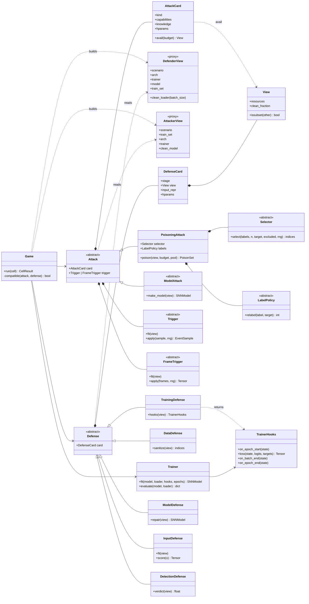
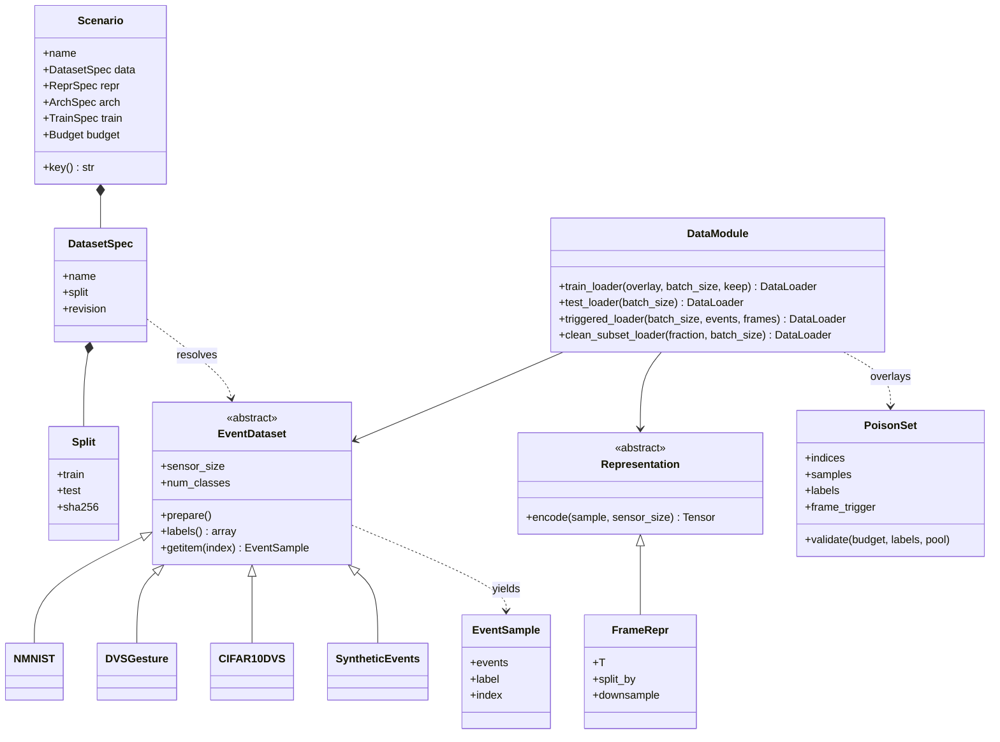
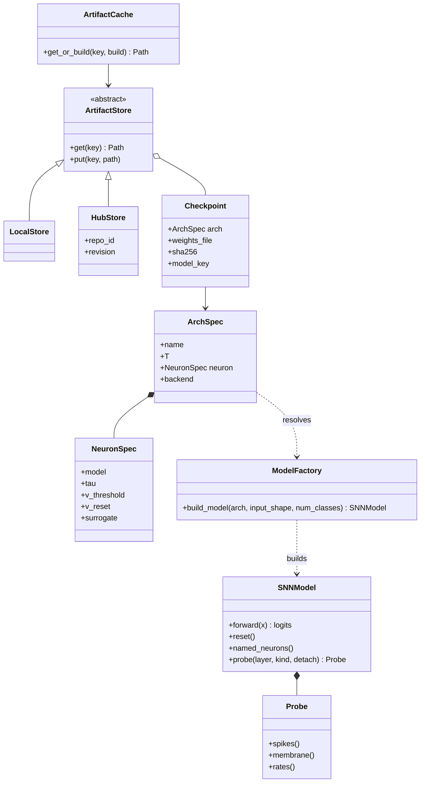
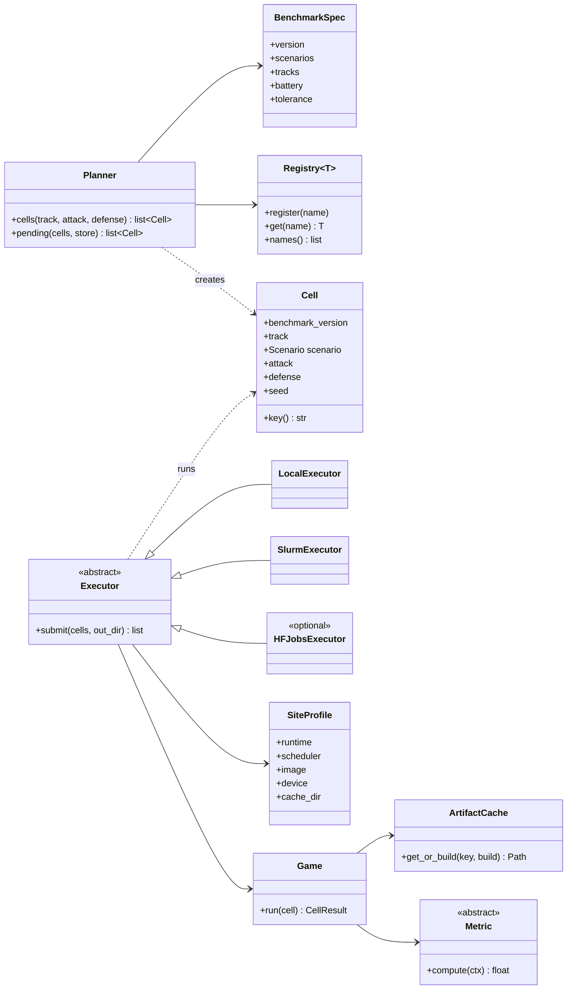
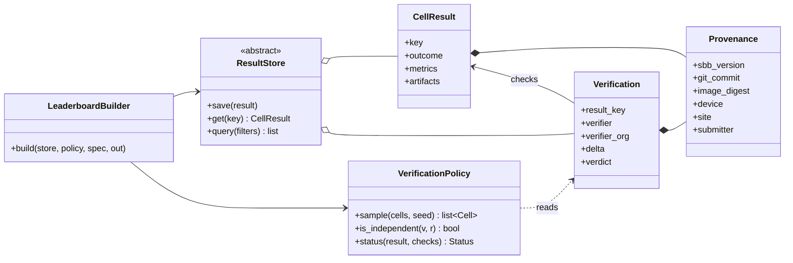
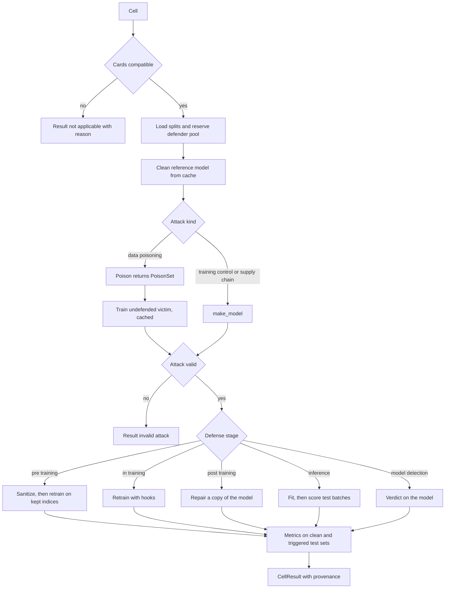
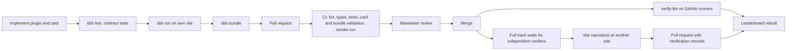

# SNN Backdoor Benchmark: design and implementation plan

Working name: `sbb` (placeholder, see section 16). Scope: versions v0 to v3. Last updated: 2026-10-15.

## 0. How to use this document

This document is the single source of truth for the project. It is written for the maintainers and for Claude Code.

- Build version by version (section 13). Do not start a version before the definition of done of the previous one passes.
- The interfaces in section 6 are contracts. If one has to change, update this document first, in the same pull request.
- Items marked **[DECIDE]** are open decisions. Use the stated default until a maintainer changes it.
- Items marked **[FILL]** need information from the maintainers (URLs, table numbers, names). Leave a TODO and continue.

## 1. Goal and scope

A living benchmark for backdoor attacks and defenses on spiking neural networks (SNNs), mainly with neuromorphic event data. Anyone can submit an attack or a defense. The harness evaluates it against every compatible method already registered, under explicit threat models, and publishes the results on a leaderboard.

Principles:

1. **Typed threat models.** Which attack and defense pairs are comparable, and which cells are N/A, is derived from machine-checked cards. Nothing is curated by hand.
2. **One code path.** The same `sbb run-cell` entry point runs on a laptop, on GitHub runners, on a Slurm cluster or on HF Jobs.
3. **Bring your own compute.** The project needs no paid compute. Trust comes from independent reproduction, not from a central service.
4. **Provenance everywhere.** Every number is produced by the harness and carries provenance. Hand-typed results are never accepted.
5. **Modular and non-repetitive.** One base class per role, plugins registered by name, one training loop, one data pipeline.
6. **Reproducible.** Pinned environment, deterministic runs, a replication record for every ported method.

Out of scope until v3: federated learning, ANN-to-SNN conversion, static-image datasets, physical recordings, deployment on neuromorphic hardware.

## 2. Glossary

| Term | Meaning |
|---|---|
| Scenario | Fixed dataset, split, representation, architecture, training recipe and budget. |
| Cell | One evaluation of (scenario, attack, defense, seed). Unit of work, caching and verification. |
| Attack, defense | Plugins. Each one is a class plus a card. |
| Card | YAML file with a plugin's threat model, metadata and frozen hyperparameters. |
| Capabilities | What an attacker controls. |
| View | The resources a defense needs to see. |
| Avail(c) | The resources still in the defender's hands when the attacker holds capabilities c. |
| DefenderView, AttackerView | Proxy objects that give a plugin only the resources its card declares. |
| Trigger | Transformation of raw events that activates the backdoor. A `FrameTrigger` (v1) transforms the encoded frames instead. |
| PoisonSet | Overlay of modified training samples: indices, new samples, new labels. |
| Defender pool | Clean training samples reserved before the attack. The attacker cannot modify them. |
| Zoo | Cached clean and backdoored models, published on Hugging Face. |
| Benchmark spec | Versioned YAML with datasets, splits, scenarios, battery, seeds, tracks and tolerances. |
| Track | `lite` (CPU, verified on GitHub runners) or `full` (GPU, verified by independent reproduction). |
| Site | A compute environment, described by a SiteProfile kept outside the repository. |
| Status | `self-reported`, `reproduced`, `disputed`, `not-applicable` or `failed`. Computed, never set by hand. |

## 3. Threat-model formalism

### 3.1 The game

Each cell is a security game. The harness plays the challenger:

1. **Compatibility.** Check the cards (3.4). If the defense needs a resource that Avail does not provide, the cell is N/A with a reason and nothing else runs.
2. **Data.** Load the clean train and test splits and fix the seed. Reserve the defender pool: a class-stratified fraction of the train split (default 5%) that the attacker cannot modify. It stays in the training set.
3. **Clean reference.** Get the clean model for this scenario and seed (cached, shared by all cells).
4. **Attack.** The attacker acts within its capabilities through an AttackerView. A poisoning attack returns a PoisonSet and a trigger. A model attack returns a model and a trigger.
5. **Victim.** For poisoning attacks, the harness trains the victim on the train split with the PoisonSet overlay, using the scenario recipe. The undefended backdoored model is cached and shared.
6. **Attack validity.** `CA(backdoored) >= CA(clean) - delta`. Otherwise the result is `invalid_attack`.
7. **Defense.** The harness builds a DefenderView with exactly the declared resources. The defense acts according to its stage (3.3). Pre-training and in-training defenses trigger a new victim training run with the sanitized data or the hooks.
8. **Metrics.** Compute the metrics (section 8) on the clean test set and on the triggered test set. Every metric but `asr_all` counts only triggered samples whose true label is not the target.

### 3.2 Attacker capabilities

Scenario kinds:

- `data_poisoning`: modifies up to `poison_rate x |train|` samples outside the defender pool. Labels may change (dirty-label) or not (clean-label). The victim trains.
- `training_control`: controls training (loss, schedule, neuron hyperparameters) for the scenario architecture and returns weights.
- `supply_chain`: receives a clean trained model from the zoo, modifies its weights, returns weights. Neuron parameters can change only where they are weights, such as the trainable time constant of PLIF neurons (v1 clarification: the victim is stored as a state dict and rebuilt from the scenario's `ArchSpec`).
- `federated` (v3): controls k of n clients.

Other capability fields:

- `labels`: `clean` or `dirty`. The harness checks it automatically against the PoisonSet.
- `trigger_domain`: `raw_events` (default) or `frames`. Frame-level injection is a stronger capability because it assumes access after preprocessing. v1: a `frames` attack has a `FrameTrigger`, which acts on the encoded frames [T, P, H, W] of the poisoned training samples and of the triggered test inputs. The Game refuses a trigger of the other domain, and a poison set that edits frames under a `raw_events` card (`ThreatModelViolation`). A train split poisoned in frames exists only as frames: `TrainSetView` refuses raw-event access there, because re-encoding the clean events and comparing them with the frames would reveal every poisoned sample. A defense that reads raw events of such a split fails the cell.

Knowledge fields:

- `architecture`: `known` or `unknown`.
- `data`: `full` or `partial`.
- `defense`: `oblivious` or `aware:<defense_id>` (adaptive attack).

The AttackerView is built from these fields. For example, with `architecture: unknown` the view has no `arch` attribute, and accessing it raises `ThreatModelViolation`.

### 3.3 Defender resources and stages

Resources:

- `train_set`: the training set as the victim received it, poisoned samples included. The defense never learns which indices are poisoned.
- `training_loop`: the right to hook into the victim's training run.
- `model`: white-box weights of the trained victim (a copy).
- `clean_subset`: a fraction of the defender pool.

| Stage | Base class | Method | Required resources |
|---|---|---|---|
| `pre_training` | `DataDefense` | `sanitize(view)` returns the indices to keep | `train_set` |
| `in_training` | `TrainingDefense` | `hooks(view)` returns `TrainerHooks` | `train_set`, `training_loop` |
| `post_training` | `ModelDefense` | `repair(view)` returns an `SNNModel` | `model`, optional `clean_subset` |
| `inference` | `InputDefense` | `fit(view)`, then `score(x)` per batch | `model`, optional `clean_subset` |
| `model_detection` | `DetectionDefense` | `verdict(view)` returns a score | `model`, optional `clean_subset` |

A `DataDefense` may train its own reference model with the shared Trainer (for example spectral signatures). That counts as using `train_set`, not `training_loop`, because it does not hook into the victim's run.

The shared `Trainer`, a seeded RNG and the public scenario description (architecture, number of classes, sensor size, T) are always available. They are tools and public knowledge, not resources.

### 3.4 Avail and compatibility

| Scenario kind | `train_set` | `training_loop` | `model` | `clean_subset` |
|---|---|---|---|---|
| `data_poisoning` | yes | yes | yes | yes |
| `training_control` | no | no | yes | yes |
| `supply_chain` | no | no | yes | yes |
| `federated` (v3) | no | server only | yes | yes |

The available clean fraction is the scenario budget `defender_clean_fraction`.

A cell (attack A, defense D) is defined if and only if `D.view.resources` is a subset of `Avail(A).resources` and `D.view.clean_fraction <= budget.defender_clean_fraction`. Otherwise the cell is N/A and the reason lists the missing resources.

Partial order: capability sets and views are ordered by inclusion. An attack that reaches the same ASR against the same defenses with fewer capabilities dominates. A defense that holds against the same attacks with a smaller view dominates. The leaderboard shows one table per comparable threat-model class plus Pareto fronts, never one global ranking.

### 3.5 Rules

- **Kerckhoffs.** Defenses are public, including their hyperparameters. Adaptive attacks declare `aware:<defense_id>`, run only against that defense, and appear on its page as "broken by".
- **Frozen hyperparameters.** Hyperparameters are fixed per (dataset, architecture) in the card. Authors may tune them only against the public dev battery. The defender cannot know the trigger, so per-cell tuning is not allowed.
- **Attack validity.** `CA(backdoored) >= CA(clean) - delta` with the same scenario and seed. Default delta = 3 percentage points **[DECIDE]**. Invalid attacks are reported, flagged and excluded from rankings.
- **Defense validity.** A defense counts as successful only if `CA(after) >= CA(before) - delta`.

## 4. Architecture

### 4.1 Packages and layers

| Layer | Package | Responsibility |
|---|---|---|
| 0 | `sbb.utils` | Canonical hashing, determinism, errors, the generic `Registry`, `ArtifactStore`, `LocalStore`, `HubStore`, `ArtifactCache`. |
| 1 | `sbb.data` | `EventSample`, dataset adapters, splits, representations, `PoisonSet`, `DataModule`. |
| 1 | `sbb.models` | `NeuronSpec`, `ArchSpec`, `SNNModel`, `Probe`, architecture builders, checkpoints. |
| 2 | `sbb.core` | Cards, views, Avail, compatibility, the plugin registries, `Trainer`, proxies, base classes for plugins and metrics, `Scenario`, `Cell`, `CellResult`, `Provenance`, `Game`. |
| 3 | `sbb.attacks`, `sbb.defenses`, `sbb.metrics` | Plugins. Shared parts (triggers, selectors, label policies, SNN adaptation utilities). |
| 4 | `sbb.runner` | `BenchmarkSpec`, `Planner`, executors, `SiteProfile`. |
| 4 | `sbb.results` | `ResultStore`, bundles and manifests, `Verification`, `VerificationPolicy`. |
| 5 | `sbb.site` | `LeaderboardBuilder` and templates. |
| 6 | `sbb.cli` | Typer CLI. |

A package may import only from lower layers (packages in the same layer do not import each other). import-linter enforces this in CI. Plugin base classes live in `sbb.core`, implementations in layer 3, so the Game finds plugins through the registry and never imports them.

### 4.2 Core: the security game



### 4.3 Data layer



### 4.4 Models and storage



### 4.5 Planning and execution



### 4.6 Results and verification



### 4.7 Lifecycle of one cell



### 4.8 Design rules

1. **One base class per role, one generic `Registry`.** A new method is one file, one class and one card, with no edits to the core.
2. **Composition over inheritance for attacks.** A poisoning attack combines a `Trigger`, a `Selector` and a `LabelPolicy`. Most new attacks are only a new trigger.
3. **One training loop.** Everything trains through `Trainer`. In-training defenses and training-control attacks provide `TrainerHooks`.
4. **Proxies enforce threat models.** `DefenderView` and `AttackerView` expose only what the card declares. Any other access raises `ThreatModelViolation`.
5. **Raw events first.** Triggers and PoisonSets act on raw `EventSample`s. Representations run afterwards. Only an attack whose card declares `trigger_domain: frames` uses a `FrameTrigger`, which the DataModule applies to the encoded frames (v1).
6. **One data pipeline.** Only `DataModule` builds loaders. Attacks return overlays, never dataset copies.
7. **Uniform model surface.** Every architecture is wrapped in `SNNModel`. Defenses reach internal activity only through probes and `named_neurons()`, so an SNN adaptation (for example "activation = spike rate over T") is defined once and reused by every port.
8. **Configs are data.** Scenarios, budgets and hyperparameters live in YAML validated by pydantic. There are no per-experiment scripts.
9. **Content-addressed caching.** Each stage (clean model, PoisonSet, backdoored model, defense output) is cached by a hash of everything that determines it. The zoo is that cache, published.
10. **Contract tests for free.** One parametrized test suite runs over everything in the registry. A new plugin gets its tests automatically.

## 5. Repository layout and hosting

### 5.1 GitHub repository

```
sbb/                                  # repository root, name [DECIDE]
├── CLAUDE.md                         # rules for Claude Code
├── README.md
├── LICENSE                           # [DECIDE]
├── pyproject.toml                    # single package, managed with uv
├── uv.lock
├── Dockerfile                        # one OCI image, runs under Docker and Apptainer
├── .importlinter                     # layer contract from section 4.1
├── src/sbb/
│   ├── utils/        hashing.py determinism.py errors.py logging.py storage.py
│   ├── data/         sample.py datasets/ splits.py splits/*.json representations.py poison.py module.py
│   ├── models/       spec.py snn.py probes.py factory.py architectures/ checkpoint.py
│   ├── core/         cards.py views.py registry.py trainer.py proxies.py plugins.py scenario.py cell.py result.py game.py
│   ├── attacks/      triggers/ selectors.py labels.py <one file per attack>.py cards/*.yaml
│   ├── defenses/     utils/ <one file per defense>.py cards/*.yaml
│   ├── metrics/      accuracy.py asr.py detection.py activity.py cost.py
│   ├── runner/       spec.py planner.py site.py executors/
│   ├── results/      store.py bundle.py verification.py policy.py
│   ├── site/         builder.py templates/
│   └── cli.py
├── benchmarks/       smoke.yaml toy.yaml v0.9.yaml v1.0.yaml
├── replications/     <method>.yaml
├── results/          <bench_version>/<cell_key>.json  manifests/<bundle_id>.json
├── verifications/    <bench_version>/<cell_key>/<verifier>-<date>.json
├── sites/examples/   local-cpu.yaml local-gpu.yaml slurm.yaml hfjobs.yaml
├── tests/            conftest.py unit/ contracts/ golden/ integration/
├── docs/             PLAN.md contributing.md threat-model.md sites.md porting.md
└── .github/          workflows/ CODEOWNERS pull_request_template.md
```

`results/` and `verifications/` in this repository are the source of truth. They are small JSON files, reviewed through pull requests.

### 5.2 Hugging Face repositories

| Repository | Type | Content | Version |
|---|---|---|---|
| `<hf-org>/sbb-zoo` | model | `<bench_version>/<model_key>/model.safetensors` and `checkpoint.json` | v1 |
| `<hf-org>/sbb-data` | dataset | dataset mirrors where the license allows redistribution, optional frame caches | v1 |
| `<hf-org>/sbb-results` | dataset | read-only mirror of `results/` and `verifications/` | v2 |
| `<hf-org>/sbb-leaderboard` | Space | optional mirror of the leaderboard | v2 |

Rules: weights only as safetensors. Every Hub reference in a spec or manifest pins a commit revision. Free public storage on the Hub is best effort, which is enough because SNN checkpoints are small. Contributors may host their own models in their own Hub repos and reference them by revision and sha256 in their manifest.

The leaderboard itself is a static site built from `results/` and served by GitHub Pages **[DECIDE]**.

## 6. Interfaces

These signatures are contracts. Python 3.11, full type hints, pydantic v2 for every spec, card and record. Docstrings and bodies are omitted here.

### 6.1 Cards and views (`sbb.core.cards`, `sbb.core.views`)

```python
class ScenarioKind(StrEnum):
    DATA_POISONING = "data_poisoning"
    TRAINING_CONTROL = "training_control"
    SUPPLY_CHAIN = "supply_chain"
    FEDERATED = "federated"            # v3

class Stage(StrEnum):
    PRE_TRAINING = "pre_training"
    IN_TRAINING = "in_training"
    POST_TRAINING = "post_training"
    INFERENCE = "inference"
    MODEL_DETECTION = "model_detection"

class Resource(StrEnum):
    TRAIN_SET = "train_set"
    TRAINING_LOOP = "training_loop"
    MODEL = "model"
    CLEAN_SUBSET = "clean_subset"

class View(BaseModel, frozen=True):
    resources: frozenset[Resource]
    clean_fraction: float = 0.0
    def issubset(self, other: "View") -> bool: ...
    def missing(self, other: "View") -> list[str]: ...      # readable N/A reasons

class Capabilities(BaseModel, frozen=True):
    labels: Literal["clean", "dirty"] | None = None          # data_poisoning only
    trigger_domain: Literal["raw_events", "frames"] = "raw_events"

class Knowledge(BaseModel, frozen=True):
    architecture: Literal["known", "unknown"] = "unknown"
    data: Literal["full", "partial"] = "full"
    defense: str = "oblivious"                                # or "aware:<defense_id>"

class CardBase(BaseModel):
    name: str                              # registry name, snake_case, unique
    version: str                           # semver of the implementation
    title: str
    paper: str | None = None
    code_reference: str | None = None
    license_note: str | None = None
    hparams: dict[str, dict[str, Any]] = {}  # keys: "default" or "<dataset>/<arch>"
    def hparams_for(self, dataset: str, arch: str) -> dict[str, Any]: ...   # default merged with override
    @classmethod
    def load(cls, path: Path) -> Self: ...

class AttackCard(CardBase):
    kind: ScenarioKind
    capabilities: Capabilities
    knowledge: Knowledge
    def avail(self, budget: "Budget") -> View: ...           # Avail table of section 3.4

class DefenseCard(CardBase):
    stage: Stage
    view: View
    input_repr: Literal["frames"] = "frames"                  # raw-event input defenses in v3
    adaptation_note: str | None = None                        # how an ANN defense was adapted

def compatible(attack: AttackCard, defense: DefenseCard, budget: "Budget") -> tuple[bool, list[str]]: ...
```

### 6.2 Data (`sbb.data`)

```python
EVENT_DTYPE = np.dtype([("x", np.int16), ("y", np.int16), ("t", np.int64), ("p", np.int8)])

@dataclass(frozen=True)
class EventSample:
    events: np.ndarray        # structured array with EVENT_DTYPE, sorted by t, t in microseconds
    label: int
    index: int                # index in the full dataset

class EventDataset(ABC):
    name: ClassVar[str]
    sensor_size: ClassVar[tuple[int, int, int]]   # (W, H, P)
    num_classes: ClassVar[int]
    def __init__(self, root: Path) -> None: ...
    @abstractmethod
    def prepare(self) -> None: ...                # download, or stop with manual-download instructions, verify checksums
    @abstractmethod
    def __len__(self) -> int: ...
    @abstractmethod
    def __getitem__(self, index: int) -> EventSample: ...
    @abstractmethod
    def labels(self) -> np.ndarray: ...           # all labels without loading events

class Split(BaseModel, frozen=True):
    name: str                 # e.g. "cifar10dvs_9to1_v1"
    dataset: str
    train: tuple[int, ...]
    test: tuple[int, ...]
    sha256: str               # hash of the canonical JSON of (dataset, train, test)

class DatasetSpec(BaseModel, frozen=True):
    name: str                 # registry name of the adapter
    split: str                # split file name
    revision: str | None = None   # Hub revision of a mirror, if used

class ReprSpec(BaseModel, frozen=True):
    kind: Literal["frames"] = "frames"
    T: int
    split_by: Literal["number", "time"] = "number"
    downsample: int = 1       # integer spatial downsampling of event coordinates

class Representation(ABC):
    @abstractmethod
    def encode(self, sample: EventSample, sensor_size: tuple[int, int, int]) -> torch.Tensor: ...  # [T, P, H, W] float32

class Budget(BaseModel, frozen=True):
    poison_rate: float = 0.1
    target: int = 0
    defender_clean_fraction: float = 0.05
    delta_pp: float = 3.0

@dataclass(frozen=True)
class PoisonSet:
    indices: np.ndarray       # dataset indices, unique, disjoint from the defender pool
    samples: tuple[EventSample, ...]
    labels: np.ndarray        # labels used for training
    frame_trigger: Callable[[torch.Tensor, np.random.Generator], torch.Tensor] | None = None  # v1
    def validate(self, budget: Budget, n_train: int, original_labels: np.ndarray,
                 label_policy: Literal["clean", "dirty"], pool: np.ndarray) -> None: ...  # raises BudgetViolation

class DataModule:
    """The only class that builds DataLoaders. Batches are (x [B, T, P, H, W], y [B], index [B])."""
    def __init__(self, dataset: EventDataset, split: Split, representation: Representation,
                 cache: ArtifactCache, defender_pool: np.ndarray, seed: int) -> None: ...
    def train_loader(self, overlay: PoisonSet | None, batch_size: int,
                     keep: np.ndarray | None = None, shuffle: bool = True) -> DataLoader: ...
    def test_loader(self, batch_size: int) -> DataLoader: ...
    def triggered_loader(self, batch_size: int,
                         events: Callable[[EventSample, np.random.Generator], EventSample] | None = None,
                         frames: Callable[[torch.Tensor, np.random.Generator], torch.Tensor] | None = None,
                         ) -> DataLoader: ...   # every test sample, true labels
    def clean_subset_loader(self, fraction: float, batch_size: int) -> DataLoader: ...  # from the defender pool

def reserve_defender_pool(labels: np.ndarray, train: Sequence[int], fraction: float, seed: int) -> np.ndarray: ...
def rng_for(seed: int, index: int) -> np.random.Generator: ...   # per-sample RNG, used by randomized triggers
```

Frames of clean samples are cached by (dataset, split, representation). Overlay samples are encoded on the fly.

v1 change: the `PoisonSet` of a `frames` attack carries its frame trigger, and every loader over the poisoned split applies it to the encoded frames of the poisoned samples with `rng_for(seed, index)`. `triggered_loader` takes the trigger of the test inputs as `events` (raw events, before the representation) or `frames` (after it).

v0 notes. `rng_for` lives in `sbb.utils.determinism` and `DatasetSpec` in `sbb.data.splits`. The frame cache is one uint16 `.npy` file read with `mmap_mode="r"` and `allow_pickle=False`, so N-MNIST frames do not have to fit in memory. `DataModule` also exposes `input_shape` (P, H, W), `encode(sample)` and `labels` (all dataset labels). `Budget.max_poison(n_train)` is the single place that rounds the poison budget. `PoisonSet.by_index()` maps each poisoned index to its (sample, label). A `Representation` takes its `ReprSpec` in the constructor (`FrameRepr(spec)`), and the frame cache key uses that spec. `FrameRepr` follows the frame boundaries of SpikingJelly's `integrate_events_by_fixed_frames_number` and rejects events outside the sensor.

### 6.3 Models (`sbb.models`)

```python
class NeuronSpec(BaseModel, frozen=True):
    model: Literal["lif", "plif", "if"] = "lif"
    tau: float = 2.0
    v_threshold: float = 1.0
    v_reset: float | None = 0.0          # None means soft reset
    surrogate: Literal["atan", "sigmoid"] = "atan"
    detach_reset: bool = True

class ArchSpec(BaseModel, frozen=True):
    name: str                            # registry name, e.g. "tiny_lif_cnn"
    T: int
    neuron: NeuronSpec = NeuronSpec()
    backend: Literal["torch", "cupy"] = "torch"
    kwargs: dict[str, Any] = {}

class SNNModel(nn.Module):           # v0: one concrete wrapper around a net mapping [T, B, P, H, W] to [T, B, K]
    """Uniform surface over every architecture.
    forward takes x [B, T, P, H, W], resets neuron states first, runs in multi-step mode,
    and returns logits [B, K] as the mean over T of a non-spiking linear readout."""   # v1: or of voted spikes, see 13.6
    def forward(self, x: torch.Tensor) -> torch.Tensor: ...
    def reset(self) -> None: ...
    def named_neurons(self) -> Iterator[tuple[str, nn.Module]]: ...
    def probe(self, layer: str, kind: Literal["spikes", "membrane"],
              detach: bool = True) -> "Probe": ...   # v1: detach False keeps the autograd graph
    @property
    def spec(self) -> ArchSpec: ...

class Probe:
    """Context manager that records one layer during forward passes."""
    def __enter__(self) -> "Probe": ...
    def __exit__(self, *exc: object) -> None: ...
    def spikes(self) -> torch.Tensor: ...      # [B, T, ...]
    def membrane(self) -> torch.Tensor: ...    # [B, T, ...]
    def rates(self) -> torch.Tensor: ...       # [B, ...], mean spike rate over T

ArchBuilder = Callable[[ArchSpec, tuple[int, int, int], int], SNNModel]   # (spec, input_shape (P, H, W), num_classes)

class Checkpoint(BaseModel):
    arch: ArchSpec
    input_shape: tuple[int, int, int]
    num_classes: int
    weights_file: str                 # safetensors file name
    sha256: str
    model_key: str

def save_checkpoint(model: SNNModel, directory: Path, model_key: str) -> Checkpoint: ...
def load_checkpoint(directory: Path) -> SNNModel: ...   # rebuilds from ArchSpec, loads safetensors, never unpickles
```

v0 change: builders receive the input shape instead of the number of input channels, because the flatten size of `tiny_lif_cnn` depends on H and W. `SNNModel` is a concrete wrapper: every architecture is a network from `[T, B, P, H, W]` to `[T, B, K]`, so subclasses would add nothing. `build_model(arch, input_shape, num_classes)` plays the role of `ModelFactory`.

### 6.4 Storage (`sbb.utils.storage`)

```python
class ArtifactStore(ABC):
    @abstractmethod
    def get(self, key: str) -> Path | None: ...        # local path of the artifact directory, or None
    @abstractmethod
    def put(self, key: str, path: Path) -> None: ...

class LocalStore(ArtifactStore): ...                  # <cache_dir>/<key>/
class HubStore(ArtifactStore): ...                    # repo_id, repo_type, revision. Read-only unless a token is configured

class ArtifactCache:
    def __init__(self, local: LocalStore, remote: ArtifactStore | None = None) -> None: ...
    def get_or_build(self, key: str, build: Callable[[Path], None]) -> Path: ...   # local, then remote, then build
```

v1 notes (task 7). `HubStore(repo_id, revision, prefix, repo_type)` keeps artifacts as `<prefix>/<key>/` folders, with the benchmark version as the zoo's prefix. It reads the repository's file list once, `keys()` lists the artifacts under the prefix, and `put_many` uploads several artifacts in one commit. `sbb zoo push VERSION --repo <hf-org>/sbb-zoo` uploads the cached artifacts that the results of VERSION reference (models as safetensors, verdicts as JSON), and `sbb zoo pull VERSION --repo ... --revision ...` copies them into the local cache, where every run looks first. The organization is still [FILL], so `--repo` has no default.

### 6.5 Attacks (`sbb.core.plugins`, implementations in `sbb.attacks`)

```python
class AttackerView:
    """Proxy built from the attack card and the scenario. Undeclared access raises ThreatModelViolation."""
    scenario: ScenarioInfo                 # always: dataset name, sensor size, classes, T, input shape
    seed: int                              # always, for rng_for
    rng: np.random.Generator               # always
    train_set: TrainSetView                # always, the clean split. Subset if knowledge.data == "partial"
    arch: ArchSpec                         # only if knowledge.architecture == "known" or kind needs it
    trainer: Trainer                       # training_control, supply_chain
    clean_model: SNNModel                  # supply_chain (a copy of the zoo model)
    def poisoned_loader(self, poison: PoisonSet, batch_size: int, shuffle: bool = True) -> DataLoader: ...  # v1

class Attack(ABC):
    card: ClassVar[AttackCard]
    trigger: Trigger | FrameTrigger        # v1: the trigger of the test inputs, set in __init__
    def __init__(self, hparams: dict[str, Any], target: int) -> None: ...

class Trigger(ABC):                        # trigger_domain raw_events
    def fit(self, view: AttackerView) -> None: ...          # optional, learned triggers only
    def learned(self) -> nn.Module | None: ...              # v1: a model attack's learned part
    @abstractmethod
    def apply(self, sample: EventSample, rng: np.random.Generator) -> EventSample: ...

class FrameTrigger(ABC):                   # v1, trigger_domain frames
    def fit(self, view: AttackerView) -> None: ...          # optional, learned or data-dependent
    def learned(self) -> nn.Module | None: ...              # a model attack's learned part
    @abstractmethod
    def apply(self, frames: torch.Tensor, rng: np.random.Generator) -> torch.Tensor: ...  # [T, P, H, W]

class Selector(ABC):
    @abstractmethod
    def select(self, labels: np.ndarray, n: int, target: int,
               excluded: np.ndarray, rng: np.random.Generator) -> np.ndarray: ...

class LabelPolicy(ABC):
    name: ClassVar[Literal["clean", "dirty"]]
    @abstractmethod
    def relabel(self, label: int, target: int) -> int: ...

class PoisoningAttack(Attack):
    selector: Selector
    labels: LabelPolicy
    def poison(self, view: AttackerView, budget: Budget, pool: np.ndarray) -> PoisonSet: ...  # generic

class ModelAttack(Attack):
    @abstractmethod
    def make_model(self, view: AttackerView) -> SNNModel: ...
```

v1 change: every attacker sees the clean train split, because a supply-chain attacker also needs data, for example to fine-tune the zoo model on poisoned samples, and `poisoned_loader` gives a loader over the attacker's own poison set for training. Model attacks always get the scenario architecture, because they must return it: the Game raises `ThreatModelViolation` when `make_model` returns a model whose `ArchSpec`, input shape or number of classes differ from the scenario's, whose state dict does not load strictly into a fresh model of that architecture, or whose `repr` differs from that fresh model with the returned weights (a neuron parameter changed in place, which a checkpoint would lose). The Game skips `make_model` when the victim is already cached, so a model attack's trigger may depend only on what `__init__` sets, and the attack contract test checks this. A model attack with a learned trigger exposes the trained part through `Trigger.learned()` or `FrameTrigger.learned()` (an `nn.Module`, None by default). The Game stores its state as `trigger.safetensors` next to the victim and restores it when the victim comes from the cache, and the contract test checks that this state restores the trigger. The first such port is the Sneaky Spikes dynamic attack. `ScenarioInfo` gains `input_shape`, the (P, H, W) of one frame after the representation, so an attacker can build the scenario network. Until the zoo of task 7 exists, the clean model of a supply-chain cell is the clean model of the local cache.

A typical attack is configuration only:

```python
@ATTACKS.register("static_patch")
class StaticPatch(PoisoningAttack):
    card = AttackCard.load(CARDS / "static_patch.yaml")

    def __init__(self, hparams: dict[str, Any], target: int) -> None:
        super().__init__(hparams, target)
        self.trigger = PatchTrigger(**hparams["trigger"])
        self.selector = RandomSelector()
        self.labels = DirtyLabel()
```

`no_attack` is a `PoisoningAttack` that selects nothing and whose trigger is the identity. Its cells give the clean reference and the natural ASR.

v1 change: `Attack.trigger_test` is replaced by the attribute `trigger`, a `Trigger` or a `FrameTrigger` as the card's `trigger_domain` says, and the Game builds the triggered test set from it. `PoisoningAttack.poison` selects the samples before it calls `trigger.fit`, so fitting a trigger does not change which samples are poisoned. It applies a raw-event trigger itself and attaches a frame trigger to the `PoisonSet`. A model attack's trigger must not change in `make_model`, which the contract test checks. The shared parts (task 5) are:

- Raw-event triggers in `sbb.attacks.triggers`: `IdentityTrigger`, `PatchTrigger`.
- Frame triggers in `sbb.attacks.frame_triggers`, ports of the official code: `FramePatchTrigger`, `MovingPatchTrigger` and `SmartPatchTrigger` (Sneaky Spikes), `FlashTrigger` (Flashy Backdoor). `SmartPatchTrigger.fit` picks its cell, polarity mode and random walk once from the train split, and the test inputs get the same trigger. The official code draws them again from the test set. The walk comes from a child of the view's generator, so like the official walk it depends on the seed and not on the poison rate.
- Temporal triggers in `sbb.attacks.temporal_triggers`, from the T-Backdoor paper's equations: `RateTrigger`, `LatencyTrigger`, `JitterTrigger`.
- Selectors: `RandomSelector(include_target=False)`, which skips the target class unless replications of the papers ask otherwise, and `TargetClassSelector` for clean-label attacks. Label policies: `CleanLabel`, `DirtyLabel`.

A local parity check compared every trigger with the official functions on random count frames. The smart trigger ran its own `fit` and `apply` with the official random stream, so its cell, mode and walk matched too. The only differences are refusals: sbb rejects a moving square that would leave the frame. The official code clips a square that leaves on the right, and paints nothing, or wraps around, for one that starts left of the frame.

### 6.6 Defenses (`sbb.core.plugins`, implementations in `sbb.defenses`)

```python
class TrainSetView:
    """Training set as the victim received it. Poisoned samples included, indices not revealed."""
    indices: np.ndarray            # full-dataset index of each position
    def __len__(self) -> int: ...
    def __getitem__(self, i: int) -> EventSample: ...
    def labels(self) -> np.ndarray: ...
    def loader(self, batch_size: int, indices: np.ndarray | None = None, shuffle: bool = False) -> DataLoader: ...

class DefenderView:
    """Proxy built from the defense card. Undeclared access raises ThreatModelViolation."""
    scenario: ScenarioInfo         # always
    arch: ArchSpec                 # always, public (3.3), v1: a DataDefense builds its reference model from it
    trainer: Trainer               # always, fresh, configured with the scenario recipe
    rng: np.random.Generator       # always
    model: SNNModel                # Resource.MODEL, a copy
    train_set: TrainSetView        # Resource.TRAIN_SET
    def clean_loader(self, batch_size: int) -> DataLoader: ...   # Resource.CLEAN_SUBSET

class Defense(ABC):
    card: ClassVar[DefenseCard]
    def __init__(self, hparams: dict[str, Any]) -> None: ...

class DataDefense(Defense):
    @abstractmethod
    def sanitize(self, view: DefenderView) -> np.ndarray: ...       # positions in train_set to keep

class TrainingDefense(Defense):
    @abstractmethod
    def hooks(self, view: DefenderView) -> TrainerHooks: ...

class ModelDefense(Defense):
    @abstractmethod
    def repair(self, view: DefenderView) -> SNNModel: ...

class InputDefense(Defense):
    threshold: float
    @abstractmethod
    def fit(self, view: DefenderView) -> None: ...                  # must set self.threshold
    @abstractmethod
    def score(self, x: torch.Tensor) -> torch.Tensor: ...           # [B], higher means more suspicious

class DetectionDefense(Defense):
    @abstractmethod
    def verdict(self, view: DefenderView) -> float: ...             # higher means more likely backdoored
```

v1 notes on how the Game plays each stage. The card's stage decides, and the class must subclass the matching base. A card must declare the resources its stage needs (the "Required resources" column of 3.3), which the card validation enforces, so a pre-training or in-training defense is N/A against model attacks. A pre-training defense returns unique positions of the train set (checked), and the victim is retrained on the poisoned split restricted to them. An in-training defense's hooks are passed to a fresh training run. Both retrained models and post-training repairs are cached under the defense key, so `sanitize`, `hooks` and `repair` run only on a cache miss. An input defense is fitted in every cell (its fitted state is not cached), and it rejects an input when its score is above `threshold`. A detection defense's verdict is cached under the defense key as `verdict.json` and reported in the cell's metrics as `verdict`. Input and detection defenses leave the model unchanged, so their cells have no `defended_model` artifact.

v1 shared parts of the SNN adaptations (task 5), in `sbb.defenses.utils`, chosen from the official code of the group A defenses:

- `channel_means(model, module, loader, device)`: the mean output per channel of any layer over a loader, in eval mode. On a spiking neuron layer it is the firing rate. sbb's fine-pruning ranks the neurons of the last conv block by it (section 12). It takes any iterable of batches.
- `zero_channels(module, channels)`: prunes output channels of a convolution or a batch norm by zeroing their weight and bias. Pruning has to live in the weights, because the Game stores a defended model as a state dict. Zeroing a convolution keeps the shift of the following batch norm (Flashy's fine-pruning), and zeroing a batch norm silences the channel (CLP).
- `conv_blocks(model)`: each batch norm with the convolution before it, as CLP pairs them for its channel Lipschitz bound, and the neuron layer after it, whose spike rates fine-pruning ranks.
- `superpose(x, overlay)`: STRIP's superposition. Inputs reach an input defense as frames, so it adds the frames, as Flashy's SNN STRIP does.
- `SNNModel.probe(layer, "membrane", detach=False)`: membrane potentials with their autograd graph, for TMPBD, which optimizes inputs to raise the output layer's membrane potential.

Learned neuron masks (ANP, group B) come with that port.

`no_defense` is a `ModelDefense` with view `{model}` that returns the model unchanged. A typical defense:

```python
@DEFENSES.register("fine_tuning")
class FineTuning(ModelDefense):
    card = DefenseCard.load(CARDS / "fine_tuning.yaml")    # view: {model, clean_subset}

    def repair(self, view: DefenderView) -> SNNModel:
        data = view.clean_loader(batch_size=self.hparams["batch_size"])
        return view.trainer.fit(view.model, data, epochs=self.hparams["epochs"])
```

### 6.7 Training (`sbb.core.trainer`)

```python
class TrainSpec(BaseModel, frozen=True):
    epochs: int
    batch_size: int
    optimizer: Literal["adam", "sgd"] = "adam"
    lr: float = 1e-3
    weight_decay: float = 0.0
    schedule: Literal["none", "cosine"] = "cosine"
    augment: Literal["none"] = "none"     # augmentation can remove triggers, so none until decided
    amp: bool = False

@dataclass
class TrainState:
    epoch: int
    step: int
    model: SNNModel
    optimizer: torch.optim.Optimizer
    batch_indices: torch.Tensor           # dataset indices of the current batch
    per_sample_loss: torch.Tensor | None  # filled before hooks are called
    inputs: torch.Tensor                  # v1: the batch x, for attacks that train a trigger generator

class TrainerHooks:
    """No-op defaults. Override only what you need. At most one hook set may override the loss."""
    def on_epoch_start(self, state: TrainState) -> None: ...
    def loss(self, state: TrainState, logits: torch.Tensor, targets: torch.Tensor) -> torch.Tensor | None: ...
    def on_batch_end(self, state: TrainState) -> None: ...
    def on_epoch_end(self, state: TrainState) -> None: ...

class Trainer:
    def __init__(self, spec: TrainSpec, device: torch.device) -> None: ...
    def fit(self, model: SNNModel, loader: DataLoader, hooks: Sequence[TrainerHooks] = (),
            epochs: int | None = None) -> SNNModel: ...
    def predict(self, model: SNNModel, loader: DataLoader, ties: Ties = "none") -> tuple[np.ndarray, np.ndarray]: ...  # predictions, labels
    def evaluate(self, model: SNNModel, loader: DataLoader, ties: Ties = "none") -> dict[str, float]: ...
```

v0 change: the Trainer takes no seed. The Game seeds before building each cached artifact, so a stage gives the same weights whether the stages before it were trained or loaded from the cache. Loaders are seeded by the `DataModule`. `SGD` uses momentum 0.9. `amp` raises `NotImplementedError` until it is needed.

v1 change (task 13, user decision of 2026-10-22): `ties` is `"none"` or `"first"`. With `"none"`, the default, an input whose top two scores are within 1e-6 gets the prediction -1 (`NO_PREDICTION`). The voting readouts of the full-track networks output multiples of 1 / (10 T), so silent and tied outputs are common, and `argmax` would send them to class 0. The Game uses `"first"` (plain `argmax`, the papers' rule) only for replication cells.

v1 change: `TrainSpec.loss` is `cross_entropy` (default) or `mse`. `mse` compares the model output with one-hot targets, which is how the ported papers train their networks on firing rates. `SNNModel` returns the mean over T of the network output, which for the papers' networks is a firing rate per class, not logits of a linear readout.

### 6.8 Scenario, cell, results and game (`sbb.core`)

```python
class Scenario(BaseModel, frozen=True):
    name: str
    data: DatasetSpec
    repr: ReprSpec
    arch: ArchSpec
    train: TrainSpec
    budget: Budget

class Cell(BaseModel, frozen=True):
    benchmark_version: str
    track: Literal["lite", "full", "replication"]   # v1: replication
    scenario: Scenario
    attack: str
    attack_version: str
    defense: str
    defense_version: str
    seed: int
    attack_hparams: dict[str, Any] = {}  # v1: merged over the card's, the paper's in a replication
    def key(self) -> str: ...            # see 7.6

class Provenance(BaseModel):
    sbb_version: str
    git_commit: str
    image_digest: str | None             # None when run without the container
    lockfile_sha256: str
    python: str
    torch: str
    spikingjelly: str
    cuda: str | None
    device: str                          # GPU or CPU model
    site: str                            # SiteProfile name
    executor: str
    deterministic: bool
    submitter: str                       # GitHub handle
    submitter_org: str
    started_at: datetime
    duration_s: float

class CellResult(BaseModel):
    key: str
    cell: Cell
    outcome: Literal["ok", "not_applicable", "invalid_attack", "failed"]
    reason: str | None = None
    metrics: dict[str, float] = {}
    artifacts: dict[str, str] = {}       # stage name to artifact key or sha256
    provenance: Provenance

class Metric(ABC):
    name: ClassVar[str]
    stages: ClassVar[frozenset[Stage]] = frozenset(Stage)   # v1: defense stages whose cells report it
    @abstractmethod
    def compute(self, ctx: "EvalContext") -> float: ...

class Game:
    def __init__(self, cache: ArtifactCache, device: torch.device, data_root: Path,
                 site: str = "local", executor: str = "in-process") -> None: ...
    def run(self, cell: Cell) -> CellResult: ...   # template method following section 4.7
```

v0 notes. `data_root` holds one directory per dataset. `site` and `executor` go into the provenance. `EvalContext` holds the predictions and true labels on the clean and triggered test sets and the target, and, in v1, the accepted masks and scores of an input defense. A poisoning attack with an empty PoisonSet (`no_attack`) stores the clean weights under its own `model_key`, because its victim run would train exactly the same weights. Keys still follow 7.6. `collect_provenance` reads `SBB_SUBMITTER`, `SBB_SUBMITTER_ORG` and `SBB_IMAGE_DIGEST` from the environment. It records the git commit, the `uv.lock` hash and the SpikingJelly version read once, when `sbb.core.result` is imported, so a long run never records code that changed on disk after it started. The PoisonSet is rebuilt in every cell and only its key is recorded, a deviation from rule 9 of 4.8: caching it must wait for learned triggers (v1), because a cached set would skip `Trigger.fit`.

### 6.9 Runner (`sbb.runner`)

```python
class Battery(BaseModel):
    attacks: list[str]
    defenses: list[str]
    dev: list[str] = []                 # public dev battery used to tune hyperparameters

class Tolerance(BaseModel):
    lite_pp: float = 1.0
    full_pp: float = 2.0
    full_sigma: float = 2.0             # full tolerance = max(full_pp, full_sigma x seed std)

class TrackSpec(BaseModel):
    scenarios: list[str]
    seeds: list[int]

class BenchmarkSpec(BaseModel):
    benchmark: str = "sbb"
    version: str
    scenarios: dict[str, Scenario]
    tracks: dict[Literal["lite", "full"], TrackSpec]
    battery: Battery
    tolerance: Tolerance = Tolerance()

class Planner:
    def __init__(self, spec: BenchmarkSpec) -> None: ...
    def cells(self, track: str | None = None, attack: str | None = None,
              defense: str | None = None) -> list[Cell]: ...      # includes N/A cells, the Game reports them
    def pending(self, cells: Sequence[Cell], store: "ResultStore") -> list[Cell]: ...

class SiteProfile(BaseModel):
    name: str
    runtime: Literal["none", "docker", "apptainer"] = "none"
    scheduler: Literal["none", "slurm", "hfjobs"] = "none"
    image: str | None = None            # pinned by digest
    device: Literal["cpu", "cuda"] = "cuda"
    cache_dir: Path
    max_parallel: int = 1
    slurm: dict[str, str] = {}          # partition, account, time, gres, extra sbatch lines
    hfjobs: dict[str, str] = {}         # flavor, namespace, timeout

class Executor(ABC):
    """Every executor ends up running: sbb run-cell <cell.json> --out <dir>."""
    def __init__(self, site: SiteProfile) -> None: ...
    @abstractmethod
    def submit(self, cells: Sequence[Cell], out_dir: Path) -> list[str]: ...   # job ids

class LocalExecutor(Executor): ...      # in-process or subprocess pool
class SlurmExecutor(Executor): ...      # sbatch job arrays, apptainer exec --nv when runtime is apptainer
class HFJobsExecutor(Executor): ...     # optional, huggingface_hub.run_job, v2
```

v1 notes (task 7). `Planner.pending` is a static method over any object with `get(key)` (a ResultStore), because the runner and results layers are independent. A cell is pending when it has no result or its last result failed. `sbb run` and `sbb replicate` run the pending cells in their own process on a local site with one worker, start `LocalExecutor`'s pool of `python -m sbb run-cell` processes with more workers, and submit through `SlurmExecutor` on a Slurm site. A submitting command returns at once, and running it again once the jobs end writes the table or fills the record. Every executor writes `<out>/jobs/<hash of the cell keys>/` with one JSON per cell, the site profile and the logs. The Slurm job is one array of at most `max_parallel` running tasks. `site.slurm` entries become `#SBATCH --<key>=<value>` lines and its `extra` entry is copied as is. With runtime `apptainer` each task runs `apptainer exec --nv --bind <cache_dir> <image> sbb run-cell ...`.

### 6.10 Results and verification (`sbb.results`)

```python
class ResultStore(ABC):
    @abstractmethod
    def save(self, result: CellResult) -> None: ...
    @abstractmethod
    def get(self, key: str) -> CellResult | None: ...
    @abstractmethod
    def query(self, **filters: str) -> list[CellResult]: ...

class LocalResultStore(ResultStore): ...          # results/<bench_version>/<key>.json

class Verification(BaseModel):
    result_key: str
    verifier: str                     # GitHub handle
    verifier_org: str
    provenance: Provenance
    metrics: dict[str, float]
    delta: dict[str, float]           # verifier minus original, per metric
    verdict: Literal["match", "mismatch"]
    notes: str | None = None

class Status(StrEnum):
    SELF_REPORTED = "self-reported"
    REPRODUCED = "reproduced"
    DISPUTED = "disputed"
    NOT_APPLICABLE = "not-applicable"
    FAILED = "failed"

class VerificationPolicy:
    def __init__(self, tolerance: Tolerance, k_samples: int = 3) -> None: ...
    def sample(self, cells: Sequence[Cell], seed: int) -> list[Cell]: ...   # seed = hash of the manifest
    def is_independent(self, v: Verification, r: CellResult) -> bool: ...
    def status(self, r: CellResult, checks: Sequence[Verification]) -> Status: ...

class Manifest(BaseModel):
    bundle_id: str
    benchmark_version: str
    submitter: str
    submitter_org: str
    plugins: dict[str, str]           # name to version
    results: list[dict[str, str]]     # path and sha256
    models: list[dict[str, str]]      # model_key, repo, revision, sha256 (optional)
```

v1 notes (task 8). `verify(original, rerun, verifier, verifier_org, tolerance_pp)` gives `match` when the outcomes agree, the rerun has every metric of the original, and each differs by at most `tolerance_pp` percentage points. `sbb reproduce RESULT_JSON --site ...` reruns the cell through the Game of the site (its cache included, so a verifier who pulled the zoo checks the defense step on the published models) and writes `verifications/<version>/<key>/<verifier>-<UTC time>.json`, with the track's tolerance by default (`lite_pp`, otherwise `full_pp`, the seed-based full tolerance is v2). `sbb bundle --plugin NAME` writes `results/manifests/<bundle_id>.json` for the plugin's results of one version and one submitter. `bundle_id` is the first 16 hex digits of the hash of the version and the result hashes, so a manifest names its content. `sbb validate PATH...` checks cards, replication records, results (key equal to the cell hash and to the file name), manifests (files present, sha256, versions, plugins, bundle id) and verification records. `VerificationPolicy` and the computed statuses are v2 (13.4).

### 6.11 Registry and errors (`sbb.core.registry`, `sbb.utils.errors`)

```python
class Registry(Generic[T]):
    def __init__(self, kind: str) -> None: ...
    def register(self, name: str) -> Callable[[type[T]], type[T]]: ...   # fails on duplicate names
    def get(self, name: str) -> type[T]: ...
    def names(self) -> list[str]: ...
    def load_entry_points(self, group: str) -> None: ...                 # v3, third-party plugins

# Module-level registries: ATTACKS, DEFENSES, METRICS (sbb.core.registry), DATASETS (sbb.data.sample),
# ARCHITECTURES (sbb.models.snn). TRIGGERS and EXECUTORS arrive with v1.

class SbbError(Exception): ...
class ThreatModelViolation(SbbError): ...
class BudgetViolation(SbbError): ...
class IncompatibleCell(SbbError): ...
class ReproducibilityError(SbbError): ...
```

Plugins register at import. `sbb.attacks.__init__` and `sbb.defenses.__init__` import every plugin module explicitly, so discovery has no magic.

v0 change: the generic `Registry` lives in `sbb.utils.registry`, because the data and model layers need it for `DATASETS` and `ARCHITECTURES` and may not import `sbb.core`. A registry stores any object, so `Registry[type[Attack]]` holds classes and `Registry[ArchBuilder]` holds functions. `IncompatibleCell` is not defined: an incompatible cell is a `not_applicable` result, not an error.

## 7. File formats

### 7.1 Attack card

```yaml
name: static_patch
version: 1.0.0
title: Static patch trigger (Sneaky Spikes)
paper: "Abad et al., Sneaky Spikes, NDSS 2024"
code_reference: "[FILL] official repository URL"
license_note: "[FILL]"
kind: data_poisoning
capabilities:
  labels: dirty
  trigger_domain: raw_events
knowledge:
  architecture: unknown
  data: full
  defense: oblivious
hparams:
  default:
    trigger: {size: "[FILL]", location: "[FILL]", polarity: "[FILL]"}
```

### 7.2 Defense card

```yaml
name: fine_pruning
version: 1.0.0
title: Fine-pruning adapted to SNNs
paper: "Liu et al., Fine-Pruning, RAID 2018"
code_reference: "[FILL]"
license_note: "[FILL]"
stage: post_training
view:
  resources: [model, clean_subset]
  clean_fraction: 0.05
input_repr: frames
adaptation_note: >
  Neurons of the last conv block are ranked by their spike rate on clean data
  (channel_means on its neuron layer), the SNN counterpart of the activations of the original
  method. Pruning silences a channel by zeroing the scale and shift of its batch norm
  (zero_channels).
hparams:                               # illustrative values
  default: {prune_ratio: 0.2, finetune_epochs: 10, lr: 0.001, batch_size: 64}
  nmnist/tiny_lif_cnn: {prune_ratio: 0.3}
```

### 7.3 Benchmark spec

```yaml
benchmark: sbb
version: 0.1.0
scenarios:
  nmnist_tiny:
    name: nmnist_tiny
    data: {name: nmnist, split: nmnist_official_v1}
    repr: {kind: frames, T: 10, split_by: number, downsample: 1}
    arch: {name: tiny_lif_cnn, T: 10, neuron: {model: lif, tau: 2.0, v_threshold: 1.0}}
    train: {epochs: 10, batch_size: 64, optimizer: adam, lr: 0.001, schedule: cosine}
    budget: {poison_rate: 0.1, target: 0, defender_clean_fraction: 0.05, delta_pp: 3.0}
tracks:
  lite: {scenarios: [nmnist_tiny], seeds: [0]}
battery:
  attacks: [no_attack, static_patch]
  defenses: [no_defense, fine_tuning]
  dev: [static_patch]
tolerance: {lite_pp: 1.0, full_pp: 2.0, full_sigma: 2.0}
```

### 7.4 Site profiles (outside the repository, examples in `sites/examples/`)

```yaml
# local-gpu.yaml
name: my-workstation
runtime: none
scheduler: none
device: cuda
cache_dir: ~/.cache/sbb
max_parallel: 1
```

```yaml
# slurm.yaml
name: my-cluster
runtime: apptainer
scheduler: slurm
image: docker://ghcr.io/<org>/sbb@sha256:<digest>
device: cuda
cache_dir: /scratch/<user>/sbb-cache
max_parallel: 16
slurm: {partition: "[FILL]", account: "[FILL]", time: "06:00:00", gres: "gpu:1"}
```

```yaml
# hfjobs.yaml (optional, paid)
name: hf-jobs
runtime: docker
scheduler: hfjobs
image: ghcr.io/<org>/sbb@sha256:<digest>
device: cuda
cache_dir: /tmp/sbb-cache
hfjobs: {flavor: l4x1, namespace: "<hf-org>", timeout: 6h}
```

### 7.5 Cell result

```json
{
  "key": "3f2a...",
  "cell": {"benchmark_version": "0.1.0", "track": "lite", "scenario": {"...": "..."},
           "attack": "static_patch", "attack_version": "1.0.0",
           "defense": "fine_tuning", "defense_version": "1.0.0", "seed": 0},
  "outcome": "ok",
  "reason": null,
  "metrics": {"ca": 0.981, "asr": 0.042, "ra": 0.915},
  "artifacts": {"poison_set": "a1b2...", "model": "c3d4...", "defended_model": "e5f6..."},
  "provenance": {"sbb_version": "0.1.0", "git_commit": "...", "image_digest": null,
                 "lockfile_sha256": "...", "python": "3.11.9", "torch": "...", "spikingjelly": "...",
                 "cuda": null, "device": "AMD EPYC 7763", "site": "github-runner",
                 "executor": "local", "deterministic": true, "submitter": "<handle>",
                 "submitter_org": "<org>", "started_at": "2026-10-15T10:00:00Z", "duration_s": 1832.4}
}
```

### 7.6 Keys and hashing

- Canonical JSON: sorted keys, no whitespace, UTF-8, floats written with `repr`. Hash: sha256, hex.
- `Cell.key()`: hash of the full cell, benchmark version included.
- Artifact keys exclude the benchmark version and the track, so artifacts are reused across versions. `sbb_minor` is the package `major.minor`.
  - `clean_model_key = H(data, repr, arch, train, seed, sbb_minor)`
  - `poison_key = H(data, budget, attack, attack_version, attack hparams, seed, sbb_minor)`
  - `model_key = H(poison_key, repr, arch, train, seed, sbb_minor)` for poisoning attacks, `H(clean_model_key, budget, attack, attack_version, attack hparams, seed, sbb_minor)` for model attacks (v1 change: the representation, the recipe and the budget, which holds the target, also determine the attacker's weights, and the clean model key covers the first two)
  - `defense_key = H(model_key, defense, defense_version, defense hparams, seed, sbb_minor)`
- Patch releases must not change any number. Golden tests enforce this.

### 7.7 Split file

```json
{"name": "cifar10dvs_9to1_v1", "dataset": "cifar10dvs",
 "train": [0, 1, 2], "test": [9, 19, 29], "sha256": "..."}
```

CIFAR10-DVS has no official split: use SpikingJelly's ordered class-stratified 9:1 split, the one every ported paper uses (`split_to_train_test_set(0.9)`: in SpikingJelly's index order, the first 900 recordings of each class train and the last 100 test). N-MNIST and DVS128 Gesture use their official splits, still materialized as files. v1 change: the ordered split replaces a seeded random split, so benchmark and replication runs use the same split, and can share the frame cache and the clean models when their representation, architecture and training also match.

### 7.8 Verification record

```json
{"result_key": "3f2a...", "verifier": "<handle>", "verifier_org": "<org>",
 "provenance": {"...": "..."}, "metrics": {"ca": 0.979, "asr": 0.047, "ra": 0.911},
 "delta": {"ca": -0.002, "asr": 0.005, "ra": -0.004}, "verdict": "match", "notes": null}
```

### 7.9 Replication record

v1 format, `replications/<method>.yaml`, the `ReplicationRecord` model in `sbb.results.replication`. A record holds one or more targets, each a scenario with the paper's numbers. `sbb replicate <method>` runs one undefended cell per target and seed (track `replication`, the record's `hparams` merged over the card's), writes the filled record to `<out>/replications/`, and with `--update` back into `replications/`.

```yaml
method: sneaky_static
source: "Abad et al., Sneaky Spikes, NDSS 2024, Table I, static trigger, baseline columns"
confirmed: false              # a maintainer confirmed the targets
hparams: {selector: {include_target: true}}   # the papers poison every class
seeds: [0, 1, 2]
tolerance_pp: 3.0               # the benchmark rule for every record
targets:
  - setting:                  # a Scenario, may differ from the benchmark scenarios
      name: sneaky_spikes_cifar10dvs
      data: {name: cifar10dvs, split: cifar10dvs_9to1_v1}
      repr: {kind: frames, T: 16, split_by: number}
      arch: {name: cifar10dvs_net, T: 16}
      train: {epochs: 28, batch_size: 16, loss: mse, optimizer: adam, lr: 0.001, schedule: cosine}
      budget: {poison_rate: 0.1, target: 0, defender_clean_fraction: 0.0, delta_pp: 100.0}
    reported: {ca: 67.7, asr_all: 100.0}          # percent, metric registry names
    ours: {ca: {mean: null, std: null}, asr_all: {mean: null, std: null}}   # filled by sbb replicate
status: pending               # pending | replicated | explained | failed
explanation: null
```

Every record uses a tolerance of 3 percentage points (user decision of 2026-10-22): a port whose means are within 3 points of every reported number is replicated. The papers' ASR counts the target class, so records compare `asr_all`. A replication setting has no defender pool, because the papers have none, and a large `delta_pp`, so the validity check never hides the ASR. The status is `replicated` when every reported metric of every target is within `tolerance_pp` of our mean over the seeds (population standard deviation alongside). Otherwise it is `failed`, unless a maintainer marked it `explained` with the reason. v1 records propose their targets from the papers and wait for the maintainer's confirmation (`confirmed`).

If a paper used an architecture that is not in the registry, register it under its own name. It is then available for replication and, if useful, for the benchmark.

## 8. Metrics

All metrics are fractions in [0, 1]. The triggered test set contains every test sample. Every metric but `asr_all` counts only the triggered samples whose true label is not the target (v1 change: before, the triggered test set left them out). A tied top score is no prediction (6.7): it is wrong for CA and RA and never a success for ASR. Replication cells score with `argmax` like the papers.

v1 notes. Registry names: `ca`, `asr`, `ra`, `frr`, `tpr` and `auroc` (input). A metric lists the defense stages it applies to (`Metric.stages`), so `frr`, `tpr` and `auroc` appear only in inference cells. `EvalContext` carries the accepted masks and scores of an input defense, and CA, ASR and RA count only accepted samples. AUROC counts ties as half. A detection cell also reports its raw `verdict`, which is not a fraction. The LeaderboardBuilder turns verdicts into the model AUROC.

| Metric | Definition | Applies to |
|---|---|---|
| CA | Clean test samples that are accepted and correctly classified. Without an input defense every sample is accepted. | all |
| ASR | Triggered samples that are accepted and classified as the target. | all |
| ASR (all), `asr_all` | ASR over every triggered sample, the target class included, the definition of the ported papers. Replications compare with it (v1). | all |
| RA | Triggered samples that are accepted and classified as their true label. | all |
| FRR | Clean test samples rejected by the input defense at its threshold. | inference |
| TPR | Triggered samples rejected by the input defense at its threshold. | inference |
| AUROC (input) | Clean versus triggered scores of the input defense. | inference |
| AUROC (model) | Verdicts on clean models (`no_attack` cells) versus valid backdoored models, per (scenario, defense). Computed by the LeaderboardBuilder. | model_detection |
| DER | `(max(0, ASR_before - ASR_after) - max(0, CA_before - CA_after) + 1) / 2`, as in BackdoorBench. Derived. | defenses |
| Activity (v2) | Mean spike rate per layer and an estimate of synaptic operations. Reuse NeuroBench implementations where possible. | all |
| Cost | Wall time per stage, peak GPU memory, device. | all |

`no_attack` cells give the clean reference and the natural ASR (the rate at which clean inputs of other classes are classified as the target).

Aggregation: mean and standard deviation over seeds, with the number of seeds. Seeds: 1 in v0, 3 for both tracks from v1 **[DECIDE]**.

## 9. Determinism and reproducibility

There are two separate guarantees.

**The port matches the paper.** Every ported attack has a replication record (7.9). It runs the paper's own setting, compares with the reported numbers and states a tolerance. A method enters the battery only with status `replicated` or `explained`. After that, benchmark numbers can differ from paper numbers only because the setting differs, never because of the port.

**Anyone can rerun a leaderboard number.**

- **Pin everything.** `uv.lock`, the container image digest, the SpikingJelly version **[FILL after compatibility check]**, split files with hashes, Hub revisions of data and checkpoints, the benchmark spec version.
- **Seed everything.** `sbb.utils.determinism.seed_everything(seed)` is called only by the Game. It seeds Python, NumPy and torch, sets `torch.use_deterministic_algorithms(True)`, `torch.backends.cudnn.benchmark = False` and `CUBLAS_WORKSPACE_CONFIG=:4096:8`, and seeds DataLoader generators and workers.
- **Per-sample randomness.** Randomized triggers use `rng_for(seed, sample.index)`, so a sample always gets the same trigger, whatever the batch order.
- **Backend.** Verified runs use the SpikingJelly `torch` backend. Test in v0 whether the `cupy` backend is deterministic. If it is not, it is allowed only for self-reported runs and recorded in the provenance. v0 result: the `torch` backend is deterministic on GPU (NVIDIA GH200, CUDA 13). The `cupy` backend of SpikingJelly 0.0.0.0.14 does not run with NumPy 1.24 or later (it uses `np.int`), so `ArchSpec` accepts only `torch` (docs/measurements.md).
- **Rerun from the record.** `sbb reproduce <result.json>` rebuilds the cell from its JSON, runs it on the current site and writes a Verification record.
- **Golden tests.** Tiny CPU runs on synthetic data with frozen expected metrics (tolerance 0.5 percentage points). If a change moves them, it is either a bug or a new benchmark version.
- **Tolerances.** The same image on the same hardware should reproduce exactly once determinism is on. Across different hardware, only agreement within tolerance is expected: `lite_pp` for the lite track, `max(full_pp, full_sigma x seed std)` for the full track.

## 10. Verification and trust

Statuses are computed by `VerificationPolicy` from CellResults and Verification records. Nobody sets them by hand.

- **Lite track.** After a pull request is merged, the `verify-lite` workflow reruns every new lite cell on GitHub-hosted runners, with the reviewed code from `main`. A match within `lite_pp` makes the cell `reproduced`. This costs nothing: standard runners are free for public repositories.
- **Full track.** A cell becomes `reproduced` when at least one independent Verification matches within tolerance. Independent means the verifier's organization differs from the submitter's. Maintainers decide in doubtful cases.
- **Disputes.** A cell is `disputed` while it has at least as many independent mismatches as matches.
- **Spot checks.** Verifiers do not rerun everything. `VerificationPolicy.sample` picks k = 3 random full-track cells per submission **[DECIDE]**, seeded by the manifest hash so anyone can recompute the choice. If half the cells of a submission were wrong, three random checks would catch it 87.5% of the time. Defense cells are cheap to check because they rerun on pinned zoo checkpoints. Attack cells and in-training defense cells need retraining.
- **Reciprocity.** Submitting a full-track method commits the submitter to verify k cells of another submission, assigned by the maintainers.
- **Open challenges.** Anyone can rerun any published cell and submit a Verification record.
- **Delayed battery (v2).** Maintainers keep newly added attacks private for one release cycle, run them on their own resources against all defenses, then publish code and cards.

Heterogeneity is a strength here: a number reproduced at two sites on different hardware says more than one central run. The leaderboard shows the sites and devices behind every status.

## 11. Contribution workflow



Steps for a contributor:

1. Fork the repository. Add the plugin file, its card and, for a published method, its replication record.
2. Run `sbb test --plugin <name>` (contract tests on synthetic data).
3. Run `sbb run benchmarks/<version>.yaml --attack <name> --site <profile>` (or `--defense`) on any hardware. The planner selects every compatible cell. Results land in `results/`.
4. Run `sbb bundle --plugin <name>`. It writes the manifest with hashes and, optionally, references to models uploaded to the contributor's own Hub repository.
5. Open a pull request with the template checklist.

Steps for a verifier:

1. Take an assigned cell, or any published cell.
2. Run `sbb reproduce results/<version>/<key>.json --site <profile>`.
3. Open a pull request that adds the Verification record under `verifications/`.

## 12. Porting existing methods

Port, do not wrap. Wrapping an official repository brings its own training loop, data pipeline and SNN adaptation, which is exactly why current numbers are not comparable across papers.

Protocol for every port:

1. Choose the replication target (one or more table cells of the paper) and write the replication record with the paper's setting.
2. Read the paper and the official code. Check the license. Code without a license can only be re-implemented from the paper, never copied.
3. Implement on the shared parts. Write method-specific code only for what is new.
4. Run the replication setting with three seeds (`sbb replicate <method>`, v1).
5. If the result misses the tolerance, document the reason in the record. The method enters the battery only with status `replicated` or `explained`.
6. For ANN defenses, describe the SNN adaptation in the card's `adaptation_note` and implement it with the shared utilities in `sbb.defenses.utils`, never inline.
7. Ask the original authors to review the port and the adaptation note.

v1 decision (user, 2026-10-21): replication covers the main results of the attack papers, their CA and ASR tables. Results that attack papers report for defenses are not replicated, because each paper adapts each defense in its own way. A defense has one sbb implementation, the SNN adaptation of its original paper described in the card's `adaptation_note`, and every evaluation uses it. Variants can come later as separate methods or versions. So a defense port has no replication record, and only attack ports need status `replicated` or `explained`. Fine-pruning, for example, ranks the neurons of the last conv block by their spike rate on clean data, the SNN counterpart of the activations of the original method, and not by Flashy's conv-output variant.

v0 decision: `static_patch` stays a raw-event variant of the Sneaky Spikes static trigger, not an exact port. The official code overwrites a patch in every SpikingJelly frame (size relative to the image, polarity modes 0 to 3) and poisons samples of every class. `static_patch` adds patch events to the raw stream and never poisons the target class. The card states this. An exact port needs frame-domain triggers (`trigger_domain: frames`), which v1 adds (6.5). The exact ports use them, and replications draw poisoned samples from every class (`RandomSelector(include_target=True)`), as the papers do. Benchmark cells keep the target class out.

v1 group B progress (2026-10-22). Defenses ported, each a plugin and a card with no replication record: `spectral_signatures` and `activation_clustering` (pre_training, on `reference_features`: a reference model trained on the train set as received, represented by its readout inputs), `abl` (in_training, through TrainerHooks), `nad` and `anp` (post_training). They are not in `benchmarks/v0.9.yaml`, which keeps the group A battery. NDSBM needs a core change first: its clamps are extra modules, and the Game stores a defended model as a state dict rebuilt from its ArchSpec, so a cached NDSBM model would lose them. Proposal: a ModelDefense may return its extra state the way a learned trigger does (`learned()`), stored as safetensors next to the defended model and reattached on a cache hit. The group B attacks wait for their replication targets. Toy check on N-MNIST (`nmnist_tiny`, seed 0, GPU, 2026-10-22): every ported defense keeps CA within 1 point of the undefended 98.7 except ANP (94.1 to 97.7) and NDSBM. Against `static_patch` and `sneaky_static`, STRIP rejects the triggered inputs (ASR 0.1 and 0.0) and the others leave ASR between 98 and 100, as T-Backdoor's Table I reports for ANP, CLP, fine-pruning, fine-tuning and NAD against the static trigger on N-MNIST. NDSBM collapses CA to 21 to 39%, also without an attack, so it stays out of the battery until that is fixed. Its bounds train with Adam, whose steps do not shrink with c, and its loss matches mean membrane potentials, which a clamped layer can match without spiking.

Order: group A first (methods the maintainers authored, where fidelity is easiest to judge, plus the defenses needed to exercise every stage), then group B.

| Group | Method | Kind or stage | Implementation on shared parts | Replication target | Official code |
|---|---|---|---|---|---|
| A | Sneaky Spikes, static | data_poisoning | `DirtyLabelPoisoning` with `FramePatchTrigger` (`sneaky_static`) | Table I, static baseline, N-MNIST, CIFAR10-DVS and Gesture (proposed) | github.com/GorkaAbad/Sneaky-Spikes (MIT) |
| A | Sneaky Spikes, moving | data_poisoning | same, with `MovingPatchTrigger` (`sneaky_moving`) | Table I, moving baseline, N-MNIST, CIFAR10-DVS and Gesture (proposed) | same |
| A | Sneaky Spikes, smart | data_poisoning | same, with `SmartPatchTrigger` (`sneaky_smart`) | Figure 3a, size 0.1, poison rate 0.1, N-MNIST, CIFAR10-DVS and Gesture (proposed, read from the plot) | same |
| A | Sneaky Spikes, dynamic | training_control | `ModelAttack` that trains the model jointly with a spiking autoencoder through `TrainerHooks`, whose output is the `DynamicTrigger` (`sneaky_dynamic`) | Figure 4, alpha 0.5, gamma 0.01, N-MNIST, CIFAR10-DVS and Gesture (proposed, read from the plot) | github.com/GorkaAbad/Sneaky-Spikes (MIT) |
| A | Flashy Backdoor, digital version | data_poisoning | same, with `FlashTrigger` (`flashy`) | Table 4, 3 frames at the start, Gesture (proposed) | github.com/Yencr0s/Flashy_backdoor (MIT) |
| A | Fine-tuning injection (baseline) | supply_chain | `ModelAttack` that poisons the train split with the static frame patch and fine-tunes the clean model with the `Trainer` (`finetune_injection`) | none | none |
| A | No defense, fine-tuning | post_training | `ModelDefense` | none | none |
| A | Fine-pruning | post_training | `ModelDefense`, spike rates of the last conv block (`channel_means`), `zero_channels` (`fine_pruning`) | none (section 12) | github.com/kangliucn/Fine-pruning-defense (ANN, no license) |
| A | CLP | post_training, data-free | `ModelDefense` with view `{model}`, `conv_blocks`, `zero_channels` (`clp`) | none (section 12) | github.com/rkteddy/channel-Lipschitzness-based-pruning (no license) |
| A | TMPBD | model_detection | `DetectionDefense` with view `{model}`, membrane probe with gradients (`tmpbd`) | none (section 12) | github.com/alexjiachenli/TMPBD-NDSBM (no license) |
| A | STRIP | inference | `InputDefense` with view `{model, clean_subset}`, frame superposition (`superpose`, as Flashy's SNN STRIP) (`strip`) | none (section 12) | github.com/garrisongys/STRIP (no license) |
| B | T-Backdoor (rate, latency, jitter) | data_poisoning | `DirtyLabelPoisoning` with `RateTrigger`, `LatencyTrigger` and `JitterTrigger` (`tbackdoor_rate`, `tbackdoor_latency`, `tbackdoor_jitter`) | Figure 4, single target, p = 0.1, official default parameters, N-MNIST and CIFAR10-DVS (proposed, read from the plot) | github.com/SiSL-URI/T-Backdoor (no license) |
| B | Temporal clean-label poisoning | data_poisoning | `EventRedistributionTrigger`, `TargetClassSelector`, `CleanLabel` | moved to a later version (user decision of 2026-10-22: unpublished, and clean-label attacks get their own version) | the maintainer's own code |
| B | BadSNN | training_control | `ModelAttack` with `TrainerHooks` that change neuron hyperparameters during training, plus trigger optimization | waits for the official code (user decision of 2026-10-22): the repository only says the code is coming, and the paper leaves T, epochs, learning rate and the frame encoding of N-MNIST open. The deployment threshold can be folded into the weights, so no core change is needed | github.com/SiSL-URI/BadSNN (no code yet) |
| B | NAD | post_training | `ModelDefense`, distillation loss through `TrainerHooks`, attention maps from probes | [FILL] | [FILL] |
| B | ANP | post_training | `ModelDefense`, neuron masks over `named_neurons()` | [FILL] | [FILL] |
| B | NDSBM | post_training | `ModelDefense`, membrane probe, clamping | [FILL] | [FILL] |
| B | ABL | in_training | `TrainingDefense` using per-sample losses from `TrainState` | [FILL] | [FILL] |
| B | Spectral signatures, activation clustering | pre_training | `DataDefense`, reference model trained with the `Trainer`, probes | [FILL] | [FILL] |

## 13. Roadmap

### 13.1 Overview

| Area | v0 toy | v1 public alpha | v2 verified | v3 extensions |
|---|---|---|---|---|
| Datasets | SyntheticEvents, N-MNIST | + DVS128 Gesture, CIFAR10-DVS | same | + static images with encoders |
| Architectures | tiny_lif_cnn | + dvsgesture_net, cifar10dvs_net (the papers' networks) | same | as needed |
| Scenario kinds | data_poisoning | + training_control, supply_chain | same | + federated, ANN-to-SNN conversion |
| Defense stages | post_training | all five | same | + raw-event input defenses |
| Methods | static_patch, fine_tuning, baselines | group A ports, group B during v1.x | group B finished, adaptive track | community |
| Executors | in-process | LocalExecutor, SlurmExecutor | + HFJobsExecutor (optional) | + others on demand |
| Results | JSON and Markdown table | bundles, zoo on the Hub, leaderboard | statuses from verifications, DOI, Hub mirror | entry-point plugins |
| Verification | determinism and golden tests | lite track on GitHub runners | independent reproduction, spot checks, disputes | automated assignment |

### 13.2 v0: toy (internal)

Goal: one cell end to end on a laptop, with the core interfaces frozen.

Scope: SyntheticEvents and N-MNIST, FrameRepr, tiny_lif_cnn, attacks `no_attack` and `static_patch`, defenses `no_defense` and `fine_tuning`, metrics CA, ASR and RA. Core, proxies, Trainer, Game, LocalStore, ArtifactCache, BenchmarkSpec, `Planner.cells`, in-process execution, LocalResultStore, Markdown table. CLI `run`, `run-cell`, `plan`, `test`.

Tasks, in order:

1. Skeleton: `pyproject.toml` with uv, src layout, ruff, mypy, pytest, import-linter contract, `ci.yml`, LICENSE, README, CODEOWNERS.
2. `sbb.utils`: canonical JSON and hashing, `seed_everything`, `rng_for`, errors, logging, LocalStore, ArtifactCache.
3. `sbb.data`: EventSample, EventDataset, SyntheticEvents, Split loading, ReprSpec and FrameRepr, Budget, PoisonSet with validation, `reserve_defender_pool`, DataModule with the frame cache.
4. `sbb.models`: NeuronSpec, ArchSpec, SNNModel (state reset inside forward, input layout `[B, T, P, H, W]`, mean readout), Probe, tiny_lif_cnn, ModelFactory, safetensors checkpoints.
5. `sbb.core`, part 1: cards, views, the Avail table, `compatible`, Registry.
6. `sbb.core`, part 2: TrainSpec, Trainer and TrainerHooks, AttackerView, DefenderView, TrainSetView, plugin base classes, Metric.
7. `sbb.core`, part 3: Scenario, Cell and keys, Provenance, CellResult, Game following 4.7.
8. Plugins: `no_attack`, `static_patch` (PatchTrigger, RandomSelector, DirtyLabel), `no_defense`, `fine_tuning`. Metrics CA, ASR, RA.
9. `sbb.runner`: BenchmarkSpec, `Planner.cells`. `sbb.results`: LocalResultStore and the Markdown table writer.
10. CLI: `run`, `run-cell`, `plan`, `test`.
11. Tests: contract suite over the registry, threat-model tests, determinism test, golden test, smoke integration test.
12. NMNIST adapter with the official split file. `benchmarks/smoke.yaml` (synthetic) and `benchmarks/toy.yaml` (N-MNIST).
13. Measure the runtime of one N-MNIST lite cell on 4 CPU cores and on one GPU. Write the numbers in `docs/`. They fix the lite-track recipe.
14. Check whether the SpikingJelly `cupy` backend is deterministic on GPU. Record the result in `docs/`.

Definition of done:

- `uv run sbb run benchmarks/smoke.yaml` finishes in CI, on CPU, in under 5 minutes.
- `uv run sbb run benchmarks/toy.yaml` writes one JSON per cell and a Markdown table for (`no_attack`, `static_patch`) x (`no_defense`, `fine_tuning`).
- Two CPU runs with the same seed give identical metrics.
- A test defense that reads an undeclared resource raises `ThreatModelViolation`.
- A data defense paired with a test card of kind `supply_chain` is reported N/A, and the reason names the missing resource.
- ruff, mypy (strict for core, data, models), import-linter and pytest pass.
- The lite-cell runtime and the cupy determinism result are written down.

### 13.3 v1: public alpha (lite verified, full self-reported)

Goal: external contributors can add methods without touching the core. Lite results are verified for free, full results are self-reported.

Tasks, in order:

1. DVSGesture and CIFAR10DVS adapters with split files and manual-download handling (13.6).
2. The standard full-track networks `dvsgesture_net` and `cifar10dvs_net`, the networks of the ported papers (v1 change, see 13.6).
3. Scenario kinds `training_control` and `supply_chain`: ModelAttack, AttackerView for both kinds, clean models taken from the zoo.
4. All defense stages in the Game: DataDefense (retrain on kept indices), TrainingDefense (retrain with hooks), InputDefense (rejection and threshold), DetectionDefense (model AUROC).
5. Shared parts: patch, moving, smart, flash and temporal triggers, random and target-class selectors, label policies, `sbb.defenses.utils` (channel means and spike rates, membrane probes with gradients, channel pruning, frame superposition).
6. Group A ports (section 12), each with its replication record, and `sbb replicate`.
7. Runner: `Planner.pending`, HubStore for the zoo, `sbb zoo pull` and `push`, SlurmExecutor with SiteProfile and Apptainer, LocalExecutor with a process pool.
8. Results: Manifest, `sbb bundle`, `sbb validate`, `sbb reproduce`, Verification records for the lite track.
9. Container image on GHCR, documented for Docker and Apptainer in `docs/sites.md`.
10. LeaderboardBuilder and GitHub Pages: an overview page, one page per (track, scenario) with matrices grouped by attack kind and defense stage, N/A reasons, status badges, mean and std with the number of seeds, one page per method (card, paper, replication record), and the verification log. v1 addition (user request of 2026-10-21): the site is interactive. Visitors filter the results by track, dataset, model, attack, defense and metric, and explore them in interactive plots (for example metric heatmaps of attacks against defenses, and paper against ours for replications). It stays a static site for GitHub Pages: `sbb site build` writes the data as JSON next to a page that filters and plots in the browser. v1 build: `sbb site build --out _site` writes `data.json` (cells over their seeds as mean and population std, the model AUROC of detection defenses, the cards and the replication records) next to `index.html`, `app.js` and `style.css`. The page filters by version, track, dataset, model, metric, attacks and defenses, and has five views: a matrix of attacks against defenses (Plotly heatmap, attacks by scenario kind, defenses by stage, baselines first), a compare view (one attack across defenses or one defense across attacks), a sortable table, the replications (paper against ours) and the methods. A view can be linked as `#replications`. It follows the system's light or dark mode. Deployment to GitHub Pages is task 11. Default order (user decision of 2026-10-22): the baselines first, then the oldest paper first (the card's `published`, the year and month of the first public version), then by name, so Sneaky Spikes leads the attacks. The filter lists keep their kind and stage groups.
11. Workflows `verify-lite.yml` and `publish.yml` (section 14). v1 build: `verify-lite` plans the lite results on main without a record of the verifier `github-actions` (on main or in an open `verify-lite/*` branch), reruns each with `sbb reproduce` on its own runner (at most 256 per run, datasets cached per dataset with `actions/cache`), and opens a pull request with the records from a `verify-lite/<run id>` branch. A pull request opened with `GITHUB_TOKEN` does not start CI, so a maintainer closes and reopens it. The site sets a lite cell `reproduced` when `github-actions` matched every seed and `disputed` when it mismatched one, and lists every record in a verification log. CODEOWNERS covers `verifications/`, since a record could name any verifier. `publish` builds the site from main and deploys it to Pages. Repository settings: Pages source GitHub Actions, and Actions allowed to create pull requests. CI runs `sbb validate` on the cards, records, results and verifications.
12. Docs: `contributing.md`, `threat-model.md`, `sites.md`, `porting.md`, pull request template. v1 build: `contributing.md` walks through a defense (stage table, the `fine_tuning` plugin and card, registration, rules), an attack (kinds, shared parts, `sneaky_static`), running, the pull request, verify-lite and verifying a cell. `threat-model.md` is the contributor-facing version of section 3 and the metrics of section 8, with adaptive attacks marked v2. `porting.md` is section 12 with the replication record of 7.9. `sites.md` came with task 9. The README links them.
13. `benchmarks/v0.9.yaml` with both tracks. Default poison rates: 10% lite, 5% full **[DECIDE]**. v1 build: lite is `nmnist_tiny` (the toy recipe), full is `dvsgesture_full` and `cifar10dvs_full` (the papers' networks at T = 16 and 128x128, with the Sneaky Spikes training recipe: MSE, Adam 1e-3, cosine, batch 16, 64 and 28 epochs), 3 seeds each, target 0, defender pool 5%. The battery holds the group A attacks and defenses and, since 2026-10-22 (user decision), the group B defenses, so `sbb plan` lists 264 lite and 528 full cells. 54 are N/A: spectral signatures, activation clustering and ABL need the train set, which `sneaky_dynamic` (training_control) and `finetune_injection` (supply_chain) do not leave to the defender. A port leaves the battery if its replication fails. A unit test checks that every spec in `benchmarks/` names registered parts. Ties are no prediction in benchmark cells (6.7, user decision).
14. Group B ports land during v1 as v1.x releases.

Definition of done:

- A test pull request adds a defense with only a plugin file, a card and a replication record, without touching the core, and passes CI.
- `sbb plan benchmarks/v0.9.yaml` lists every cell, with N/A reasons.
- Every lite cell runs within the 6-hour job limit of a GitHub-hosted runner, and the lite track is verified after merge.
- All group A attack ports have status `replicated` or `explained` (defenses have no replication record, section 12).
- One cell gives matching results through LocalExecutor and through SlurmExecutor on at least one cluster.
- The leaderboard is online with statuses and N/A reasons.

### 13.4 v2: verified (benchmark spec 1.0)

Goal: trust for full-track results through independent reproduction.

Tasks, in order:

1. VerificationPolicy: independence, spot checks, disputes, status computation. Full-track verification flow with `sbb reproduce` and Verification pull requests.
2. Leaderboard: statuses with sites and devices, method pages with "broken by" links, Pareto fronts per threat-model class.
3. Adaptive track: attacks with `aware:<defense_id>`.
4. Seeds and intervals in every table. Activity metrics, reusing NeuroBench where possible.
5. HFJobsExecutor (optional).
6. Delayed battery: private repository for pending attacks, one release cycle before publication.
7. Group B ports finished.
8. Freeze `benchmarks/v1.0.yaml`, tag the release, mint a DOI through the Zenodo GitHub integration, mirror results to `<hf-org>/sbb-results`.

Definition of done:

- At least one full-track submission reproduced by an independent group.
- A seeded mismatch in the tests yields `disputed`.
- Release tagged with a DOI, results mirrored on the Hub.

### 13.5 v3: extensions

- Federated scenario kind with server-side defenses.
- ANN-to-SNN conversion track.
- Static-image datasets with rate and direct encoders (new Representation classes).
- Raw-event input defenses (`input_repr: raw_events`).
- Third-party plugins through Python entry points.
- Private recorded DVS test split and a physical-trigger track.
- Automated verifier assignment.
- Governance: maintainer team, release cadence.

### 13.6 Datasets and architectures

| Dataset | Adapter | Sensor (W, H, P) | Classes | Split | Notes |
|---|---|---|---|---|---|
| Synthetic | `SyntheticEvents` | (16, 16, 2) | 4 | generated from a seed | tests and smoke runs only, no download |
| N-MNIST | `NMNIST` | (34, 34, 2) | 10 | official train and test | lite track |
| DVS128 Gesture | `DVSGesture` | (128, 128, 2) | 11 | official train and test (by subject) | downloaded from IBM Box or a Dropbox mirror, manual fallback |
| CIFAR10-DVS | `CIFAR10DVS` | (128, 128, 2) | 10 | SpikingJelly's ordered 9:1 | no official split |

Adapters read raw events and reproduce SpikingJelly's dataset conventions exactly, because every ported paper loads its data through SpikingJelly: the index order, the labels and, for CIFAR10-DVS, its coordinate convention. If a dataset needs a manual download, `prepare()` stops with clear instructions. Dataset licenses decide whether a mirror on the Hub is allowed **[FILL]**. DVS128 Gesture and CIFAR10-DVS are CC BY 4.0.

v1 change: adapters decode the raw files themselves instead of wrapping SpikingJelly's classes, and unit tests check them against SpikingJelly. SpikingJelly 0.0.0.0.14 cannot read CIFAR10-DVS with NumPy 2.3 or later (it calls `np.fromstring`), its converters drop failed recordings silently, and its frame loader opens files with `allow_pickle=True`. Two consequences of following SpikingJelly: DVS128 Gesture labels follow its folder order: CSV classes 1 and 2 are labels 0 and 1, CSV class 11 (other gestures) is label 2, and CSV classes 3 to 10 are labels 3 to 10 (the adapter docstring has the table), and CIFAR10-DVS coordinates are jAER's transposed and flipped. Shared download, checksum and unpacking code lives in `sbb.data.datasets.common`.

| Architecture | Use | Source |
|---|---|---|
| `tiny_lif_cnn` | lite track, tests | in-house: two conv blocks (16 and 32 channels) with LIF neurons and pooling, flatten size computed from the input, linear readout |
| `dvsgesture_net` | full track, DVS128 Gesture | SpikingJelly's `parametric_lif_net.DVSGestureNet`: five conv blocks of 128 channels and a voting readout |
| `cifar10dvs_net` | full track, CIFAR10-DVS | SpikingJelly's `parametric_lif_net.CIFAR10DVSNet`: four conv blocks of 128 channels and a voting readout |

Full-track defaults: T = 16 at 128x128, no downsampling, for both datasets. This is the setting of the ported papers (Sneaky Spikes, Flashy Backdoor, TMPBD), which train these two networks with LIF neurons, the ATan surrogate and `detach_reset=True`, and an MSE loss between the firing rate and the one-hot label.

v1 change (user decision of 2026-10-16): the benchmark runs every attack and defense on a small fixed set of standard networks, `tiny_lif_cnn` for the lite track and the papers' two networks for the full track, so results compare with the literature. Replication records use the papers' networks exactly. `sbb.models.architectures.voting_cnn` rebuilds SpikingJelly's layout layer for layer, and only the first conv's input channels, the flatten layer and the output layer follow the input and the number of classes. A unit test checks it against SpikingJelly's classes at the papers' shapes: the output of every layer in eval mode, and the outputs, every gradient and the batch-norm buffers after one MSE training step. `spiking_vgg11` and `sew_resnet18` are dropped, and are added only if a replication target needs them. v1 addition (user request of 2026-10-21): `nmnist_net`, SpikingJelly's NMNISTNet (two conv blocks, a 2048-unit layer, IF neurons), replicates the papers' N-MNIST results. The same unit test checks it against SpikingJelly at 2x34x34. The dynamic attack's generator then follows the official AutoencoderMNIST.

## 14. Tooling, CLI and CI/CD

### 14.1 Tooling

| Concern | Choice |
|---|---|
| Python | 3.11 **[DECIDE]** |
| Environment and lockfile | uv |
| SNN framework | SpikingJelly on PyTorch **[DECIDE]**, versions pinned in v0 |
| Specs, cards, records | pydantic v2 |
| CLI | typer, rich for output |
| Lint and format | ruff, line length 100 |
| Types | mypy, strict for `sbb.core`, `sbb.data`, `sbb.models` |
| Tests | pytest, pytest-xdist, markers `slow` and `gpu` |
| Layers | import-linter |
| Weights | safetensors |
| Hub | huggingface_hub |
| Leaderboard | jinja2 templates, static HTML |
| Container | Dockerfile on `python:3.11-slim` with the pinned uv, `uv sync --frozen --no-dev` (torch and its CUDA libraries come from `uv.lock`, so a PyTorch base image would only add a second, unpinned torch), published on GHCR as `ghcr.io/gorkaabad/sbb` for amd64 and arm64, used as is by Apptainer (`docker://` images) |

### 14.2 CLI

| Command | Purpose | Version |
|---|---|---|
| `sbb run SPEC [--track] [--attack] [--defense] [--site]` | Plan the cells and submit the pending ones to the site's executor | v0 |
| `sbb run-cell CELL_JSON --out DIR` | Run exactly one cell. The only entry point executors call | v0 |
| `sbb plan SPEC [filters]` | List cells, pending cells and N/A reasons | v0 |
| `sbb test [--plugin NAME]` | Run the contract tests | v0 |
| `sbb replicate METHOD` | Run a replication record | v1 |
| `sbb bundle --plugin NAME` | Collect results and write the manifest | v1 |
| `sbb validate PATH` | Validate cards, bundles and records (used by CI) | v1 |
| `sbb reproduce RESULT_JSON [--site]` | Rerun a cell and write a Verification record | v1 |
| `sbb zoo pull` and `sbb zoo push` | Sync zoo artifacts with the Hub | v1 |
| `sbb site build --out DIR` | Build the leaderboard | v1 |

### 14.3 Workflows

| Workflow | Trigger | What it does | Secrets |
|---|---|---|---|
| `ci.yml` | pull request, push | ruff, mypy, import-linter, pytest (unit, contracts, golden), `sbb validate` on changed cards and bundles, smoke run | none |
| `verify-lite.yml` | push to main, manual | matrix over new or changed lite cells on GitHub-hosted runners, then an automated pull request with the Verification records | `GITHUB_TOKEN` only |
| `publish.yml` | push to main that changes `results/` or `verifications/` | builds the leaderboard and deploys GitHub Pages, mirrors results to the Hub (v2) | `HF_TOKEN`, main only |
| `image.yml` | tag `v*` | builds and pushes the container image to GHCR, writes the digest into the release notes | `GITHUB_TOKEN` |

Limits to design for: a job on a GitHub-hosted runner runs at most 6 hours, the free plan runs 20 jobs at once, and a matrix holds at most 256 jobs per workflow run. Datasets for `verify-lite` come from `actions/cache` or from the Hub mirror.

### 14.4 Repository settings

- Branch protection on `main`, with the `ci.yml` checks required.
- CODEOWNERS: maintainers own `src/sbb/{utils,data,models,core,runner,results,site}`, `.github/`, `benchmarks/` and `tests/golden/`.
- Approval required before workflows run for first-time contributors from forks.
- No self-hosted runner attached to the repository.

## 15. Security

1. Untrusted code runs only on contributors' machines, on GitHub-hosted runners (a fresh VM per job), or at a verifier's site after the verifier has read the code. Never attach a self-hosted runner to the public repository.
2. Pull request workflows get no secrets. `HF_TOKEN` and write permissions exist only in workflows that run on `main`.
3. Post-merge workflows run reviewed code from `main`, so a pull request cannot change the harness that verifies it.
4. Artifacts: safetensors for weights, npz with `allow_pickle=False` for arrays, JSON for metadata. `load_checkpoint` rebuilds the model from the ArchSpec and never unpickles. Never call `torch.load` on downloaded files.
5. Proxies stop accidental threat-model violations, not deliberate cheating. Code review is the control for cheating, for example an input detector that flags anything not identical to the public test set. A private recorded test split (v3) closes that case fully.
6. Pending attacks of the delayed battery never leave the maintainers.

## 16. Open decisions

| ID | Decision | Default |
|---|---|---|
| D1 | Project and package name | `sbb` |
| D2 | GitHub and Hugging Face organizations | [FILL] |
| D3 | License | MIT |
| D4 | SNN framework | SpikingJelly on PyTorch, versions pinned in v0 |
| D5 | Python version | 3.11 |
| D6 | Full-track architectures | `dvsgesture_net`, `cifar10dvs_net`, the papers' networks (decided 2026-10-16) |
| D7 | Full-track T and downsampling | T = 16 at 128x128, no downsampling, the papers' setting (decided 2026-10-16) |
| D8 | Poison rates | 10% lite, 5% full |
| D9 | Validity delta | 3 percentage points |
| D10 | Tolerances | lite 1.0 pp, full max(2.0 pp, 2 x seed std) |
| D11 | Seeds | 1 in v0, 3 from v1 |
| D12 | Spot checks | k = 3 cells per submission |
| D13 | Leaderboard host | GitHub Pages, optional Hub Space mirror in v2 |
| D14 | Maintainers in CODEOWNERS | [FILL] |

Other [FILL] items to collect before the matching task starts: official code URLs and licenses, replication targets (table and row) for every port, trigger hyperparameters from the papers, dataset licenses for Hub mirrors.

## 17. Related work

- **BackdoorBench:** a static attack and defense grid under one threat model, run by its maintainers. Source of the DER metric.
- **RobustBench:** standardized threat models with model submissions.
- **TrojAI:** evaluation on sequestered test models.
- **NeuroBench:** a neuromorphic benchmark harness. Source for the activity metrics.
- **Methods to port:** see section 12.
